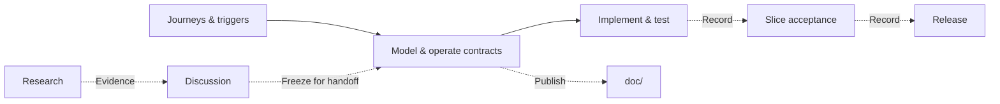

# CLAUDE.md

为 P5 学生 Sophia 设计一个练习场（Exercise Arena）：录入她的错题（文字或照片），按复习阶梯重做，用检验卷确认是否掌握。

<!-- design-kernel:begin -->
## Kernel

discuss-design manages this block from the workspace's recorded version (`./check.sh` verifies its hash; use `design-init` to upgrade or `link` to restore). Put workspace-specific content below.

This guide states the workflow, map, rules and terms. Skills in `.agents/skills/` and the global `design-init` hold procedures; load each skill when its description applies. Choose the language of your conversation, workspace prose and publications.

### Journey-driven design

Start features and design changes from user and operator journeys in `journey/`, or from explicit external or scheduled triggers. Derive domain, architecture and specs from runtime steps, trace support steps to `model/operate/` contracts, and check dependencies from both sides. Research supplies evidence for discussion; the designer decides trade-offs, and freezing the discussion hands the design to implementation. Implementation updates `impl/`, `operate/` and, as needed, `verify/`. Slice acceptance checks user-perspective behavior in Feature Verify (`scope: feature`) or Integration Verify (`scope: integration`, deploying to an `OFFLINE` environment when needed) against journey success conditions and `model/verify/SPEC.md`, and may directly add or adjust `verify/` entries within the settled acceptance contract without looping back to implementation. Release deploys to an `ONLINE` environment when applicable and announces the verified version to users. Each stage writes a record in `record/` for the next stage, stocktaking assesses pending handoffs anytime, and `doc/` publishes to readers.

### Standard map

| Category | Location | What it answers | Authority / maintenance |
|---|---|---|---|
| guide | `CLAUDE.md`, `AGENTS.md` | Workflow, map, rules, terms | `AGENTS.md` links `CLAUDE.md`; managed block hash-verified |
| guide | `.discuss_design/config.yaml` | Version, `scan`, integrations, manifest | Kernel owns `toolkit`, `managed`; rest workspace-owned |
| guide | `.agents/skills/`, `.claude/skills/` | Task procedures | Commit managed copies and matching `.claude/skills/` symlinks |
| guide | `check.sh`, `.discuss_design/checker.sh`, `.discuss_design/visible-text.awk`, `check.local.sh` | Checks and local hook | First three managed; `check.local.sh` workspace-owned; exit 0 passes |
| journey | `journey/` (`USER.md`, `OPERATOR.md`, `NNNN-*.md`) | User and operator goals and steps | Authoritative; flat directory, role indexes, single global numbering |
| model | `model/domain/GLOSSARY.md` | Term definitions (English & Chinese names) | Fixed location |
| model | `model/domain/DOMAIN.md` | Domain structure and invariants | Authoritative |
| model | `model/arch/CONTAINER.md` | Actors, containers, runtime placement | Authoritative |
| model | `model/arch/SCENARIO.md` | Inter-container interactions | Authoritative |
| model | `model/arch/<container>/COMPONENT.md` | Responsibilities inside one container | Short name from container list; create as needed |
| model | `model/arch/<container>/SCENARIO.md` | Intra-container interactions | Optional; name parent scenario refined |
| model | `model/arch/<container>/SPEC.md` | Contracts, shapes, failure boundaries | One owner per contract; split under `spec/` as needed |
| model | `model/operate/INDEX.md` | Active work groups and contract links | Add as needed |
| model | `model/operate/<group>/SPEC.md` | Support contract and boundaries | Authoritative; split under `spec/`; `deploy` covers artifacts, `OFFLINE`/`ONLINE` environments and release announcements |
| model | `model/verify/SPEC.md` | Acceptance environments, policy, exemptions | Authoritative stable contract (no concrete case lists); cites journey success conditions |
| model | `model/adr/NNNN-*.md` | Lasting trade-offs and rationale | Authoritative |
| impl | `impl/` | Source, builds, contract tests | Implements paired model; map subpaths below |
| operate | `operate/` (`operate/README.md`) | Tools, config, runbooks | Lists active groups; group READMEs link contracts; map below |
| verify | `verify/` (`verify/README.md`) | Journey-based acceptance entries and case catalog | Sole concrete case catalog (`verify/README.md`); writable by implementation and acceptance; map directory pointer below |
| record | `record/research/NNNN-*.md` | Point-in-time external research | Freezes with consuming discussion |
| record | `record/discuss/NNNN-*.md` | Decisions and write-off | Freezes on completion or abort |
| record | `record/implement/YYYYMMDD-*.md` | Upstream rows, paired entries, tests | Updatable in place across unreleased loops; freezes globally on a covering completed release (or abort) |
| record | `record/verify/YYYYMMDD-*.md` | Scope, baseline, upstream records, verdicts | Updatable in place across unreleased loops; freezes globally on a covering completed release (or abort) |
| record | `record/release/<version>[-<environment>][-<sequence>].md` | Candidate, target, release notes, verification | Freezes on completion or abort |
| doc | `doc/NNNN-<topic>.*` | Reader hubs with two sync baselines | Sync both ways; design edits go through discussion |

- Read `model/domain/GLOSSARY.md`, relevant ADRs, and both sides of a mapped pair before changing either. Journeys and `model/` files are authoritative design; create directories as needed and name model files by responsibility. A root `README.md` belongs to the workspace.
- Extend this map below the managed block with one row per relevant `impl/` or `operate/` subpath, a `verify/` directory pointer (`verify/README.md` owns concrete acceptance entries, commands and tags), retained existing source directory, workspace skill or other workspace-owned path—naming its paired design, test/deploy commands, authority in a conflict and plain category (`impl`, `operate`, `verify`, `guide`). `./check.sh` checks top-level coverage.
- Records carry status, location and upstream references, drive pending handoffs from the baseline tree, and freeze per the map above; skills define formats and `./check.sh` validates them.

### Rules

1. **Discuss new design trade-offs. Change `journey/`, `model/`, `impl/`, `operate/` and `verify/` for those decisions only after the user confirms.** The agent supplies evidence and the user decides.
   - Before confirmation, write only discussion and research files.
   - Confirmation authorizes implementing the confirmed design: discussion writes journey, model and discussion files and freezes for handoff, and implementation may continue in the same session without re-confirming. Obtain separate confirmation for `ONLINE` deploys, releases and irreversible external actions.
   - Trace new model elements to journeys or system scenarios and raise untraced elements as questions. Process reviews, local trade-offs, mechanical edits and authorized maintenance need no invented journeys.
   - Four kinds of work may proceed within existing authorization:
     - Mechanical edits (renames, link repairs, formatting, `doc/` edits/syncs, `design-init` upgrades/recovery).
     - Direct user instructions to change this guide, `check.sh`, `check.local.sh` or `.discuss_design/config.yaml` (check for conflicts first).
     - Authorized maintenance (apply frozen rows or settled contracts, adjust `verify/` entries within settled `model/verify/SPEC.md` and `journey/` during acceptance, restore established behavior, or refactor preserving contracts; send contract/boundary changes to discussion and report internal choices individually).
     - Authorized routine operations (write only outputs and state covered by an agreed operation).
2. **Frozen records stay as written.** Only downstream and peer records may reference individual records; journeys, models and skills may refer only to `record/` or `doc/` directories and must state needed facts themselves. The sole freeze exception is renumbering an incoming discussion on merge collision.
3. **Keep this guide to workflow, map, rules and terms.** Put procedures in skills and design facts in authoritative files.
4. **After changing a model, implementation, operational support or acceptance entry, run `./check.sh` and the registered tests in the workspace map.** Both must pass.
   - Commit only scoped paths (ask if existing changes cannot be separated), exclude `.DS_Store` and temporary files, and follow workspace push rules.
   - Verify and save routine operations per their contracts. Keep field logs, credentials, incident examples and operational results out of the repo unless a journey agrees.

### Terms

- **Design** covers decisions across journeys, models, implementation, operational support and acceptance.
- **Journey** describes one person's goal, trigger, main success steps, extensions and success conditions (agents act within delegation; the person decides and confirms).
- **User and operator** are overlapping target-system responsibilities: a user achieves a goal and receives value; an operator enables deployment, release, operation and recovery. Neither confers design or production authorization.
- **Deploy vs. release:** **Deploy** places an artifact into an environment—an `OFFLINE` environment for QA or `verify/` tools, or an `ONLINE` environment for live users; **release** announces a new verified version of the solution to users.
- **Handoff** passes frozen discussion design rows and the current model to implementation, which traces impact through the workspace map and returns design gaps with evidence.
- **Write-off** applies, verifies and commits confirmed design edits and records results in the discussion file.
- **Freeze** ends edits to a record permanently: discussions (with consumed research) and releases freeze on completion or abort; implementation and acceptance records stay updatable in place across unreleased loops and freeze globally once a completed release covers their work (or on abort).
<!-- design-kernel:end -->

## 本工作区的地图

除标准地图外，本工作区还有：

| 类别 | 位置 | 回答什么 | 权威 / 维护 |
|---|---|---|---|
| model | `DATA.md` | 页面 `db` 的存储形状、写入与旧数据兼容；归类来源 | 唯一数据契约；运行命令见 `model/arch/arena/SPEC.md` |
| impl | `impl/arena.html` | 单页面源码，对应 `model/domain/`、`model/arch/` 与 `DATA.md` | 算法实现；运行 `node impl/logic.test.js impl/arena.html`；不得覆盖约定模型 |
| impl | `impl/logic.test.js` | 页面纯逻辑算法与可执行例，对应领域、运行时与数据契约 | `node impl/logic.test.js impl/arena.html`；逻辑断言不证明平台集成 |
| operate | `operate/README.md` | 实际工具索引，对应 `model/operate/INDEX.md` | 工具现状；约定边界以模型为准，条目扩展交实现 |
| operate | `operate/maintain/README.md` | 本地维护命令，对应 `model/operate/maintain/SPEC.md` | `./check.sh` 与 `node impl/logic.test.js impl/arena.html`；不代替集成验收 |
| operate | `operate/deploy/README.md` | 手动 Artifact 入口，对应 `model/operate/deploy/SPEC.md` | 接受候选后另行授权发布；无自动命令或已验证回滚，扩展步骤待实现 |
| verify | `verify/README.md` | 实际验收条目与证据层级，对应 `model/verify/SPEC.md` | 模拟运行时与授权运行时两层；授权运行时每个发布候选一次，需授权 `OFFLINE` 测试环境/数据，尚未运行 |
| verify | `verify/fake-platform-smoke.js` | 模拟运行时用例（假平台上跑真实页面，按旅程编号），对应 `model/verify/SPEC.md` 的边界类 | `node verify/fake-platform-smoke.js impl/arena.html [--journeys 0002,0008]`；只证明页面行为，不证明平台边界 |

其余路径按托管块里的标准地图走：`journey/` 管目标与步骤，`model/` 管领域与架构，`impl/` 管实现，`operate/` 管维护与发布，`verify/` 管验收入口。

旅程约定目标与成功条件；领域模型约定概念、关系与不变量；架构和运行时模型约定职责、交互及失败边界。`DATA.md` 独占存储形状、写入和兼容规则；`TAX` 独占归类 id。源码与测试维护这些契约内的详细算法与可执行例，不另写重复算法手册。测试、源码与模型矛盾时返回讨论，不静默改规则。

变更模型后在根目录运行 `./check.sh` 和 `node impl/logic.test.js impl/arena.html`。这两项是注册的本地检查；它们通过不表示新运行契约已实现、集成验收已通过或可发布。维护、验收与交付分别记录证据，生产数据修复不由页面交付隐含授权。
