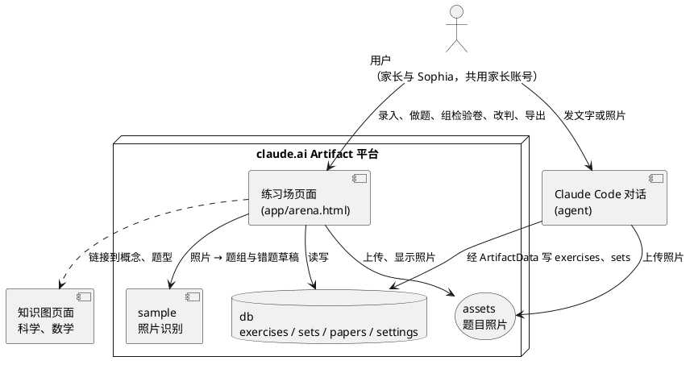

# 容器

练习场只有一个要开发、部署的软件单元：练习场页面。它运行在 claude.ai 的 Artifact 平台上，数据、照片与图片识别都用平台的运行时能力。

| 单元 | 种类 | 职责 |
|---|---|---|
| 练习场页面 | Container（`app/arena.html`） | 全部界面；阶梯、判对、抽题的计算；读写 `db`、`assets`，调用 `sample` |
| claude.ai Artifact 平台 | 外部系统 | 托管页面；提供 `db`、`assets`、`sample`、`downloads`；家长账号登录 |
| Claude Code 对话 | 外部参与者（agent） | 确认后，把对话里收到的错题与题组写进 `exercises`、`sets`，照片传进 `assets` |
| 知识图页面 | 外部系统 | 科学、数学的专题、概念、题型与讲解；练习场只链接过去 |
| 用户（家长与 Sophia） | 参与者 | 共用家长账号，使用全部功能 |
