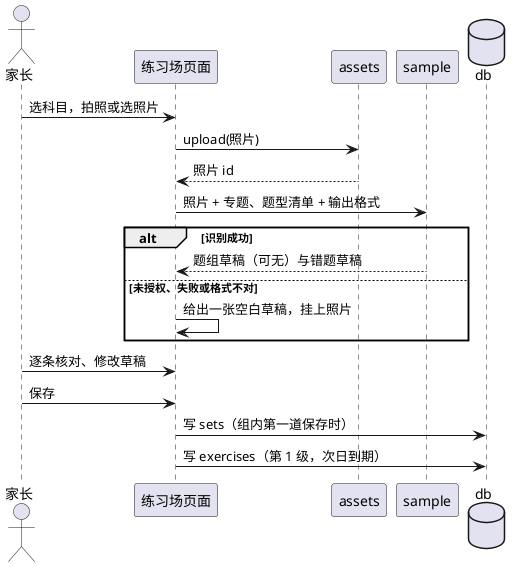

# 运行时场景

## 照片录入

家长在家长侧拍下一页卷子，页面把照片存进 `assets`，请 Claude 拆成草稿，家长逐条确认后保存。几道题共用一份材料时，Claude 另拆出一份题组草稿，这批照片挂在题组上；没有题组时，照片挂在每份错题草稿上。识别不可用或拆得不准时，家长在同一张表单里手填，原照片照样挂在草稿上。

## 对话录入

家长在 Claude Code 对话里发文字或照片。agent 先把题组与错题草稿列在对话里，家长确认后，agent 用 `ArtifactData` 写进 `sets` 与 `exercises`；有照片时，先把照片传进 `assets`，再把 id 写在题组或错题上。

## 每日重做

Sophia 在练习侧打开每日重做，逐题作答。选择题和短答题提交后立即判对；主观题提交后显示讲解与得分关键词，由她自评。每次作答写进该错题的作答记录，并按复习阶梯更新它的级与到期日。同一题组当天到期的题连在一起，材料在第一题完整显示，之后默认收起。

## 检验卷

家长在家长侧选科目、专题和题数，页面抽题生成检验卷。抽中的同组错题在卷面上排在一起，材料只出现一次。Sophia 在练习侧一次做完、交卷，交卷后才看到答案，主观题自评。也可以打印：卷面只有题目，答案另起一页；纸上做完后，家长在家长侧逐题勾选结果。每道题的结果都写成一次作答，并更新阶梯；检验卷记下完成时刻与完成方式。得分由这些作答算出；家长可以在检验卷详情里逐题改判，得分随之变化。
