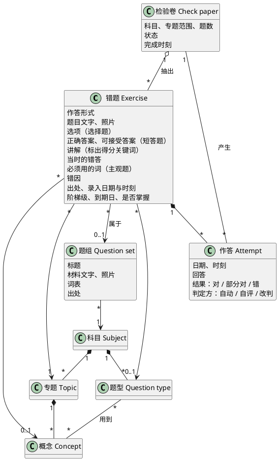
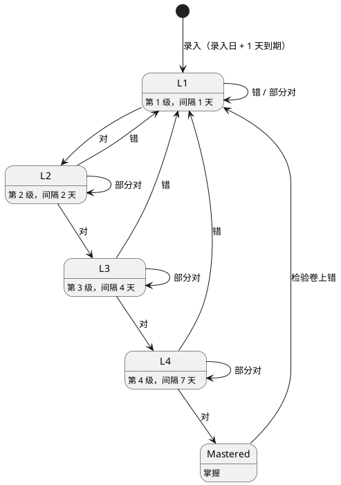

# 领域总览

练习场围绕错题转：录入时归类，之后按复习阶梯重做，检验卷抽查是否掌握。每次作答都改变错题在阶梯上的位置。运行载体与账号的取舍见 [ADR 0001](../adr/0001-arena-runs-as-claude-artifact-with-db.md) 与 [ADR 0002](../adr/0002-arena-is-used-through-the-parent-account.md)；几道题共用一份材料的取舍见 [ADR 0003](../adr/0003-question-set-holds-shared-material-questions-keep-own-ladder.md)。

## 模型

- **归类**：每道错题必有科目与专题，概念与题型可选。数学、科学的专题、概念、题型取自知识图，英文的由练习场自定，见 `design/arena/TAXONOMY.md`。
- **作答形式**：选择、选词、短答、主观。前三种自动判对，主观题由 Sophia 对照讲解自评；可以改判任何一次作答。选词题必须属于带词表的题组，答案是词表里的一个词；题组的词表改动不能让组内选词题的答案落空。主观题可以列出必须用的词，提交前没用到或写成多句时先提醒，仍由她自评。
- **错因**：概念没懂、审题错、粗心、答法不完整，四选一。
- **题组**：几道错题共用一份文章、图或实验装置时，材料存在题组里，错题各自指向它。题组与所属错题同科目；组内按保存先后排，后来补录的排在组尾。题组只在至少一道错题挂着时有效：没有错题挂着的题组不显示，组里最后一道错题删掉或移出时，题组随之删除。

## 复习阶梯

不变式：

- 到期日从上次作答日起算，加上新所在级的间隔。按时做对时，重做落在录入后第 1、3、7、14 天。
- 做对升一级；做错回第 1 级，次日到期；部分对留在原级，再隔本级间隔到期。
- 第 4 级做对即掌握，不再有到期日。掌握的错题在检验卷上做错，回第 1 级；做对或部分对，保持掌握。
- 每日重做和检验卷的作答适用同一套规则。
- 错题的阶梯状态完全由录入日与它的全部作答依次推出；改判后按新结果重新推出。
- 阶梯逐题计算，同一题组的错题各有各的级与到期日。

每日重做只列到期的错题。同一题组里当天到期的题连在一起，材料只读一次；一组放不下就整组留到下次，后面放得下的照常补进来。

## 检验卷

选科目、专题范围与题数，从范围内的错题里抽题。顺序：错的次数多的在前；同次数时已掌握的在前；再按上次作答早的在前。抽中的同组错题在卷面上排在一起，材料只出现一次。Sophia 交卷前看不到答案。交卷后每道题产生一次作答，按上面的规则改变阶梯；检验卷记下完成时刻。

检验卷上每道题的作答不另存，由带这张检验卷编号的作答找出。得分也不存，由这张检验卷仍在的错题的作答算出，所以在任何地方改判，得分都随之变化。删除检验卷不影响这些作答与阶梯。

## 留白

- **变式题**：同一概念换情境的新题。位置：作为一道错题录入，多一个指向原题的关联。
