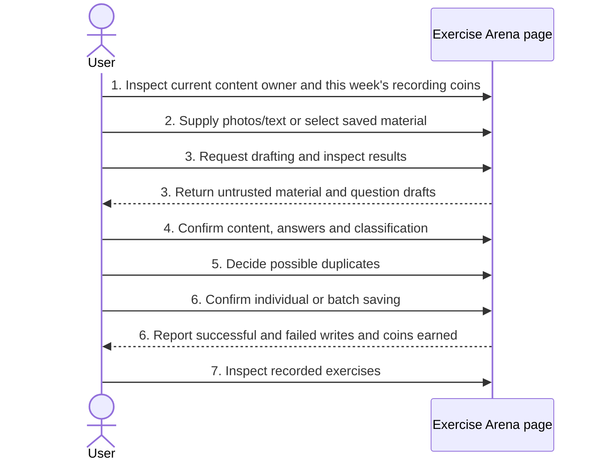

# 0001 Record exercises for practice

- **Actor** User; AI supplies drafts, not decisions.
- **Goal** Save confirmed exercises from wrong answers or supplementary saved material.
- **Trigger** The user has a wrong exercise to record, or wants to record additional questions from saved material.
- **Prerequisites** [0010](./0010-open-shared-arena.md) has established identity and a ready owner scope.
- **Success** Each confirmed successful write belongs to the selected owner, appears in the library, starts the actor's ladder due the next day, and names the actor as Recorder, earning 2 coins this week in that library. New set references obey same-owner membership. Unsuccessful drafts remain distinguishable from recorded content.

## Main success scenario

1. The user checks the selected content owner and the coins they have earned this week by recording in that library; changing owner belongs to [0006](./0006-manage-settings.md).
2. The user supplies new photos/text, or selects an eligible saved Question set or same-subject photo group and specifies what to supplement.
3. The user requests AI drafting and inspects the returned material and exercises.
4. The user confirms or edits material, subject, topic, optional concept/question type, answer format, correct answer, explanation, wrong answer and error cause.
5. The user decides whether each possible duplicate should be saved or skipped.
6. The user confirms saving, one draft or all. The page reports per-draft results in one short line per outcome. While a save that can earn coins runs, a treasure bowl shows its progress and passes one coin (2 per new exercise) to the recording total for each saved exercise; when it ends having earned coins, a final celebration carries the amount into that total; new material is saved before its first member, with the same content owner and subject.
7. The user inspects the successfully recorded exercises and any drafts still needing attention.

## Extensions

- **2a. Saved material is unavailable or legacy ownership is unresolved.** Existing member questions remain usable under compatibility rules, but supplementation into that set is blocked until separately authorized ownership repair.
- **3a. Upload, drafting or parsing fails, or the user cancels.** Report the stage; retain retryable input/available drafts in the current session. Retry or discard explicitly; durable cross-session draft recovery is not promised.
- **3b. Referenced saved photos cannot all be read.** Report unavailable/skipped photos and use remaining photos or available set text; a photo-only group with no readable photos cannot proceed to AI drafting.
- **4a. Content or a word-pick answer is invalid.** Identify the affected draft and require correction before saving.
- **5a. A duplicate warning remains.** Save all skips warned drafts and reports them; an individual save is deliberate confirmation, not an automatic duplicate ban.
- **6a. A write fails after assets or a set were saved.** Report only acknowledged exercise writes as successful. Retain remaining drafts for retry; orphan assets/sets are possible and the page does not purge them globally (only an authorized [capacity operation](../model/operate/capacity/SPEC.md) deletes assets).
- **6b. Owner scope changed while a draft retained a set reference.** Reject a conflicting new link rather than saving an exercise under another owner. Re-select compatible material or return to the intended scope.
- **6c. Only some drafts saved.** Report the saved count and coins as success and the remaining drafts as needing attention, not as a failure.
- **7a. The exercise was supplementary rather than previously wrong.** Preserve that distinction; do not invent an original wrong answer. It earns the same 2 coins.
- **7b. An agent records on the user's command.** The commanding user is the Recorder and earns the coins.

## Runtime trace

Steps 1-2 use Session/settings; 3-6 use Record and Platform/data gateway; 7 reads the library. See [scenarios](../model/arch/SCENARIO.md) S1-S3, [runtime contracts](../model/arch/arena/SPEC.md) C1-C2 and C7 for coins, [domain](../model/domain/DOMAIN.md) and [data contract](../DATA.md). Later content correction belongs to [0007](./0007-maintain-exercise-library.md).
