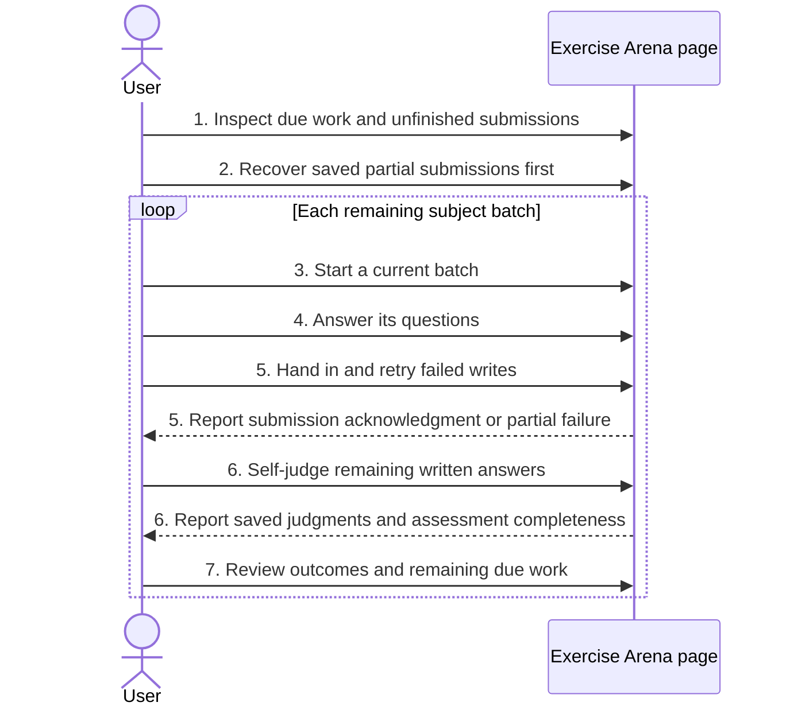

# 0002 Complete today's daily redo

- **Actor** User, practicing as the authenticated actor in the selected owner's library.
- **Goal** Complete today's due exercises through successive subject batches.
- **Trigger** Due work or a protected unfinished daily submission is shown on Today.
- **Prerequisites** [0010](./0010-open-shared-arena.md); existing exercises and effective settings defaults.
- **Success** No due items or protected unfinished submissions remain in the actor/owner scope, and every started batch is handed in and fully assessed. A partially completed day is reported as such; no due items alone does not prove completion.

## Main success scenario

1. The user opens Today and inspects the actor's due work by subject and protected unfinished submissions in the selected owner scope.
2. The user recovers protected submissions before starting new batches in their subject. The page restores saved answers/judgments and retries only missing attempt or marker writes.
3. The user starts one subject's current batch, capped by the effective daily limit. Untouched drafts are replaced with overlapping saved responses carried forward.
4. The user answers the batch's questions, using material and answer controls as appropriate.
5. The user hands in. The page saves missing objective attempts and then the actor's submission marker; acknowledged submission is distinct from full assessment.
6. The user self-judges written answers in the current session until every remaining question has a saved judgment.
7. The user reviews ladder, streak, coins and newly mastered outcomes, then repeats steps 3-7 while due work remains.

## Extensions

- **1a. No questions are due.** Still expose protected unfinished submissions. If neither exists, report no due work; this is not proof of mastery for all library content.
- **2a. Multiple protected papers exist.** Reopen the most recent for that subject and expose the others; do not delete them. Resolve protected work before a new batch for that subject.
- **2b. A protected paper or referenced question was externally deleted.** Show missing content and the failed recovery boundary; do not reconstruct a historical paper.
- **3a. The user returns to an untouched draft.** Generate a fresh batch and carry matching responses. Legacy mixed-subject daily papers remain readable but are not resumed.
- **5a. An attempt or marker write fails.** Stop at the failed objective write, report partial effects, and retry only missing writes. Preserve an unsubmitted paper with persisted actor attempts even if none of its questions remains due.
- **5b. No actor attempt has been saved, including an all-written paper.** In-session retry remains available; restart protection is not promised for an otherwise untouched draft.
- **6a. A judgment write fails.** The batch remains incompletely assessed; retain retryable session work and do not present a final assessment.
- **6b. The user leaves before saving written judgments.** Recovery of unsaved written responses across sessions is deferred. Show any surviving pending judgments truthfully; do not infer them from a hand-in marker.
- **7a. An answer is partial or wrong.** Apply the agreed ladder/reward rules; late practice uses the actual attempt date.
- **7b. The user stops before finishing.** Report the completed batches and remaining work rather than claiming the day's goal succeeded.

## Runtime trace

Steps 1/7 read Progress; 2-6 use Papers and Platform/data gateway, scoped by Session/settings. See [scenarios](../model/arch/SCENARIO.md) S5/S9, [runtime contracts](../model/arch/arena/SPEC.md) C4-C5 and [data contract](../DATA.md). The [domain](../model/domain/DOMAIN.md) separates per-actor ladder, paper acknowledgment and assessment.
