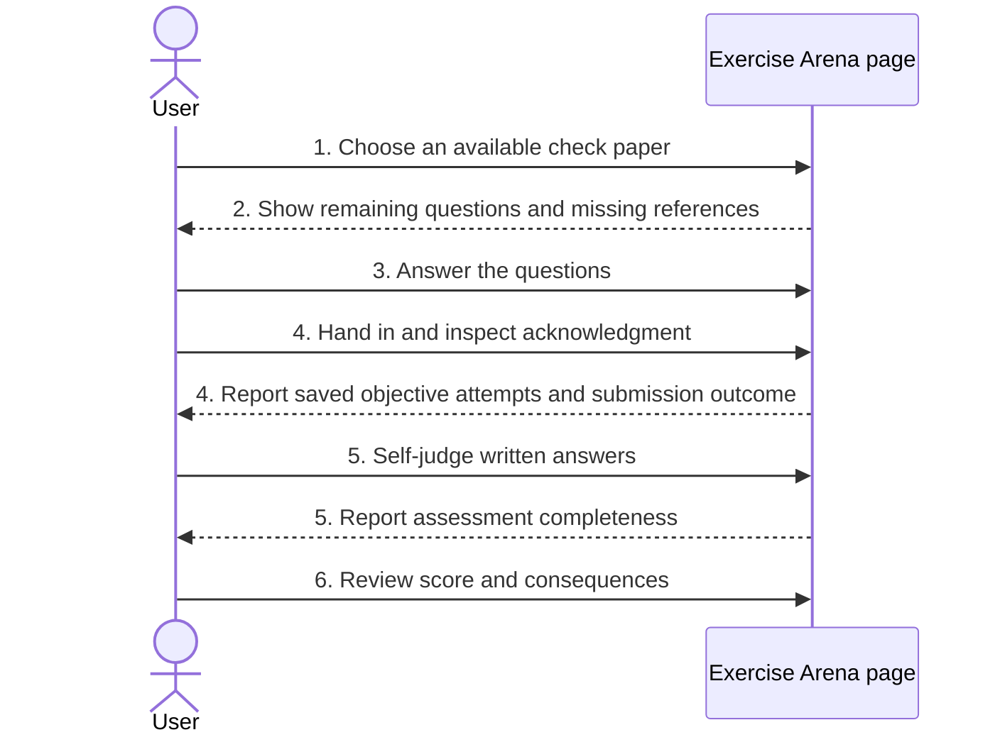

# 0003 Take a check paper

- **Actor** User taking the paper as the authenticated actor.
- **Goal** Assess understanding with an existing Exam paper.
- **Trigger** The user chooses an available check paper.
- **Prerequisites** [0010](./0010-open-shared-arena.md); a paper prepared through [0008](./0008-prepare-check-paper.md), possibly by another user.
- **Success** The actor has handed in once, every remaining question has a saved judgment, and the page shows assessment and ladder consequences. An empty/deleted-content paper is not evidence of mastery.

## Main success scenario

1. The user selects an Exam paper in the selected owner's library that the actor has not yet submitted.
2. The user reviews its available referenced exercises and material; missing references are explicit.
3. The user answers the available questions.
4. The user hands in. The page saves missing objective attempts and the actor's acknowledgment as separate writes.
5. The user self-judges written answers in the current session until all remaining questions have saved judgments.
6. The user reviews score, answers and consequences: wrong check answers reset the ladder; right/partial check answers do not advance it, and check attempts award no coins.

## Extensions

- **1a. No appropriate paper exists.** Prepare one through 0008; preparation is a separate goal.
- **1b. The actor already submitted.** Open the recorded result rather than allowing another submission.
- **2a. Questions were deleted.** Show missing references and compute the score over remaining exercises. No remaining exercises means no meaningful assessment.
- **4a. A write fails.** Report partial effects and offer in-session retry that skips saved actor/paper attempts; no atomic submission guarantee.
- **5a. Written judgments remain missing.** Keep them explicit and in the score denominator; submission acknowledgment is not final assessment.
- **5b. The user leaves.** Persistent check drafts and cross-session recovery of unsaved written answers are deferred; do not imply automatic completion or resume.
- **6a. A saved judgment needs correction.** Use [0009](./0009-correct-own-judgment.md), not a second attempt.

## Runtime trace

Papers coordinates steps 1-5; Progress derives step 6. See [scenarios](../model/arch/SCENARIO.md) S7/S9, [runtime contracts](../model/arch/arena/SPEC.md) C5-C6, [domain](../model/domain/DOMAIN.md) and [data contract](../DATA.md).
