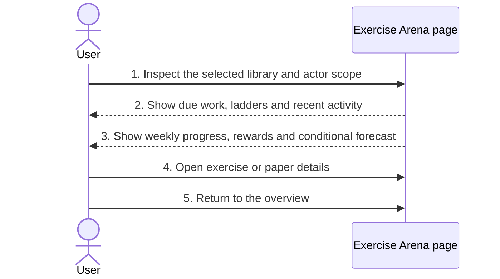

# 0004 Review my progress

- **Actor** User viewing their own practice outcomes.
- **Goal** Understand workload, mastery and weekly progress within the selected owner's library.
- **Trigger** The user wants to review practice or a completed paper.
- **Prerequisites** [0010](./0010-open-shared-arena.md); ready supporting snapshots.
- **Success** The user can distinguish due work, ladder distribution, recent activity, newly mastered exercises and rewards, and inspect available supporting details. This is a read-only goal.

## Main success scenario

1. The user opens Today or Exercises and checks the selected content owner.
2. The user inspects their own due work, ladder distribution, streak and recent attempts on those exercises.
3. The user reviews weekly progress, newly mastered exercises, coins/balance of the selected library (redo and recording coins) and any conditional forecast.
4. The user opens available exercise history, or a handed-in paper from Today or Papers, to understand an outcome. The Paper page shows the same outcome block as right after hand-in: score and assessment status, ladder movement and, for daily papers, coins.
5. The user returns to the overview without changing content or judgments.

## Extensions

- **1a. Owner scope changes.** Reload before showing new results. Selecting an owner does not impersonate that owner's attempts or ladder.
- **2a. There is no activity.** Show an empty state, not a loading/subscription failure disguised as zero progress.
- **3a. A forecast is shown.** It assumes on-time right answers; it is not a fixed assignment.
- **3b. A late correction, a deleted recorded exercise or concurrent match spending affects balance.** Recompute from saved attempts/stakes; balance may be negative.
- **4d. A written answer has no saved judgment.** The paper page shows it as not judged and counts it in "N to judge", never as no answer.
- **3c. Default owner was changed after earning coins or playing under another library.** Coins and balance cover only the selected library: other libraries' coins are not counted and their match stakes are not deducted, so the change alone never makes balance negative. Selecting the earlier library again shows its figures as before.
- **4a. Daily-paper retention or exercise deletion removed details.** Show their unavailability; attempts survive paper retention but not exercise deletion.
- **4b. Content needs correction.** Start [0007](./0007-maintain-exercise-library.md).
- **4c. An own judgment needs correction.** Start [0009](./0009-correct-own-judgment.md).

## Runtime trace

Progress reads Session/settings snapshots; it writes no aggregate. See [scenarios](../model/arch/SCENARIO.md) S9/S13, [runtime contracts](../model/arch/arena/SPEC.md) C7/C10 and [domain](../model/domain/DOMAIN.md). Detailed algorithms remain executable in the mapped source/tests.
