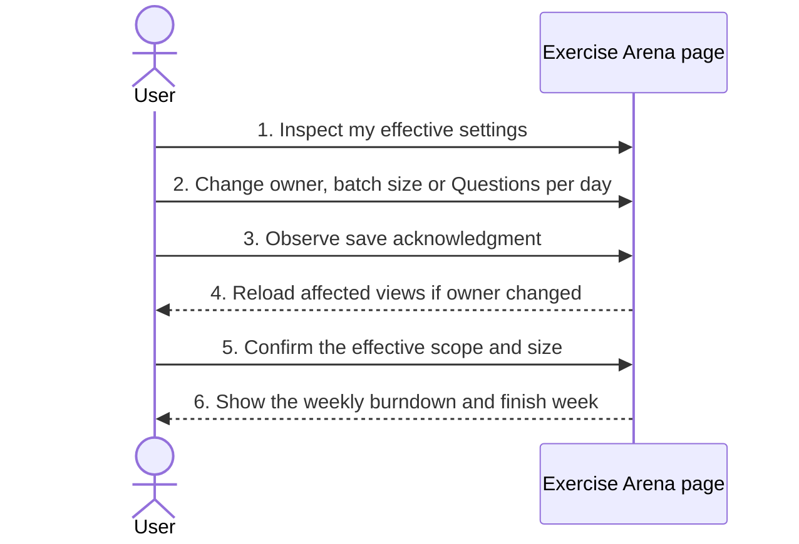

# 0006 Configure my practice

- **Actor** User changing their own User settings.
- **Goal** Select a content owner and subject-batch size, and set Questions per day to see when today's exercises would all be Mastered.
- **Trigger** The user wants a different library or practice batch size, or wants to know how long their exercises will take at a daily amount.
- **Prerequisites** [0010](./0010-open-shared-arena.md).
- **Success** The setting write is acknowledged and the page uses the effective settings in a ready, correct owner scope. The Finish forecast shows, week by week, how many questions would be left at that daily amount and names the week today's exercises would all be Mastered.

## Main success scenario

1. The user opens Settings and inspects their own effective values.
2. The user changes Default owner, daily limit or Questions per day. The limit is 1-50 per subject batch, default 10; it is not a cap on the whole day. Questions per day is 1-150; it drives only the Finish forecast and does not limit Today.
3. The page writes the setting change and reports acknowledgment.
4. If owner changed, the page cancels old subscriptions, shows loading and obtains the new owner scope; coins, balance and match eligibility are recomputed in that scope.
5. The user confirms the effective settings and affected views, including recording and paper preparation.
6. The user reads the Finish forecast under Questions per day: one bar per week with the questions left at the end of that week (today's exercises and projected new ones apart), and a line naming the week today's exercises would all be Mastered, at their recent right rate and recent weekly recording.

## Extensions

- **1a. No settings document exists.** Use defaults: the actor as owner and batch size 10; Questions per day is unset.
- **1b. Questions per day is unset.** Show the actor's recent pace in its place, marked as such; saving other settings never stores that pace.
- **2a. A value is malformed.** Apply the fallback/clamping rules in DATA; a nonempty owner ID is not automatically proven to be a registered user.
- **3a. The write fails.** Report unsaved settings; do not equate a local selection with persistence.
- **4a. A required subscription fails.** Show unavailable, not an empty library or completed scope switch.
- **4b. Another device changes the actor's settings.** Apply the same owner reload boundary.
- **4c. Retained recording drafts or check previews refer to the previous owner.** New reference writes must validate current scope; a stale check preview requires re-preview.
- **5a. Another owner's library is selected.** View/practice/edit access continues; identity, own judgments and content ownership do not transfer.
- **6a. There are too few recent attempts to measure a right rate.** The forecast assumes a stated rate and says so.
- **6b. Today's exercises would not all be Mastered within 52 weeks.** The line says so and suggests more a day instead of naming a week.
- **6c. Owner scope changes.** The forecast is recomputed for the new library.
- **5b. Coins or matches belong to the previous library.** They are neither counted nor deducted in the new library, so changing owner never produces a negative balance by itself; switching back restores the previous library's coins, spending and balance.

## Runtime trace

Session/settings coordinates Platform/data gateway and page readiness; Progress reads the effective scope and computes the Finish forecast. See [scenarios](../model/arch/SCENARIO.md) S1/S11, [runtime contracts](../model/arch/arena/SPEC.md) C1/C7/C9 and [data contract](../DATA.md).
