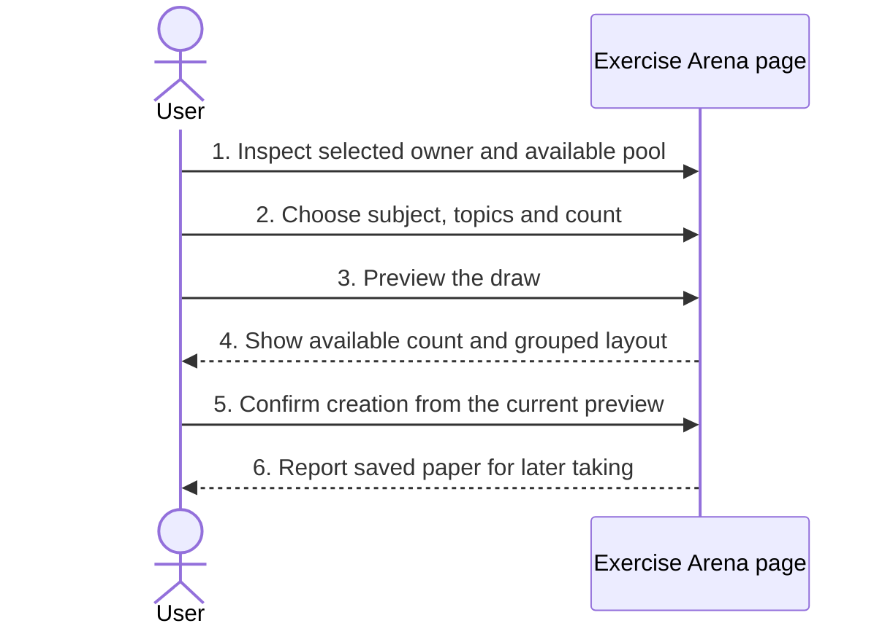

# 0008 Prepare a check paper

- **Actor** User preparing an Exam paper; the taker may be another user.
- **Goal** Create a reusable check paper from the selected owner's exercises.
- **Trigger** The user wants a check of selected subjects/topics.
- **Prerequisites** [0010](./0010-open-shared-arena.md); a ready, nonempty matching pool.
- **Success** An acknowledged paper contains the confirmed available references from the selected library and can be selected for taking. Creation is not assessment.

## Main success scenario

1. The user opens paper preparation in the selected owner's ready library.
2. The user selects subject, topics and desired question count.
3. The user requests a preview from the matching pool, which may include mastered exercises.
4. The user inspects actual available count, questions and grouped material.
5. The user confirms creation. Before writing, the page validates the preview's scope and current referenced exercises against the selected library.
6. The user sees the saved Exam paper; taking belongs to [0003](./0003-take-a-check-paper.md).

## Extensions

- **3a. The pool is smaller than requested.** Preview/report the actual count.
- **3b. No exercises match.** No meaningful paper can be created; revise the selection or record content.
- **5a. Owner scope changed or referenced questions are unavailable/out of scope.** Require re-preview; do not combine stale IDs with a new owner.
- **5b. Creation fails.** Keep the result uncreated and report failure; an unacknowledged request is not success.
- **6a. Another user takes the paper.** Their attempts/assessment are their own, once per actor.
- **6b. Referenced content later changes or is deleted.** The paper is not an immutable snapshot; details must show current/missing references.

## Runtime trace

Papers draws and validates through Session/settings and Platform/data gateway. See [scenarios](../model/arch/SCENARIO.md) S6, [runtime contracts](../model/arch/arena/SPEC.md) C6 and [data contract](../DATA.md).
