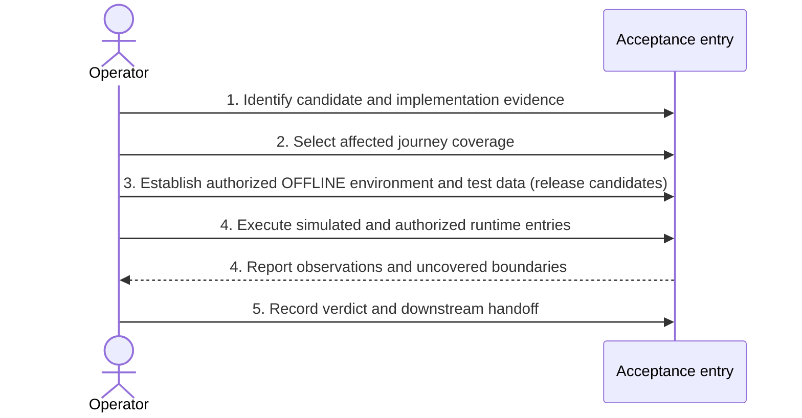

# 0013 Accept an integrated slice

- **Actor** Operator executing acceptance; the same person may also maintain or deliver.
- **Goal** Establish whether an identified candidate satisfies the scoped journey success conditions.
- **Trigger** An implementation candidate and upstream record are ready for acceptance.
- **Success** A verification record identifies the candidate, actual coverage, results and uncovered boundaries; an accepted verdict is supported by the required integrated evidence.

## Main success scenario

1. The operator identifies candidate revision/content identity and the upstream implementation record whose passing registered tests match the baseline tree.
2. The operator selects journey steps, extensions and affected component/contract boundaries.
3. For a release candidate, the operator establishes an authorized `OFFLINE` test candidate, platform capabilities, actors and test-data scope through the deploy contract. A slice accepted on the simulated runtime alone skips this step.
4. The operator executes the entries for the affected steps: the simulated runtime for page-side behavior and, for a release candidate, the authorized runtime for platform boundaries. Implementation-stage checks are not re-counted as evidence.
5. The operator records results and verdict under `record/verify/`; accepted candidates may proceed to separately authorized [0012](./0012-publish-artifact.md).

## Extensions

- **1a. Baseline or upstream evidence is missing.** Do not infer it from historical publication comments.
- **3a. Runtime access or test-data authority is unavailable for the authorized runtime.** Mark each platform boundary unverified, not passed, and do not issue an accepted verdict for a release candidate; never substitute an unaccepted production upload.
- **4a. Behavior fails a settled contract.** Return a defect to implementation; a new design boundary returns to discussion.
- **4b. Only simulated-runtime or helper checks pass.** The page-side boundaries they exercise may pass, but platform boundaries remain unverified.
- **5a. Required coverage is incomplete.** Do not issue an accepted verdict for that slice.

## Support trace

[Acceptance contract](../model/verify/SPEC.md) owns coverage/verdicts. [Deploy contract](../model/operate/deploy/SPEC.md) supplies the test candidate/environment; no new operational work group is added.
