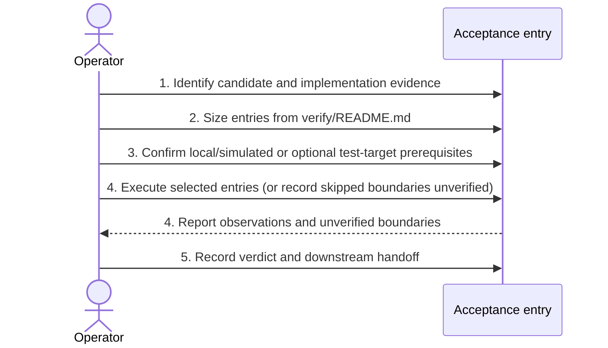

# 0013 Accept an integrated slice

- **Actor** Operator executing acceptance; the same person may also maintain or deliver.
- **Goal** Establish whether an identified candidate satisfies the scoped journey success conditions.
- **Trigger** An implementation candidate and upstream record are ready for Feature Verify (`scope: feature`) or Integration Verify (`scope: integration`).
- **Success** A `record/verify/` record identifies the candidate, mode, actual coverage, judgments and unverified boundaries; zero `fail` completes the record, and completed `scope: integration` evidence satisfying release prerequisites may proceed to [0012](./0012-publish-artifact.md).

## Main success scenario

1. The operator identifies candidate revision/content identity, selects `scope: feature` or `scope: integration`, and matches the baseline product tree (outside `record/` and `verify/`) to an upstream implementation record whose registered tests passed.
2. The operator sizes the run from [verify/README.md](../verify/README.md) using the contract's `Cost`/`Cadence` defaults and confirms any user-directed widening, narrowing or skipping.
3. The workspace is prod-only by default (no maintained `OFFLINE` test Artifact): local simulated checks need only a local browser runtime, and an ad-hoc test Artifact is supplied through [deploy SPEC](../model/operate/deploy/SPEC.md) only when explicitly requested and authorized.
4. The operator executes the selected entries (editing `verify/` directly within the settled contract if an entry needs adjustment and committing the new baseline first). Implementation-stage checks are not re-counted as acceptance evidence.
5. The operator records judgments (`pass`, `fail`, or `unverified` with reason) under `record/verify/`: zero `fail` marks `completed`. Completed `scope: feature` records proceed to `scope: integration`; completed `scope: integration` records may proceed to separately authorized [0012](./0012-publish-artifact.md) with all `unverified` boundaries disclosed.

## Extensions

- **1a. Baseline product tree or upstream evidence is missing.** Route to implementation for a post-merge integration retest; never infer evidence from historical publication comments.
- **3a. Local browser runtime or optional test target is unavailable or skipped.** Record each unrun boundary `unverified` with the reason; never substitute an unaccepted production upload.
- **4a. Behavior fails a settled contract.** Record `fail` and keep `record/verify/` `in-progress`. Route `verify/`-only defects to `verify/` repair, product defects to implementation, and contract or success-condition gaps to discussion.
- **4b. Only simulated-runtime checks run.** Page-side boundaries they exercise may `pass`; real platform boundaries remain `unverified` and must be disclosed.
- **5a. Unrun or user-skipped boundaries remain with zero `fail`.** Complete the record with each unrun or skipped boundary marked `unverified` (with reason), and disclose all remaining `unverified` boundaries to the user prior to [0012](./0012-publish-artifact.md) release authorization.

## Support trace

[Acceptance contract](../verify/SPEC.md) owns policy, substitutes and `on-touch` sizing; [verify/README.md](../verify/README.md) owns the concrete entry catalog. [Deploy contract](../model/operate/deploy/SPEC.md) supplies the test candidate/environment and release prerequisites; no new operational work group is added.
