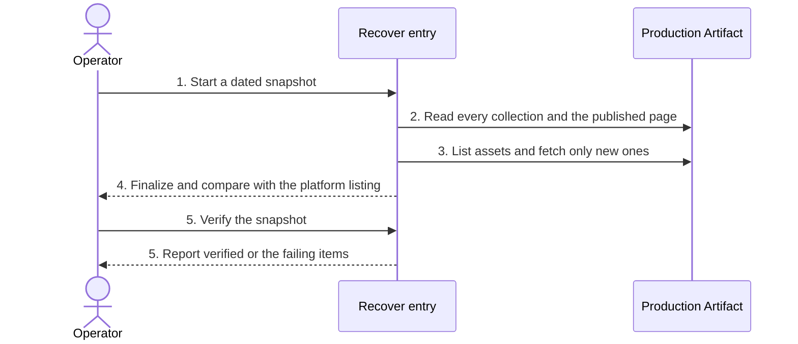

# 0014 Back up the production library

- **Actor** Operator with owner access to the production Artifact, delegating reads and local checks to an agent. The operator decides when to back up.
- **Goal** Keep a local, verified copy of every production record and photo.
- **Trigger** The operator's own schedule, any authorized production repair, or a paper-plan re-plan ([0016](./0016-build-paper-plan.md)); a verified backup must exist immediately before the latter two.
- **Success** A new snapshot holds every document of every collection and the published page. The local asset store holds every asset the platform lists, and the snapshot's verification passes. Backup data stays local and outside the repository.

## Main success scenario

1. The operator starts a snapshot named by date.
2. The agent reads every document of `exercises`, `sets`, `papers`, `users`, `settings`, `matches`, `plans` and `schoolPapers`, plus the published page, into the snapshot. These reads are read-only.
3. The agent lists the platform's assets and downloads only those not already in the local asset store.
4. The agent finalizes the snapshot. The stored asset count and bytes equal the platform listing, and every asset referenced by a document is stored.
5. The agent verifies the snapshot against its manifest and reports the result to the operator.

## Extensions

- **2a. A read is paged.** Continue until no page is left; a partial read does not finalize.
- **3a. An asset download fails.** Retry it. Do not finalize while a listed asset is missing.
- **4a. Stored count or bytes differ from the listing.** Stop and find the difference before treating the snapshot as complete.
- **4b. A referenced asset is missing on the platform.** Record it as a finding; the snapshot is still a faithful copy.
- **5a. Verification fails because a local file changed or disappeared.** The snapshot is not verified. Take a new snapshot, which fetches missing assets again while the platform still has them.
- **5b. The snapshot precedes a repair.** It becomes the pre-repair snapshot and is retained indefinitely ([recover contract](../model/operate/recover/SPEC.md)).

## Support trace

Every step uses the [recover contract](../model/operate/recover/SPEC.md). Restore is outside this journey and needs separate authorization.
