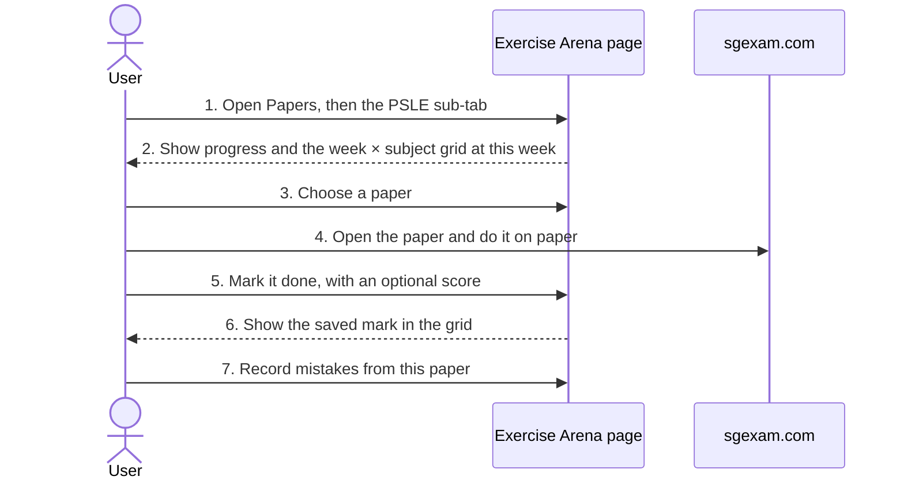

# 0015 Follow my PSLE paper plan

- **Actor** Any user following the shared Paper plan; they do each School paper on paper, outside the arena.
- **Goal** Do one Maths, one English and one Science School paper each week up to PSLE, and see the plan and history in one place.
- **Trigger** The user wants this week's papers, wants to mark a paper done, or wants to look back at earlier weeks.
- **Prerequisites** [0010](./0010-open-shared-arena.md); the shared Paper plan built by [0016](./0016-build-paper-plan.md).
- **Success** Every user sees the same planned weeks up to PSLE as one grid with their own history: their done papers with dates and optional scores, papers behind, this week and the weeks ahead. They can open each paper on sgexam.com. A done mark they set is saved as their own, leaves other users' marks unchanged and shows on every device, and the mistakes from that paper can be recorded with the paper as Source.

## Main success scenario

1. The user opens Papers and chooses the PSLE sub-tab, next to Exam and Daily.
2. The page shows, from the user's own marks, how many papers are done of the total, how many are behind and how many weeks remain to PSLE, then a grid with one row per week and a column each for Maths, English and Science. Done papers show their score, papers behind are marked, this week stands out, and the grid opens at this week.
3. The user chooses a paper and sees its full name with its actions.
4. The user opens the paper on sgexam.com and does it on paper.
5. The user marks it done, today or an earlier day, and may enter a score (marks out of a total).
6. The page saves the mark and shows the paper as done in the grid.
7. The user chooses Record mistakes and continues in [0001](./0001-record-a-wrong-exercise.md) with the paper's subject selected and its name as Source.

## Extensions

- **1a. No Paper plan has been built.** The sub-tab says there is no plan yet; Exam and Daily are unaffected.
- **2d. The user's Default owner is someone else.** A "Mine · <owner>" switch shows that person's marks, counts and history read-only; Mark done, Undo and Record mistakes appear only on Mine.
- **2a. The plan or the marks cannot be read.** The sub-tab says which is unavailable, never an empty plan or nothing done.
- **2b. A paper from an earlier week is not done.** It stays in its week, counts as behind, and can still be done and marked at any time; nothing moves automatically.
- **2c. The user wants papers beyond the plan.** Reserve papers are listed, folded, under the grid; changing the weekly amount is a re-plan by [0016](./0016-build-paper-plan.md).
- **4a. The paper link does not open.** The user reports it; replacing a paper is a re-plan by [0016](./0016-build-paper-plan.md).
- **5a. The user does a paper ahead of its week.** It can be marked done before its week.
- **5b. The user marked a paper by mistake.** Undo clears the mark and the score.
- **5c. A score is malformed or the date is in the future.** The page rejects it and keeps the paper as it was.
- **6a. The save fails.** The page says the mark is not saved and the paper is not shown as done.
- **6b. The agent re-plans while the user marks a paper.** The mark survives; only weeks and order of this and later weeks may change ([plan contract](../model/operate/plan/SPEC.md)).

## Runtime trace

Papers and the Platform/data gateway serve this journey; see [scenarios](../model/arch/SCENARIO.md) S14, [runtime contracts](../model/arch/arena/SPEC.md) C11 and [data contract](../DATA.md). The plan itself comes from the support journey [0016](./0016-build-paper-plan.md).
