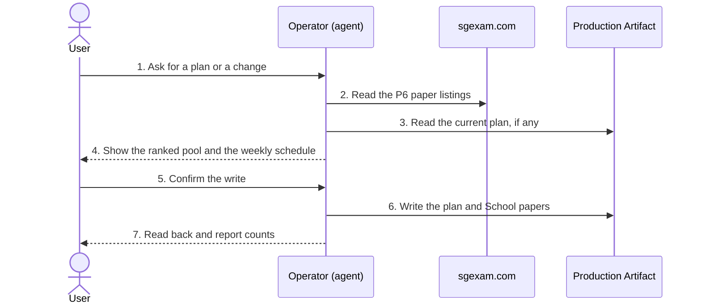

# 0016 Build or re-plan a PSLE paper plan

- **Actor** Operator (an agent acting on the user's request); the user decides and confirms every production write.
- **Goal** Give every user of the arena one shared Paper plan of sgexam.com School papers, one per subject per week up to PSLE, plus a ranked reserve, and keep it current.
- **Trigger** The user asks for a plan, a different weekly amount, a new PSLE date, a replacement paper or the migration of a per-user plan.
- **Prerequisites** The production Artifact; read access to sgexam.com; for a re-plan, a verified [0014](./0014-back-up-production-library.md) snapshot taken immediately before.
- **Success** The production `db` holds the shared Paper plan and School papers as the user confirmed them. Reading them back gives the planned counts per subject and week; after a re-plan, past weeks are unchanged and every user's Paper marks are unchanged.

## Main success scenario

1. The user asks for a plan, or for a change to the weekly amount, the PSLE date or a paper.
2. The agent reads the sgexam.com P6 listings for Maths, English and Science and ranks papers by the [plan contract](../model/operate/plan/SPEC.md).
3. The agent reads the existing shared Paper plan and School papers, if any.
4. The agent shows the user the pool, the weekly schedule from the start week and, for a re-plan, every document it will change.
5. The user confirms the write.
6. The agent writes only the Paper plan and School paper documents, never Paper marks.
7. The agent reads them back and reports the counts per subject, the first and last planned weeks, and the reserve size.

## Extensions

- **1a. SEAB publishes the PSLE date.** Re-plan with the new date; done papers keep their weeks.
- **1b. The weekly amount changes.** Re-plan from the current week using the reserve; earlier weeks keep their papers.
- **1c. A per-user plan from before the shared shape exists.** Migrate it by the [plan contract](../model/operate/plan/SPEC.md): backup, write the shared plan, copy done marks into Paper marks, compare again after the new page is released, and delete the old documents only on a separate confirmation.
- **2a. A paper link no longer opens.** Replace it with the next ranked paper and report it.
- **2b. The pool is smaller than the contract asks for.** Fill it as the contract allows and report the shortfall.
- **5a. The user declines.** Nothing is written.
- **6a. A write fails part-way.** Re-run the same operation; document ids are fixed, so it completes the plan without duplicates.
- **6b. A user marks a paper done during a re-plan.** Marks live in their own documents, which a re-plan never writes, so the mark survives.

## Support trace

Every step uses the [plan contract](../model/operate/plan/SPEC.md). Backups use the [recover contract](../model/operate/recover/SPEC.md). The page side is [0015](./0015-follow-psle-paper-plan.md).
