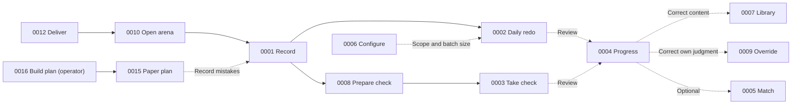

# User journeys

Goals, not screens. Existing IDs remain stable; status describes body availability, not implementation or acceptance.

| ID | Actor | Goal | Body | Status | TODO |
|---|---|---|---|---|---|
| 0001 | User | Record exercises for practice | [0001-record-a-wrong-exercise.md](./0001-record-a-wrong-exercise.md) | detailed | Runtime ownership validation |
| 0002 | User | Complete today's daily redo | [0002-do-todays-daily-redo.md](./0002-do-todays-daily-redo.md) | detailed | Protected-submission recovery |
| 0003 | User | Take a check paper | [0003-take-a-check-paper.md](./0003-take-a-check-paper.md) | detailed | Runtime assessment evidence |
| 0004 | User | Review my progress | [0004-review-progress.md](./0004-review-progress.md) | detailed | Runtime evidence |
| 0005 | User | Play a match | [0005-play-a-match.md](./0005-play-a-match.md) | detailed | Runtime partial-write evidence |
| 0006 | User | Configure my practice | [0006-manage-settings.md](./0006-manage-settings.md) | detailed | Scope-reload evidence |
| 0007 | User | Maintain the exercise library | [0007-maintain-exercise-library.md](./0007-maintain-exercise-library.md) | detailed | Set validation and legacy compatibility |
| 0008 | User | Prepare a check paper | [0008-prepare-check-paper.md](./0008-prepare-check-paper.md) | detailed | Stale-preview scope validation |
| 0009 | User | Correct my own judgment | [0009-correct-own-judgment.md](./0009-correct-own-judgment.md) | detailed | Runtime recalculation evidence |
| 0010 | Account holder | Open the shared arena | [0010-open-shared-arena.md](./0010-open-shared-arena.md) | detailed | Readiness and legacy-loading evidence |
| 0015 | User | Follow my PSLE paper plan | [0015-follow-psle-paper-plan.md](./0015-follow-psle-paper-plan.md) | detailed | Runtime evidence |

Solid edges describe prerequisites; existing records/papers may satisfy them. Dashed edges are optional/feedback paths. An authenticated user may access another owner's library without changing actor identity or transferring content.

## Scope slices

Scope only, not attainment or delivery status.

| Slice | Included steps and extensions | Excluded | Prerequisites and substitutes | Cross-role dependencies |
|---|---|---|---|---|
| First usable loop | 0010 access/readiness; 0001 complete recording path; 0002 complete daily main path and applicable failure/self-judgment extensions | 0003-0009 as separate goals; no explicit configuration beyond prerequisite defaults; no full cross-session written-answer recovery | Authorized platform account and test data; ready library; default settings; no local-logic substitute for runtime writes | 0011 aligned implementation; 0013 integrated acceptance; 0012 separate authorized delivery enables access |
