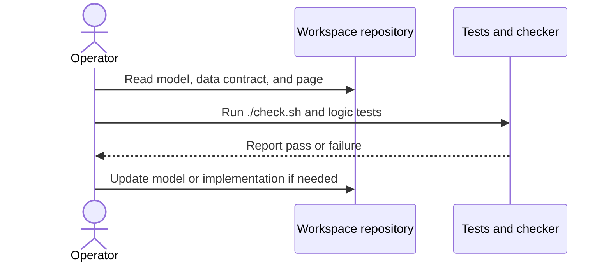

# 0001 Maintain and verify the Exercise Arena

- **Actor** Operator
- **Goal** Keep the model, data contract, page, and tests aligned.
- **Trigger** A design or implementation change is made.
- **Success** `./check.sh` and the logic tests pass, and the page behavior still matches the model.

## Main success scenario

1. The operator reads the affected journey, model, and data contract.
2. The operator runs `./check.sh`.
3. The operator runs `node impl/logic.test.js impl/arena.html`.
4. The operator manually inspects the affected page behavior when needed.
5. The operator updates the model or implementation if drift is found.

## Extensions

- **2a. A check fails.** The operator fixes the model, implementation, or test and reruns it.
- **4a. Behavior differs from the model.** The operator routes the gap to design discussion.
