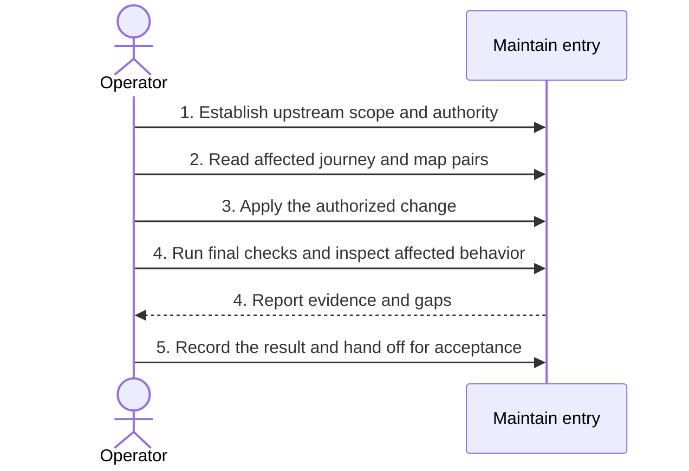

# 0001 Maintain an aligned change

- **Actor** Operator with repository access and authorized design or contract-preserving maintenance scope.
- **Goal** Produce a change aligned with journeys, models, data contracts and executable rules.
- **Trigger** A frozen design handoff or authorized maintenance need.
- **Success** The scoped change is aligned, final registered checks pass, and an implementation record describes results and remaining gaps. This is maintenance evidence, not integrated acceptance.

## Main success scenario

1. The operator identifies authorized scope and any frozen upstream design rows.
2. The operator reads affected journeys, domain/runtime/DATA contracts and both sides of the workspace map.
3. The operator makes the authorized implementation/maintenance change.
4. The operator runs final checker and registered logic tests after changes and inspects affected behavior within authorized local scope.
5. The operator records the baseline, changed pairs, tests and unresolved gaps under `record/implement/`, then hands the candidate to [operator/0003](./0003-accept-integrated-slice.md).

## Extensions

- **2a. Toolkit-managed files drift.** Use design-init for managed recovery/upgrade; do not hand-edit the kernel.
- **3a. A new rule or boundary is required.** Return to design discussion before changing it; never rewrite a model/test just to conceal drift.
- **4a. A check fails.** Fix within authority and rerun the final checks.
- **4b. Local tests pass but runtime evidence is missing.** State the gap; do not claim acceptance or publish.

## Support trace

Steps 1-5 use [maintain contract](../../model/operate/maintain/SPEC.md). Integrated acceptance is owned by [acceptance contract](../../model/verify/SPEC.md); delivery is a separate goal.
