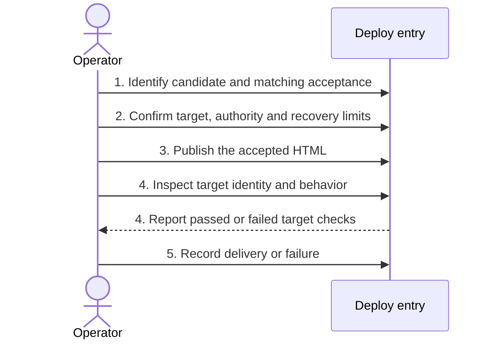

# 0002 Deliver an accepted Artifact

- **Actor** Operator with target access and separate publication authorization.
- **Goal** Deliver the exact accepted page candidate to the intended Artifact.
- **Trigger** Matching acceptance evidence and user delivery authorization exist.
- **Success** The intended target contains the accepted candidate, post-publication checks pass, and the delivery result is recorded. An upload alone is not delivery.

## Main success scenario

1. The operator identifies the exact candidate revision/content identity and matching [operator/0003](./0003-accept-integrated-slice.md) evidence.
2. The operator confirms intended target, explicit publication authorization, artifact inventory and available recovery entry/source.
3. The operator publishes only the accepted HTML through the established platform entry.
4. The operator checks actual target identity, loading and affected behavior against the acceptance baseline.
5. The operator records candidate, target, authority, checks and outcome under `record/deliver/`.

## Extensions

- **1a. Acceptance is missing or describes another candidate.** Stop and obtain matching evidence.
- **2a. Target access, authority or recovery capability is unknown.** Record limits; do not invent rollback or proceed without required authorization.
- **3a. Upload fails.** Inspect actual target state; the prior version is not assumed to have survived.
- **4a. Target identity or behavior differs.** Delivery failed. Record the gap; restoration requires an available prior candidate and established authority/entry.
- **5a. Production data repair is requested.** It is not implied by page publication and needs separate scope/authorization.

## Support trace

All steps use [deploy contract](../../model/operate/deploy/SPEC.md); evidence requirements use [acceptance contract](../../model/verify/SPEC.md). Publication enables [user/0010](../user/0010-open-shared-arena.md), not cross-owner content sharing.
