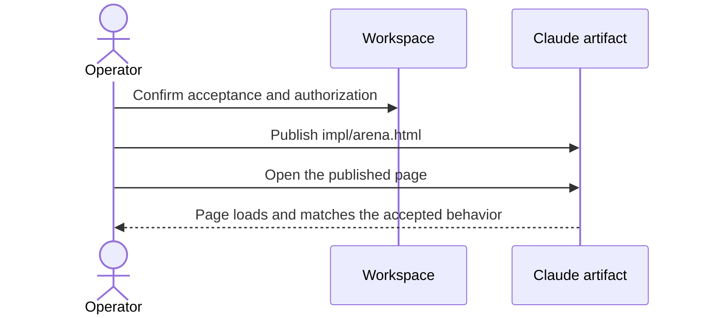

# 0002 Publish the Exercise Arena artifact

- **Actor** Operator
- **Goal** Publish an accepted page version to the Claude artifact.
- **Trigger** An accepted change is ready for use.
- **Success** The published page loads and behaves as accepted.

## Main success scenario

1. The operator confirms the accepted version and separate user authorization.
2. The operator opens the Claude artifact.
3. The operator publishes `impl/arena.html`.
4. The operator opens the published page and checks the affected behavior.

## Extensions

- **3a. Publishing fails.** The operator stops, records the failure, and keeps the prior version.
- **4a. The published page differs from the accepted version.** The operator records the gap and does not treat the change as delivered.
