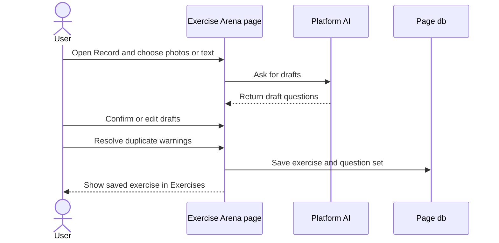

# 0001 Record a wrong exercise

- **Actor** User
- **Goal** Record a wrong exercise from text or a photo.
- **Trigger** A wrong exercise needs to be added to the practice arena.
- **Success** The exercise is saved under the current default owner, appears in Exercises, and is due the next day.

## Main success scenario

1. The user opens the Record tab.
2. The user chooses new photos or text, or selects saved material.
3. The user confirms the AI-generated drafts, including subject, topic, concept, question type, answer, explanation, and error cause.
4. The user resolves any duplicate warnings.
5. The page saves the exercise and, if applicable, its question set under the current default owner.
6. The user sees the saved exercise in Exercises.

## Extensions

- **3a. AI cannot parse the input.** The user edits the draft manually or retries with clearer input.
- **4a. A possible duplicate is found.** The user decides whether to save or skip the draft.
- **5a. The question belongs to a shared set.** The page stores the material once and links the exercise to it.
