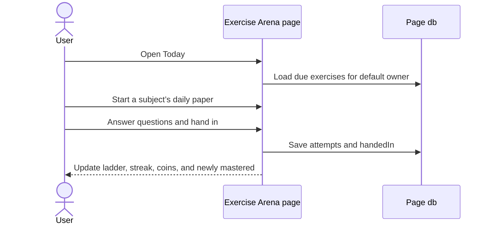

# 0002 Do today’s daily redo

- **Actor** User
- **Goal** Complete today’s due exercises.
- **Trigger** The Today tab shows due daily redo items.
- **Success** The user hands in a daily paper, and the page updates the ladder, streak, coins, and newly mastered list.

## Main success scenario

1. The user opens the Today tab.
2. The page lists due daily redo items by subject for the current default owner.
3. The user starts one subject’s daily paper.
4. The user answers the questions and hands in the paper.
5. The page saves the attempts and updates the ladder, streak, coins, and newly mastered list.

## Extensions

- **2a. No exercises are due.** The page shows that nothing is due today.
- **4a. Some answers are partial or wrong.** The page keeps the ladder at the current level or resets it according to the result.
- **4b. The user leaves and returns.** The page resumes the latest unsubmitted paper for that subject.
