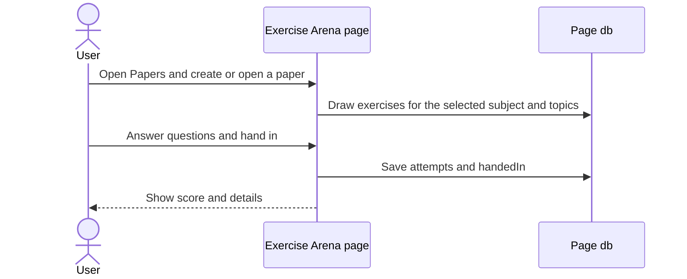

# 0003 Take a check paper

- **Actor** User
- **Goal** Confirm mastery with a check paper.
- **Trigger** The user or a parent wants to confirm whether exercises are mastered.
- **Success** The user completes the paper, sees the score, and any wrong answers reset the ladder.

## Main success scenario

1. The user opens the Papers tab.
2. The user creates a check paper by selecting subject, topics, and question count, or opens an existing one.
3. The page draws exercises from the current default owner’s scope.
4. The user answers the questions and hands in the paper.
5. The page saves the attempts and shows the score and details.

## Extensions

- **3a. Not enough exercises match.** The page uses the available exercises and reports the actual count.
- **4a. A question is subjective.** The user self-judges the answer.
- **5a. An answer is wrong.** The page resets that exercise’s ladder to level 1.
