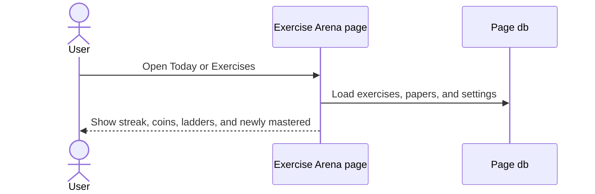

# 0004 Review progress

- **Actor** User
- **Goal** See mastery, streak, weekly progress, and newly mastered exercises.
- **Trigger** The user wants to review progress.
- **Success** Today and the progress views reflect the current default owner’s data.

## Main success scenario

1. The user opens the Today or Exercises tab.
2. The page loads the current default owner’s exercises, papers, and settings.
3. The page shows the streak, coins, ladder distribution, weekly review, and newly mastered exercises.

## Extensions

- **2a. The default owner changes.** The page reloads the new owner’s data.
- **3a. There is no activity yet.** The page shows empty-state views.
