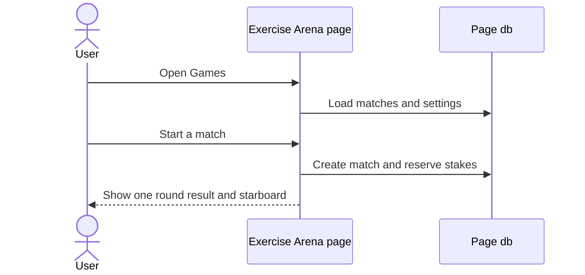

# 0005 Play a match

- **Actor** User
- **Goal** Compare weekly progress by playing a match.
- **Trigger** The user wants to compete with other users.
- **Success** A match is created, one round is completed, and the starboard reflects the result.

## Main success scenario

1. The user opens the Games tab.
2. The page shows the current balance and recent matches.
3. The user starts a match.
4. The page creates the match, reserves stakes, and runs one round.
5. The user sees the result and the starboard.

## Extensions

- **3a. Fewer than two entrants have enough balance.** The page does not start the match.
- **4a. The user is the opener.** The user may add extra stake before the match starts.
