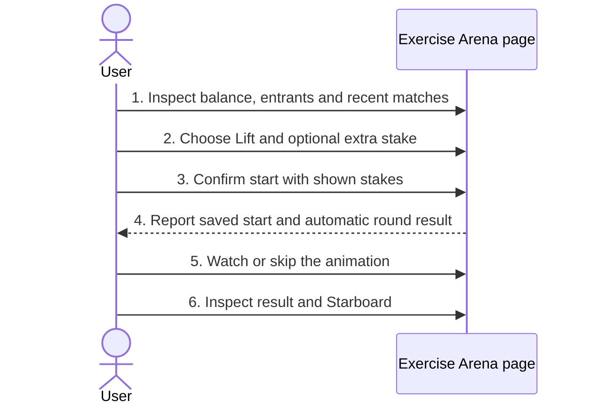

# 0005 Play a match

- **Actor** User opening a match; eligible other users may be offline.
- **Goal** Complete one automatic Lift match and inspect its result.
- **Trigger** The user chooses to compete using their weekly balance.
- **Prerequisites** [user/0010](./0010-open-shared-arena.md); ready eligibility snapshots and at least two eligible entrants including the actor.
- **Success** Match start and its one round result are saved, and the user can inspect the result and Starboard. Failed result persistence is not success.

## Main success scenario

1. The user opens Games and reviews balance, eligible entrants sharing the opener's Default owner, and recent matches.
2. The user selects Lift and may add 0-10 extra coins to the opener's standard 10-coin stake.
3. The user starts the match after confirming entrants and spending; every entrant must afford their stake and the opener must be included.
4. The page saves the committed start, computes one automatic round, and saves its result before animation.
5. The user watches or skips the animation; opponents do not need to be online or make decisions.
6. The user inspects lifts, stars, ranking and the updated Starboard.

## Extensions

- **2a. Sprint or Climb is selected.** Their playable rules remain undefined/unavailable; do not invent them.
- **3a. Fewer than two entrants qualify, the opener is absent, or extra stake is unaffordable.** Do not start.
- **3b. Required snapshots are unavailable.** Do not infer eligibility from an incomplete group.
- **4a. Start persistence fails.** Report failure rather than a created match.
- **4b. Start succeeds but result persistence fails.** The committed stake remains spent; no refund or automatic result recovery is promised.
- **4c. Another device spends concurrently.** Derived balances do not prevent overspending; negative balances remain a known boundary.
- **6a. The opener loses despite extra stake.** Extra stake changes probability, not guaranteed victory or repayment.

## Runtime trace

Games uses Progress for eligibility/rankings and Platform/data gateway for start/result writes. See [scenarios](../../model/arch/SCENARIO.md) S10, [runtime contracts](../../model/arch/arena/SPEC.md) C8 and [data contract](../../DATA.md).
