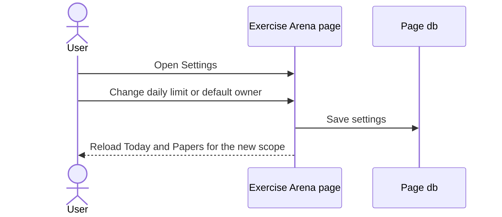

# 0006 Manage settings

- **Actor** User
- **Goal** Set the daily limit and default owner.
- **Trigger** The user wants to change practice volume or whose exercises are shown.
- **Success** Settings are saved and the page scope updates.

## Main success scenario

1. The user opens the Settings tab.
2. The user changes the daily limit or default owner.
3. The page saves the setting.
4. Today and Papers reload with the new scope.

## Extensions

- **2a. The daily limit is out of range.** The page clamps it to the supported range.
- **3a. The default owner is invalid.** The page falls back to the current user.
