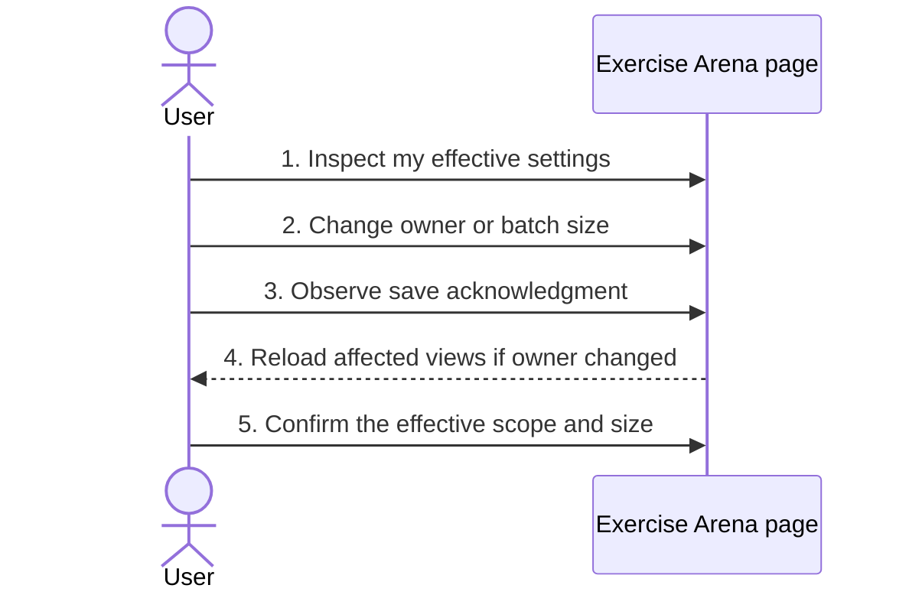

# 0006 Configure my practice

- **Actor** User changing their own User settings.
- **Goal** Select a content owner and subject-batch size.
- **Trigger** The user wants a different library or practice batch size.
- **Prerequisites** [user/0010](./0010-open-shared-arena.md).
- **Success** The setting write is acknowledged and the page uses the effective settings in a ready, correct owner scope.

## Main success scenario

1. The user opens Settings and inspects their own effective values.
2. The user changes Default owner or daily limit. The limit is 1-50 per subject batch, default 10; it is not a cap on the whole day.
3. The page writes the setting change and reports acknowledgment.
4. If owner changed, the page cancels old subscriptions, shows loading and obtains the new owner scope; coins, balance and match eligibility are recomputed in that scope.
5. The user confirms the effective settings and affected views, including recording and paper preparation.

## Extensions

- **1a. No settings document exists.** Use defaults: the actor as owner and batch size 10.
- **2a. A value is malformed.** Apply the fallback/clamping rules in DATA; a nonempty owner ID is not automatically proven to be a registered user.
- **3a. The write fails.** Report unsaved settings; do not equate a local selection with persistence.
- **4a. A required subscription fails.** Show unavailable, not an empty library or completed scope switch.
- **4b. Another device changes the actor's settings.** Apply the same owner reload boundary.
- **4c. Retained recording drafts or check previews refer to the previous owner.** New reference writes must validate current scope; a stale check preview requires re-preview.
- **5a. Another owner's library is selected.** View/practice/edit access continues; identity, own judgments and content ownership do not transfer.
- **5b. Coins or matches belong to the previous library.** They are neither counted nor deducted in the new library, so changing owner never produces a negative balance by itself; switching back restores the previous library's coins, spending and balance.

## Runtime trace

Session/settings coordinates Platform/data gateway and page readiness; Progress reads the effective scope. See [scenarios](../../model/arch/SCENARIO.md) S1/S11, [runtime contracts](../../model/arch/arena/SPEC.md) C1/C9 and [data contract](../../DATA.md).
