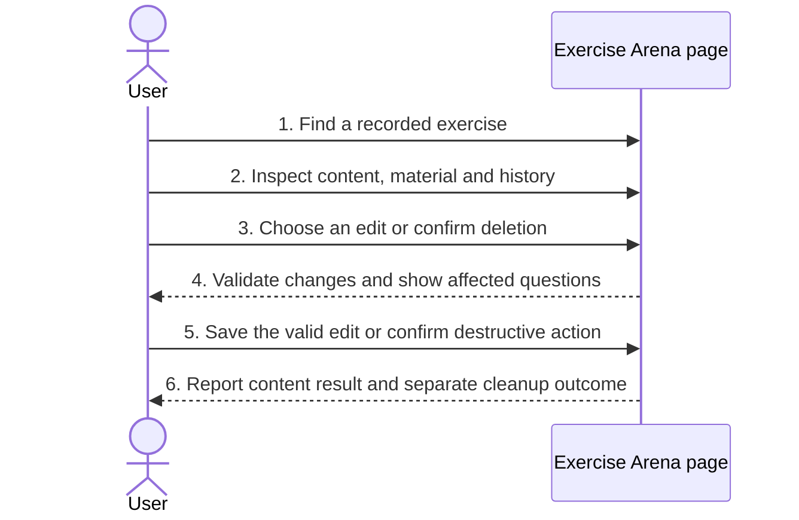

# 0007 Maintain the exercise library

- **Actor** User accessing the selected owner's library.
- **Goal** Keep recorded exercises and material accurate.
- **Trigger** The user finds content to inspect, correct or delete.
- **Prerequisites** [user/0010](./0010-open-shared-arena.md); acknowledged content and required membership reads.
- **Success** The deliberate edit/delete is acknowledged and visible. Edits preserve owner, creation timestamps and attempts; valid set members remain consistent. Any deferred set cleanup is reported separately.

## Main success scenario

1. The user finds an exercise in the selected library.
2. The user inspects its content, referenced material and attempt history.
3. The user chooses an Exercise/material edit, or deliberately confirms deletion after considering its history/reference consequences.
4. The page validates usable content, subject/reference consistency and correct answers. Material changes preserve the set's owner/subject and every member word-pick answer.
5. The user saves the validated edit or confirms deletion; the page acknowledges the content write.
6. The user inspects the result. Removal of a final set member permits set-document cleanup only with valid ownership and verified complete empty membership.

## Extensions

- **3a. The intended change is a saved judgment, not content.** Use [user/0009](./0009-correct-own-judgment.md).
- **3b. Ownership transfer is requested.** It is not part of this editor or an added feature; changing Default owner grants access without transferring content.
- **4a. A bank edit would remove a member's correct answer.** Reject the set save and identify affected questions. Correct their answers through Exercise editing before retrying; no automatic rewriting/rejudging/ladder reset.
- **4b. Ownership or complete membership is uncertain.** Block destructive bank changes. An unresolved legacy set cannot be edited or receive new links; ordinary valid Exercise edits may preserve a compatible unchanged legacy reference, owner and subject.
- **5a. The write fails.** Report failure and retryable session work; do not claim a saved edit.
- **5b. An unrelated material/title edit is saved from a stale form.** It must not overwrite unchanged owner, subject or word-bank fields.
- **6a. An Exercise is deleted.** Its embedded attempts for every actor disappear; papers show missing references rather than reconstructed history.
- **6b. Cleanup reads are incomplete, ownership is invalid, or deletion fails.** Retain/defer set cleanup and report it separately even if the Exercise change succeeded. Do not purge other orphan sets or delete assets.
- **6c. Another browser mutates membership/material concurrently.** Serial validation is not a transactional reference-integrity guarantee.

## Runtime trace

Exercise library coordinates gateway writes, Session membership and Progress history reads. See [scenarios](../../model/arch/SCENARIO.md) S4, [runtime contracts](../../model/arch/arena/SPEC.md) C3, [domain](../../model/domain/DOMAIN.md) and [data contract](../../DATA.md).
