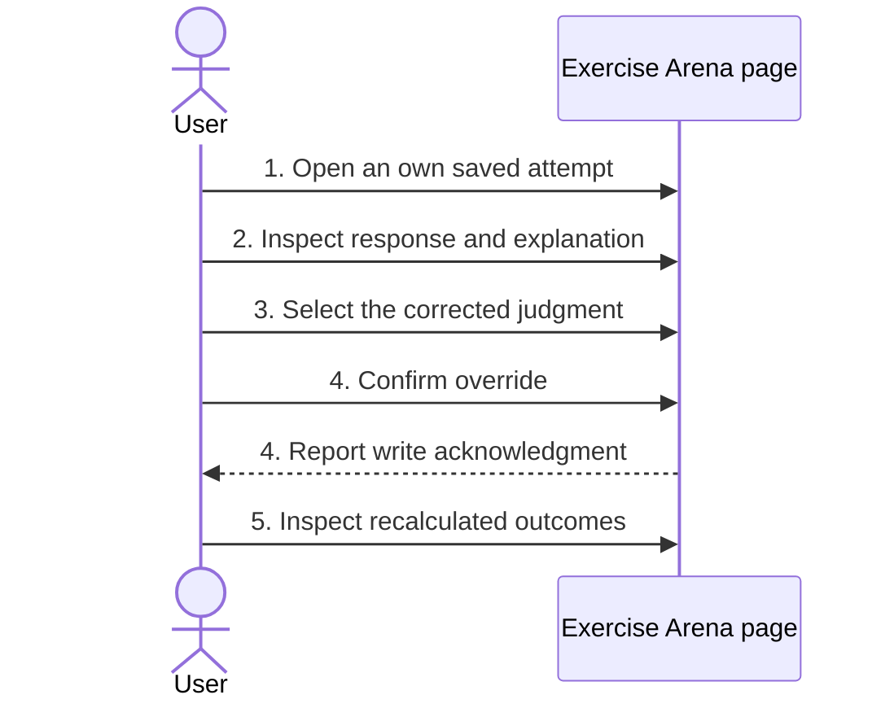

# 0009 Correct my own judgment

- **Actor** User correcting their own saved Attempt.
- **Goal** Make an incorrect saved judgment accurate and inspect recalculated outcomes.
- **Trigger** The user finds an incorrect judgment in Exercise history or paper details.
- **Prerequisites** [user/0010](./0010-open-shared-arena.md); an existing actor-authored Attempt.
- **Success** The own-attempt judgment change is acknowledged and dependent ladder, mastery, paper assessment and rewards are recalculated without adding a new attempt.

## Main success scenario

1. The user opens Exercise history or a Paper page (the same page right after hand-in or re-opened) and selects their own saved Attempt.
2. The user reads its response, correct answer and explanation.
3. The user chooses the accurate right/partial/wrong judgment.
4. The user confirms Override; the page changes that existing actor-authored judgment while preserving other attempts. On the Paper page every judged card offers it, including right after a self-mark.
5. The user reviews recalculated ladder, mastery, paper assessment, coins and balance.

## Extensions

- **1a. The attempt belongs to another actor.** This UI cannot override it; selecting their content owner does not change authorship.
- **1b. No judgment was saved.** Override cannot create a missing written attempt; the card reads "Not judged yet". Right/Partial/Wrong is offered only while the written response is still in the current taking session. Cross-session recovery remains deferred.
- **4a. The write fails.** The prior saved judgment remains authoritative.
- **5a. A correction affects later results.** Replay the agreed derivations; rewards may decrease and balance may become negative. This is not a new coin grant.
- **5b. An existing compatible legacy set reference remains.** The attempt write may preserve it without repairing ownership or modifying material.

## Runtime trace

Exercise library/Papers requests gateway override; Progress derives consequences. See [scenarios](../../model/arch/SCENARIO.md) S8/S9/S13, [runtime contracts](../../model/arch/arena/SPEC.md) C5/C7/C10 and [data contract](../../DATA.md).
