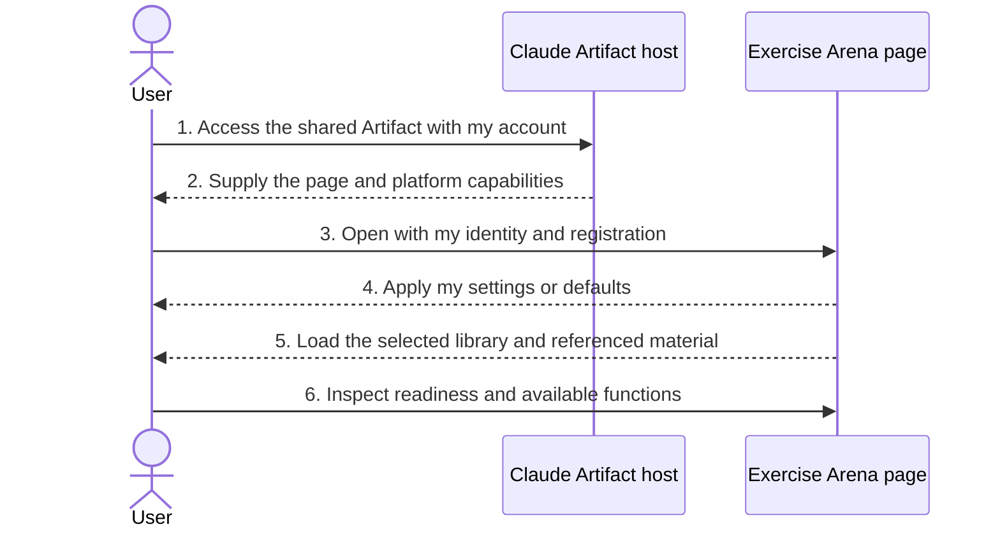

# 0010 Open the shared arena

- **Actor** Authenticated account holder using their own platform identity; sharing/account eligibility remain external responsibilities.
- **Goal** Reach a usable Exercise Arena page in the selected owner scope.
- **Trigger** The user opens the published Artifact.
- **Success** Required identity/database/scope dependencies are ready, own settings/defaults are effective, and the page distinguishes unavailable capabilities from empty data.

## Main success scenario

1. The user accesses the Artifact using their own account under platform sharing rules.
2. The host supplies the page and its database, identity, assets and AI capabilities.
3. The page resolves the actor's platform ID and registers a User if needed.
4. The page reads the actor's settings, using effective defaults when no document exists.
5. The page loads the selected owner's exercises/papers and required set material, including referenced legacy material.
6. The user sees a ready page and can choose an available journey.

## Extensions

- **1a. Access, sign-in or account eligibility is unresolved.** The account holder/platform resolves it; the page does not create student/parent permission roles or decide account eligibility.
- **2a. Required identity or database capability is absent.** The page is unavailable, not an empty library.
- **3a. Registration or profile lookup fails.** Report the appropriate boundary. Missing display names may use a fallback; display lookup does not establish identity.
- **4a. Own settings cannot be read.** A failed read is not the same as a confirmed missing document; do not claim a ready, correct scope from that failure.
- **5a. Required subscriptions fail or scope changes.** Show loading/unavailable and discard old subscription-generation results.
- **5b. Snapshot completeness is not established.** Display readiness does not authorize destructive set operations or prove global membership.
- **5c. Legacy ownership is unresolved.** Keep existing practice/material readable with a warning; restrict set mutation/new links/cleanup pending separate repair.
- **6a. AI/assets are unavailable.** Degrade affected recording/material operations without inventing offline behavior. Optional knowledge maps and font fallbacks do not become mandatory boot dependencies.

## Runtime trace

Session/settings and Platform/data gateway own boot and scope reload. See [scenarios](../../model/arch/SCENARIO.md) S1, [runtime contracts](../../model/arch/arena/SPEC.md) C1, and [container](../../model/arch/CONTAINER.md). Publication enabling this entry belongs to [operator/0002](../operator/0002-publish-artifact.md); sharing the Artifact does not share/copy questions between content owners.
