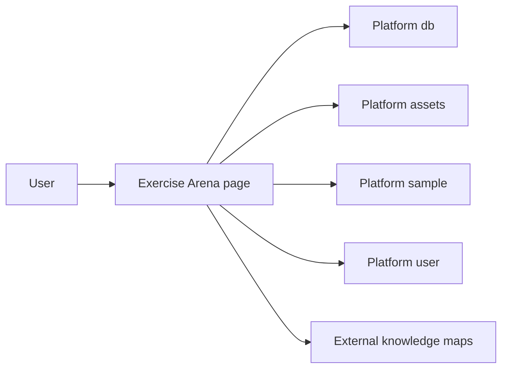

# Exercise Arena container

Exercise Arena is one Claude Artifact page. It owns the UI and page logic, and uses the platform’s database, assets, image sampling, and user identity.

## Components

| Component | Responsibility |
|---|---|
| Record | Capture photos or text, call AI, review drafts, resolve duplicates, save exercises and question sets. |
| Today | Show due daily redo, dashboard, streak, coins, and newly mastered exercises. |
| Exercises | List, search, edit, and show exercise details. |
| Papers | Create and complete daily and check papers. |
| Games | Show balance, start matches, and display the starboard. |
| Settings | Set daily limit and default owner. |

## Runtime nodes

- The page runs in a browser through the Claude Artifact runtime.
- Data is stored in the platform database and assets.
- Taxonomy and external references come from the embedded `TAX` block and external knowledge maps.
