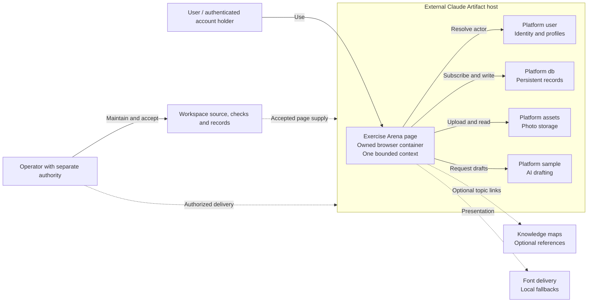

# Exercise Arena containers

One workspace-owned container hosts the single domain context ([ADR 0001](../adr/0001-arena-runs-as-claude-artifact-with-db.md)). Users open browser instances through the external Claude Artifact host; [ADR 0002](../adr/0002-each-user-opens-the-arena-with-their-own-claude-account.md) owns identity/access rationale.

## Inventory

| Unit/dependency | Ownership and responsibility | Context |
|---|---|---|
| Exercise Arena page | Owned UI, coordination, validation and projections | Exercise Arena |
| Claude Artifact host | External access/sharing and capability supply | Generic platform |
| Platform user/db/assets/sample | External identity/profiles, persistent records, photos and untrusted AI | Generic platform |
| Science/math knowledge maps | Optional explanations; taxonomy IDs remain embedded TAX | External reference |
| Font delivery | Presentation dependency with local fallbacks | No domain context |

## Runtime nodes

- Browser instances share platform storage but have separate sessions; no owned backend, scheduled cleanup server or cross-device coordinator is introduced.
- Platform records/assets outlive sessions. Multiple browsers can write them; the model does not invent transaction/snapshot guarantees.
- Required identity/db/scope failures prevent readiness; narrower AI/assets/profile/reference failures are defined in [runtime SPEC](./arena/SPEC.md).
- Repository maintenance, acceptance and publication are support flows, not in-page components.
- [COMPONENT.md](./arena/COMPONENT.md) owns internal responsibilities; [SCENARIO.md](./SCENARIO.md) owns collaborations.
- Sources, artifact inventory and target flow belong to [deploy SPEC](../operate/deploy/SPEC.md).
