# Runtime scenarios

The page is a black-box container here; [components](./arena/COMPONENT.md) own internal coordination. [Runtime SPEC](./arena/SPEC.md) owns command outcomes; [DATA](../../DATA.md) owns stored shapes and compatibility. Step references below point to authoritative journey bodies, not implementation status.

## S1 Open and reload owner scope

- **Trigger / journey steps** 0010 1-6; 0006 4-5 and another-device settings change.
- **Entry responsibility** Session/settings.

```mermaid
sequenceDiagram
    actor U as Account holder
    participant H as Artifact host
    participant P as Arena page
    participant I as Platform user
    participant D as Platform db
    U->>H: Open permitted Artifact
    H-->>P: Supply page and capabilities
    P->>I: Resolve actor identity
    I-->>P: Identity or failure
    P->>D: Register if needed; read own settings
    P->>D: Subscribe selected library and resolve referenced material
    D-->>P: Snapshots or failures
    P-->>U: Ready, loading or unavailable; legacy warning where needed
```

Identity/settings precede owner subscriptions. Reload cancels prior generation; old results cannot populate the new scope. Required failed reads are not confirmed empty data. Legacy material remains resolvable even without set owner; completeness is not inferred from readiness. Profile lookup, AI/assets and optional references have narrower degradation boundaries (C1).

## S2 Record new input

- **Trigger / journey steps** 0001 1-7, new photos/text alternative.
- **Entry responsibility** Record.

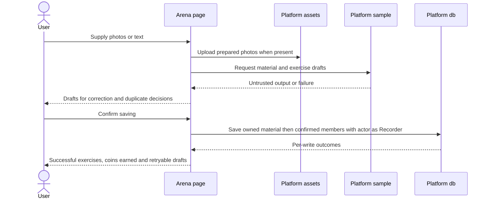

AI is not the decision maker. Upload/AI/parse cancellation and per-draft failures are distinct; artifacts can survive failed member writes. Same-owner/subject reference validation occurs at save; no automatic orphan/asset purge (C2). Entered from a School paper (0001 2b, S14), the session starts with the paper's subject and a default Source label that drafts keep (C2).

## S3 Record from saved material

- **Trigger / journey steps** 0001 2-7, saved material alternative.
- **Entry responsibility** Record.

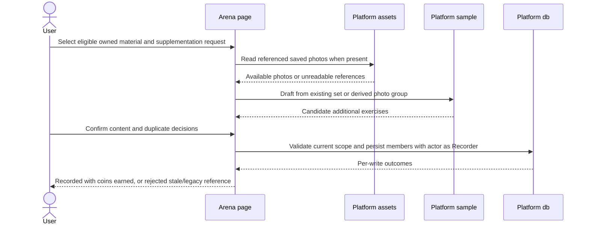

Saved photo groups are derived from scoped independent exercises; they are not another collection. Read failures/skipped images are reported: available set text or remaining photos may support drafting, but a photo-only group with no readable photos stops before AI. A retained A-set draft cannot save a B member; unresolved legacy sets cannot receive new links. Changing settings does not share or copy a set (C2).

## S4 Edit or delete library content

- **Trigger / journey steps** 0007 1-6.
- **Entry responsibility** Exercise library.

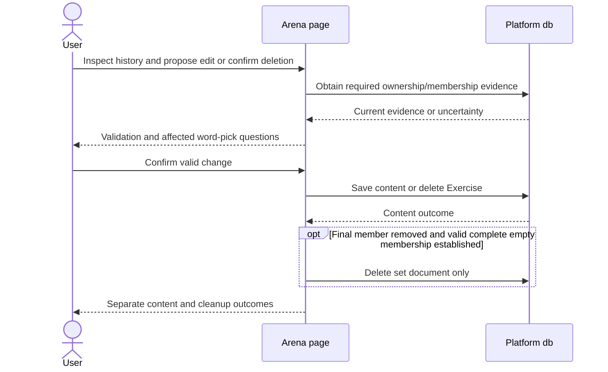

Edits preserve history/owner/timestamps; usable material, subject and every member bank answer remain valid. Unchanged fields are not overwritten from stale forms. Uncertain destructive bank changes are blocked; cleanup retains/defers. Existing compatible legacy links may survive ordinary Exercise edits, but set mutation/new links/cleanup remain blocked until repair (C3).

## S5 Daily batch, submission and protected recovery

- **Trigger / journey steps** 0002 1-7; recovery also when due count is zero.
- **Entry responsibility** Papers; Progress supplies actor-specific due work.

```mermaid
sequenceDiagram
    actor U as User
    participant P as Arena page
    participant D as Platform db
    U->>P: Inspect due work and protected submissions
    alt Unsubmitted paper has saved actor attempts
        U->>P: Recover protected paper
        P->>D: Restore saved attempts and retry missing writes
    else Untouched draft or new batch
        U->>P: Start subject batch
        P->>D: Save batch, overlapping answers and explicit unsubmitted marker state
        D-->>P: Creation acknowledgment
        P->>D: Delete superseded untouched drafts
    end
    U->>P: Answer and hand in
    loop Missing objective attempts, stop at first failure
        P->>D: Save one judged actor attempt
        D-->>P: Per-write acknowledgment or failure
    end
    alt An objective write failed
        P-->>U: Retry missing writes; protect if actor attempts persisted
    else Objective writes completed
        P->>D: Save actor submission marker
        D-->>P: Marker outcome
        alt Marker failed
            P-->>U: Retry marker; protected recovery requires saved actor attempts
        else Marker acknowledged
            P-->>U: Handed in, written judgments may remain
            U->>P: Self-judge written answers in this session
            P->>D: Save missing written judgments
            D-->>P: Per-write outcomes
            P-->>U: Assessment, ladder/rewards and remaining batches
        end
    end
```

No multi-root transaction is claimed. On failed marker/attempt writes, protect only papers with persisted actor attempts and restore them without rejudging saved answers from an empty buffer. Multiple protected papers stay discoverable; a new batch for that subject waits. Legacy marker and mixed-subject rules are in DATA. Full unsaved written-answer recovery across sessions remains deferred; incomplete assessment is truthful (C4-C5).

## S6 Prepare an Exam paper

- **Trigger / journey steps** 0008 1-6.
- **Entry responsibility** Papers.

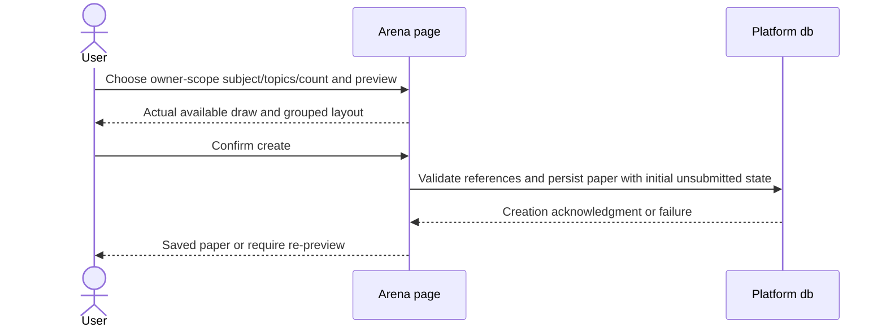

An empty pool is not a successful paper. Stale scope/unavailable references require re-preview rather than combining current owner with old IDs. Papers reference mutable content, not snapshots (C6).

## S7 Take an Exam paper

- **Trigger / journey steps** 0003 1-6.
- **Entry responsibility** Papers.

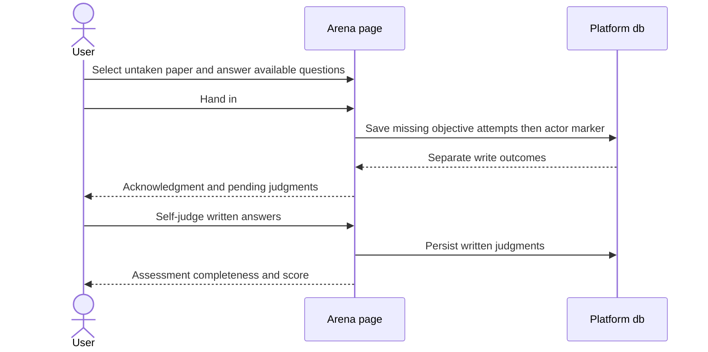

Each actor submits once. Wrong check judgments reset ladder; right/partial do not advance it; check attempts award no coins. Deleted references leave the denominator, unjudged existing ones remain; empty content is not mastery evidence. Check draft/unsaved written-answer durability is not promised (C5-C6).

## S8 Correct own saved judgment

- **Trigger / journey steps** 0009 1-5.
- **Entry responsibility** Exercise library/Papers; Progress derives consequences.

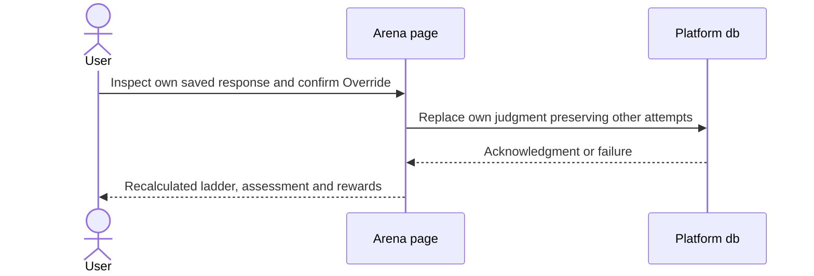

This changes an existing own Attempt, not authorship or a new attempt/coin grant. Missing judgments cannot be filled by Override; failed writes leave prior saved judgment authoritative. Compatible legacy references can remain unchanged (C5/C7).

## S9 Read progress

- **Trigger / journey steps** 0004 1-5; 0001 1/6, 0002 1/7, 0003 6, 0007 6, 0009 5.
- **Entry responsibility** Progress.

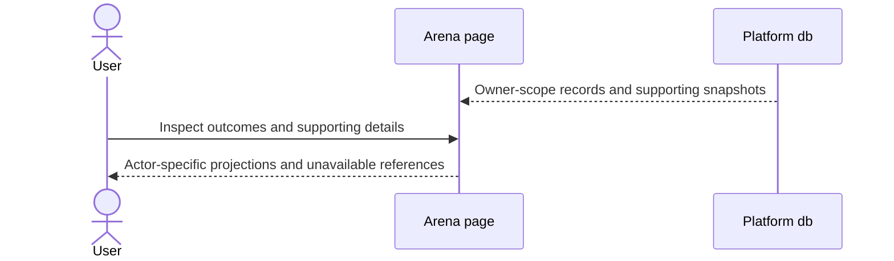

Reads create no durable projection store. Forecasts are conditional; corrections and deleted recorded exercises can alter rewards and produce negative balance. Paper retention affects details but not Exercise attempts; scope selection does not impersonate owner progress. Coins (from attempts and recordings) and balance are derived in the selected library only; match spending of other libraries is excluded (C7).

## S10 Match start and result

- **Trigger / journey steps** 0005 1-6.
- **Entry responsibility** Games.

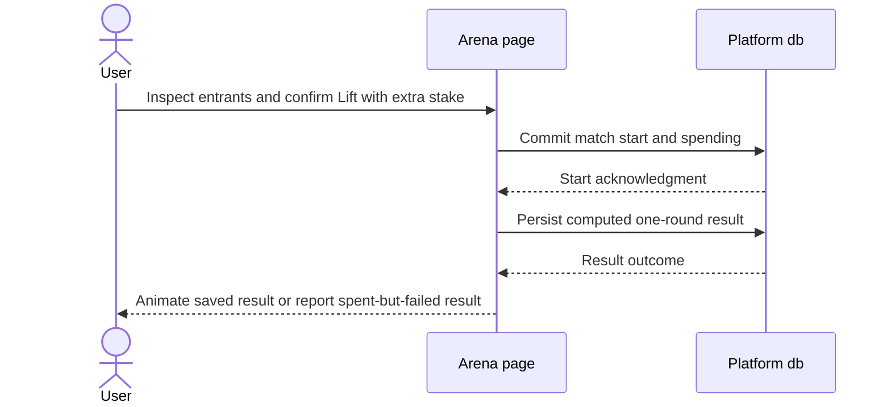

The committed start records the opener's Default owner as the match's library. Opponents may be offline. Missing supporting snapshots cannot prove eligibility. Result failure does not refund; simultaneous starts may overspend. Sprint/Climb rules remain deferred (C8).

## S11 Save own settings

- **Trigger / journey steps** 0006 1-5.
- **Entry responsibility** Session/settings.

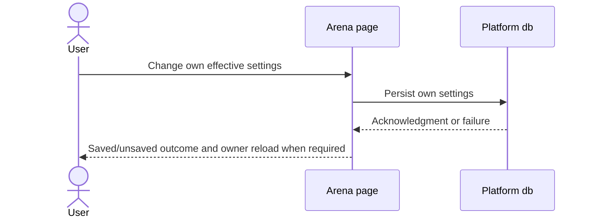

Apply DATA defaults/clamping; nonempty owner ID is not proof of a registered User. Changing Questions per day saves it like any setting and redraws the Finish forecast from current snapshots (Progress, no write); the forecast also redraws on owner reload. A save never stores the recent-pace placeholder (C9, C7). Same-device and other-device owner changes share S1's reload boundary; retained drafts/previews must not bypass current scope checks. After an owner change, balance is recomputed in the new library and never charges another library's match stakes (C9, C7).

## S12 Page-triggered daily-paper retention

- **Trigger** Required Exercise/Paper/Set views ready, and after scope reload.
- **Journeys served** 0002, 0004; system reaction, not a new operator journey.
- **Entry responsibility** Papers.

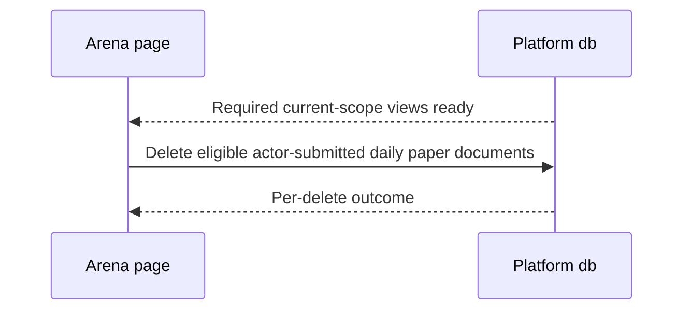

Eligibility/30-day boundary and legacy hand-in inference belong to DATA. Attempts survive; failed deletions are best-effort and do not authorize a background global purge (C9).

## S13 Open and use a paper page

- **Trigger / journey steps** 0002 1/4-7, 0003 1-6, 0004 4-5, 0009 1-5.
- **Entry responsibility** Papers; Progress supplies the outcome block.

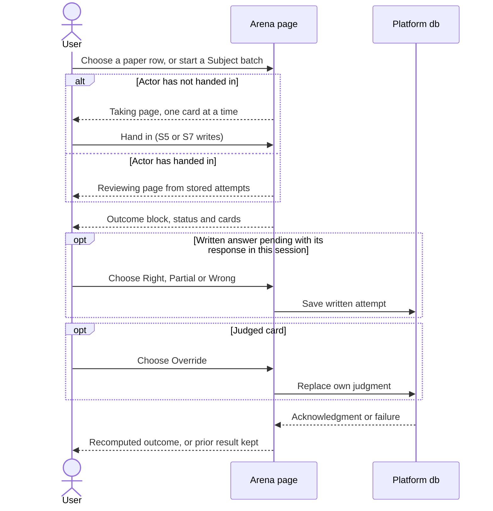

The same page serves the first review right after hand-in and every later one; rows from Today and Papers share the Start-or-Review rule. Pending judgments are shown as not judged, never as no answer, and cannot be created without their response. No stored field is added (C10).

## S14 Follow the paper plan

- **Trigger / journey steps** 0015 1-7.
- **Entry responsibility** Papers; Session supplies the actor's Paper plan and School papers.

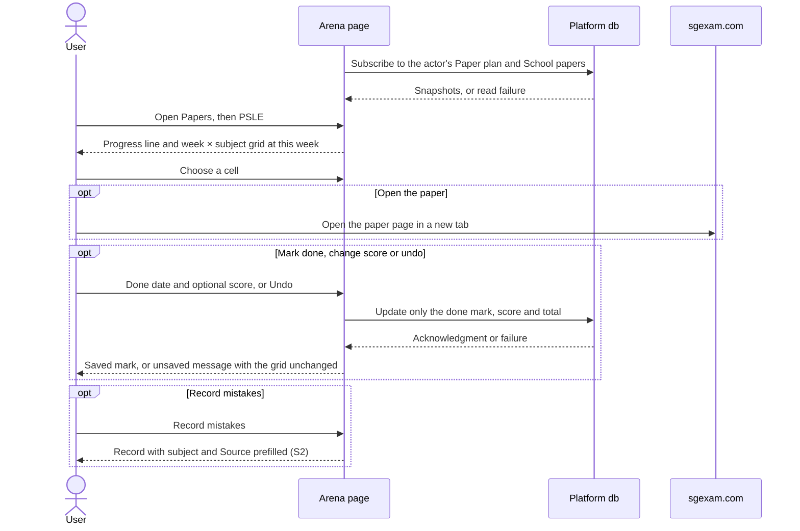

A missing plan document is "no plan yet"; a failed read is "plan unavailable", never an empty plan. The page never creates, reschedules or deletes School papers; an operator re-plan ([plan contract](../operate/plan/SPEC.md)) changes only weeks and ranks, so a concurrent done mark survives (C11).

## Support scenarios

0011 maps to [maintain SPEC](../operate/maintain/SPEC.md). 0016 maps to [plan SPEC](../operate/plan/SPEC.md); 0014 to [recover SPEC](../operate/recover/SPEC.md). 0013 uses [acceptance SPEC](../../verify/SPEC.md) and deploy-provided test candidates. 0012 maps to [deploy SPEC](../operate/deploy/SPEC.md). Repository checks/publication are not Games interactions or in-page services.

## Journey coverage

| Journey | Runtime/support coverage |
|---|---|
| 0001 | S1-S3/S14; C1-C2 |
| 0002 | S5/S9/S12/S13; C4-C5/C7/C9/C10 |
| 0003 | S7/S9/S13; C5-C7/C10 |
| 0004 | S9/S12/S13; C7/C9/C10 |
| 0005 | S10; C8 |
| 0006 | S1/S11; C1/C7/C9 |
| 0007 | S4; C3 |
| 0008 | S6; C6 |
| 0009 | S8/S9/S13; C5/C7/C10 |
| 0010 | S1; C1 |
| 0015 | S2/S14; C2/C11 |
| 0011-0013 | Owning maintain/deploy/acceptance contracts |
| 0014, 0016 | Owning recover and plan contracts |
