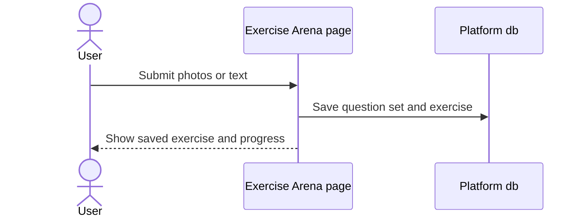
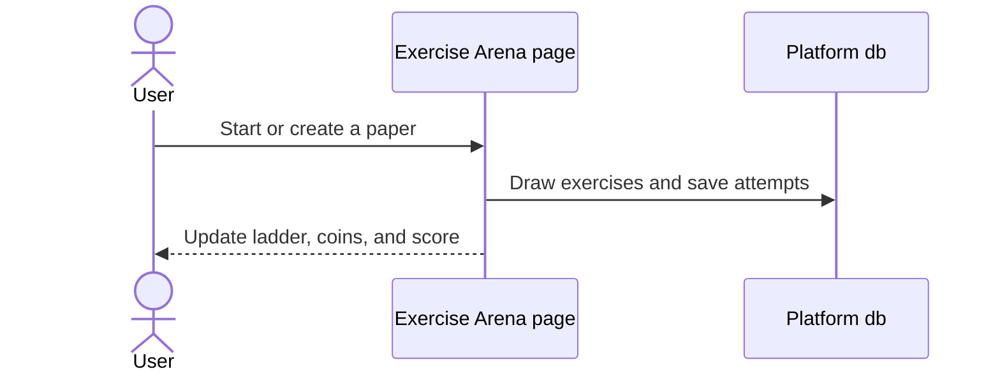
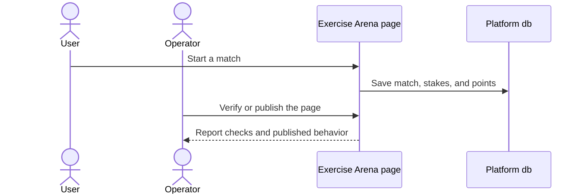

# Runtime scenarios

## Record and review exercises

- **Trigger** A user records a wrong exercise.
- **Journeys served** user/0001, user/0004

1. The page stores shared material once and links member exercises to it.
2. The page derives each user’s ladder from embedded attempts.
3. The page shows progress only for the current default owner.

## Practice and assess mastery

- **Trigger** A user does today’s redo or takes a check paper.
- **Journeys served** user/0002, user/0003

1. Daily redo uses due, unmastered exercises in the current owner scope.
2. A check paper can include mastered exercises.
3. Wrong answers reset the ladder; right or partial answers do not.

## Compete and maintain

- **Trigger** A user plays a match, or an operator maintains or publishes the page.
- **Journeys served** user/0005, operator/0001, operator/0002

1. A match has one round and updates the starboard.
2. The operator verifies model and implementation alignment before publishing.
3. Publishing requires separate user authorization.
