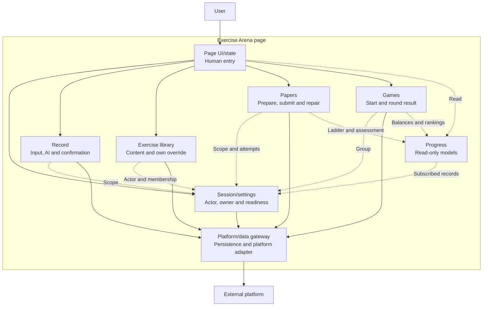

# Exercise Arena components

Logical responsibilities in one page; no required source split, new service/collection or exclusive database writer.

## Responsibilities

| Component | Entry/operations | Aggregate writes requested | State/read responsibility |
|---|---|---|---|
| Page UI/state | Decisions, navigation, confirmations and errors | None directly | Transient input, drafts, answers, previews/animation |
| Session/settings | Open/register, settings, reload/readiness | User and own settings through gateway | Actor separate from owner; snapshots/generation; referenced legacy material |
| Record | New/saved input, uploads/AI, draft validation and saves | Set and Exercise through gateway | Draft scope, duplicates, partial-write outcomes |
| Exercise library | Search/details, content/material edits/delete, own override | Exercise/Set through gateway | History preservation, bank/membership checks, conditional cleanup |
| Papers | Daily recovery, check creation, paper rows and the Paper page (taking, review, submit/judge, override), runtime retention | Paper and Exercise attempts through gateway | Protected submissions, preview scope, acknowledgment versus assessment, one page for taking and reviewing |
| Progress | Ladder/due work, assessment, streak/mastery, rewards/rankings | None | Actor projections in selected scope |
| Games | Eligibility, stakes, start and automatic result | Match through gateway | Committed spending; animate after saved result |
| Platform/data gateway | Identity/profiles, db reads/writes, assets and sample | Sole logical persistence adapter for six roots | Acknowledgment/failure, not transactions or automatic repair |

Coordinators validate actions and request gateway operations. Gateway snapshots update Session; components do not own competing persistent copies. Projection refresh is not a durable event bus.

## Collaboration and limits

- Papers owns partial-submission recovery and daily-paper retention through the gateway; neither is an operator cleanup service.
- New set links and check creation validate current owner scope. Existing compatible legacy references may survive ordinary content/attempt edits without automatic repair.
- Progress never writes a second ladder, score or coin store.
- [SPEC.md](./SPEC.md) owns runtime outcomes; [parent scenarios](../SCENARIO.md) map journey steps; DATA owns shapes/compatibility.
- Papers shows one Paper page per paper and one row meaning (Start or Review) in every list; Progress supplies its outcome block (C10).
- Cache/helper/animation layout, tested draw/tie/duplicate algorithms and source modularization remain implementation choices.
- Current code has not implemented the new ownership/legacy, recovery or stale-preview boundaries. Strong concurrent integrity and complete unsaved written-answer recovery remain deferred.
