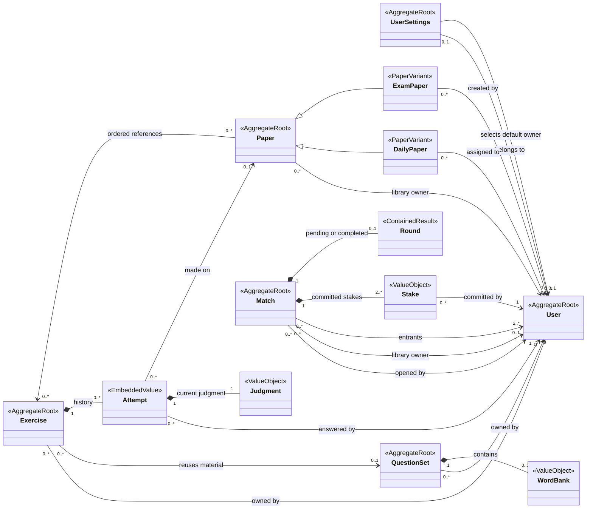

# Domain model

Exercise Arena is one core bounded context for recording, reviewing and assessing exercises, with optional competition. Its home is the browser page; platform identity, db, assets and AI are external generic facilities, not contexts we implement.

## Proposition

A user confirms exercises from wrong answers or supplementary material. Each actor practices within a selected content owner's library; saved attempts derive that actor's ladder, assessment and rewards. Selecting another library changes scope, not identity or ownership.

Terms are defined in [GLOSSARY.md](./GLOSSARY.md). Stored shapes, writes and compatibility have one owner: [DATA.md](../../DATA.md). Detailed algorithms and taxonomy remain in mapped source/tests within these contracts.

## Aggregate ownership

| Aggregate root | Contained concepts | Logical writer | Journey commands |
|---|---|---|---|
| User | Platform registration; no stored display-name authority | Platform/data gateway | 0010 |
| User settings | Default owner and batch-size configuration | Gateway via Session/settings | 0006, 0010 |
| Exercise | Content, optional material reference, embedded Attempts/Judgments | Gateway via Record, Exercise library or Papers | 0001, 0002, 0003, 0007, 0009 |
| Question set | One owner's same-subject material and optional Word bank | Gateway via Record/Exercise library | 0001, 0007 |
| Paper | Ordered Exercise references, draft state and per-actor acknowledgment | Gateway via Papers | 0002, 0003, 0008; retention |
| Match | Committed entrants/Stake values and contained Round result | Gateway via Games | 0005 |

The gateway is one logical persistence responsibility, not an exclusive browser writer or cross-document transaction. No new collection, recorder provenance, immutable paper snapshot or judgment audit trail is introduced.

## Conceptual relations

This is the target relation for new/validated records. Legacy ownerless/mixed-owner sets remain readable under DATA without invented owners/new links. Legacy missing creators/stakes and historical multi-round matches remain readable. Deleted references are unresolved. Daily/Exam are Paper variants, not separate roots/tables.

## Values and derived models

Attempt/Judgment are embedded values changed through Exercise. Word bank and Stake are contained values; Draft is transient; Saved material includes a derived photo grouping, not another root.

| Derived model | Inputs and boundary | Journeys |
|---|---|---|
| Review ladder and mastery | One actor's daily attempts and wrong check attempts, from Exercise creation | 0002, 0003, 0004, 0009 |
| Daily redo | Actor ladder, selected owner, local date, subject and effective batch size | 0002, 0006 |
| Paper assessment | Remaining references, saved actor judgments, distinct hand-in fact | 0002, 0003, 0004, 0009 |
| Paper outcome | One actor's saved attempts on one paper: ladder before and after, daily coins, assessment status (judged, pending, deleted) | 0002, 0003, 0004, 0009 |
| Progress, Streak, Mastery transition | Actor history in subscribed scope; conditional forecast | 0004, 0009 |
| Coin and Balance | Weekly daily rewards in the selected library minus committed spending of matches belonging to that library | 0004, 0005, 0009 |
| Star and Starboard | Saved rounds, period and users' Default-owner grouping | 0004, 0005 |

These are computed models, not independently persisted aggregates.

## Invariants and lifetime

1. Actor supplies attempt authorship; selected owner supplies content scope. Shared-library access is not transfer or a permission role ([ADR 0002](../adr/0002-each-user-opens-the-arena-with-their-own-claude-account.md); 0006, 0010).
2. New/validated sets and members have the same owner/subject. Reuse is within that library, not cross-owner sharing. Each actor's ladder remains per question ([ADR 0003](../adr/0003-question-set-holds-shared-material-questions-keep-own-ladder.md); 0001, 0002, 0007).
3. Ordinary edits preserve owner, timestamps and attempts. Material/bank edits preserve usable material and every member word-pick answer; no automatic answer rewriting, rejudging or ladder reset (0007).
4. Last-member set deletion is command-triggered and conditional on valid ownership and complete current empty membership. Uncertainty retains/defers cleanup; the page performs no orphan purge or asset deletion (0007). Asset deletion is only an authorized operator action under the [capacity contract](../operate/capacity/SPEC.md).
5. Legacy compatibility preserves material access, valid unchanged-reference Exercise edits and actor attempt/judgment writes. Missing/conflicting owners do not authorize set mutation/new links/cleanup. A uniquely inferred owner is not persisted automatically; repair is separately authorized and deferred (0001, 0002, 0003, 0007, 0009, 0010).
6. Papers hold mutable/deletable references. At creation references belong to the current owner scope; stale previews require re-preview. Exercise deletion removes all embedded attempts and leaves missing paper references (0007, 0008).
7. Daily papers are for one actor; each actor takes an Exam paper once. Both store attempts in Exercise ([ADR 0004](../adr/0004-attempts-are-embedded-in-the-exercise-document.md); 0002, 0003).
8. Handed in is not fully assessed. New papers explicitly start unsubmitted rather than invoking absent-marker legacy inference. Existing unjudged questions remain in the score denominator; no remaining questions is not mastery evidence (0002, 0003; DATA owns marker initialization).
9. Unsubmitted daily papers with saved actor attempts are protected, with recovery visible even without due work. Restore saved responses/judgments and retry missing writes/marker; untouched drafts keep fresh replacement. Unsaved written/check-draft cross-session recovery is deferred (0002).
10. Retention deletes eligible submitted daily Paper documents in the actor's current owner scope, not embedded attempts. Details may become unavailable (0002, 0004; DATA).
11. Match start commits spending before round-result persistence. Result failure does not refund; derived eligibility cannot prevent concurrent overspending (0005).
    - A Match belongs to its opener's Default owner library at start. Coins and Stakes are derived in the same library scope, so changing Default owner changes which purse is shown and never charges one library's stake against another's coins. Legacy matches without an owner are attributed only when all entrants currently share the scope; the inferred attribution is not persisted (0004, 0005, 0006; DATA).
12. No writer label proves a transaction/complete snapshot. Attempt-array, marker-map, bank and membership writes retain distinct concurrent overwrite/reference risks.

## Implementation boundary

Ownership/legacy restrictions, protected-paper recovery and stale-preview validation are not yet implemented or accepted by the current page. [Runtime contracts](../arch/arena/SPEC.md) and [acceptance contract](../verify/SPEC.md) define the downstream handoff. Local logic tests do not prove these future command boundaries.
