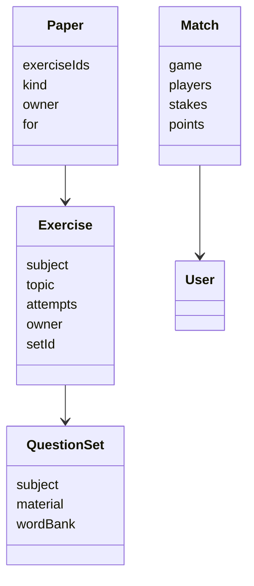

# Domain overview

Exercise Arena is a single-context system for recording wrong exercises, practicing them on a review ladder, checking mastery, and comparing progress through games.

## Proposition

A user records wrong exercises from text or photos. The page derives each user’s review ladder from attempts, generates daily redo and check papers, calculates coins and progress, and runs matches between users.

## Aggregates

| Aggregate | Root | Members | Writer |
|---|---|---|---|
| Exercise | `exercises/{id}` | fields, embedded attempts, optional set link | Exercise Arena page |
| Question set | `sets/{id}` | subject, material, word bank | Exercise Arena page |
| Paper | `papers/{id}` | exercise ids, handed-in state, daily responses | Exercise Arena page |
| Match | `matches/{id}` | players, stakes, points, game-specific data | Exercise Arena page |
| User settings | `settings/{user id}` | daily limit, default owner | Exercise Arena page |

## Value objects

- Attempt: one user’s dated response and judgment on one exercise.
- Coin and Balance: weekly progress and spendable balance derived from attempts and matches.
- Star and Starboard: match result and ranking derived from match points.

## Invariants

1. Every exercise has an owner and belongs to exactly one subject. See ADR 0002.
2. Attempts are embedded in the exercise and identify their author. See ADR 0004.
3. A question set stores shared material once; each member exercise keeps its own ladder. See ADR 0003.
4. A paper is either a daily paper for one user or a check paper drawn from one owner’s exercises.
5. A match has one round, at least two entrants, and stakes deducted when it starts.
