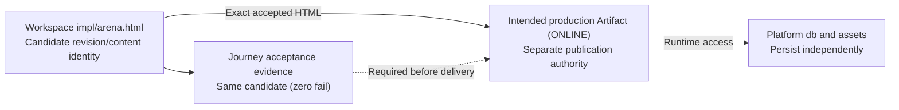

# Deploy support contract

- **Journeys / steps** 0013 3 optionally supplies a test candidate when explicitly requested; 0012 1–5 delivers an accepted candidate.
- **Operator and authorization** Target-capable account holder/operator. Production publication needs separate explicit user authorization; any ad-hoc test target writes need named test scope. Page delivery does not authorize database repair.
- **Environment and dependencies** Identified source candidate, compatible Artifact runtime capabilities, intended production target, matching completed integration acceptance evidence (zero `fail`). No separate `OFFLINE` test Artifact is maintained by default (prod-only workspace).

## Artifact flow

Manual publication, not an automated integration. Real platform boundaries stay `unverified` during local/simulated acceptance unless an ad-hoc authorized test target is used, and are disclosed before `ONLINE` publication.

## Artifacts and dependencies

| Artifact/dependency | Producer and source | Destination | Lifecycle / container |
|---|---|---|---|
| Page HTML with embedded TAX and logic | Workspace maintainer; `impl/arena.html` | Authorized test and intended production Artifact | One browser page container; identify exact revision/hash |
| db records | Page runtime or separately authorized data operation; DATA owns shapes | Platform db | Outlive page publication; not a bundled deploy/reset |
| Photo assets | Page upload capability; authorized capacity repair | Platform assets | Outlive sessions; publication does not delete/migrate them; only the [capacity contract](../capacity/SPEC.md) shrinks, relinks or deletes them |
| Platform user/db/assets/sample | External provider | Browser capabilities | Verify compatibility at target; no owned service deployment |
| Knowledge maps/fonts | External reference/presentation providers | Runtime links/fetches | Optional reference or fallback-supported presentation, not packaged source |

The intended production URL recorded by the source header is [Exercise Arena Artifact](https://claude.ai/artifact/626tqFyFmmfXKdMHYnbJAh). This is recorded intent, not verified live target identity/version. The source's runtime declaration is historical evidence; verify actual capabilities when touched or before delivery.

## Supply an acceptance candidate (optional)

- **Prerequisites and scope** Exercise Arena is prod-only by default: no separate `OFFLINE` test Artifact is maintained, and routine slices do not require one under [acceptance SPEC](../../../verify/SPEC.md). Only when the user explicitly requests an ad-hoc test target, identify source content/revision, authorized test target, actors/capabilities, named synthetic `test: true` data/asset scope and allowed writes. Do not upload an unaccepted candidate to production merely to obtain acceptance evidence.
- **Success / failure** Without an authorized test target, real platform boundaries stay `unverified` and are disclosed before publication.
- **Verification / recovery** Verify candidate identity and test scope through [acceptance SPEC](../../../verify/SPEC.md). Do not invent a sandbox or safe rollback. Test cleanup must be explicitly authorized, not a global data purge.
- **Implementation** Manual platform entry; see [deploy tools](../../../operate/deploy/README.md).

## Publish an accepted page

- **Prerequisites and scope** Confirm exact accepted candidate, passing local checks (`./check.sh` and `node impl/logic.test.js impl/arena.html` on the matched implementation record), matching completed `scope: integration` acceptance record (zero `fail`), intended target, target access and separate publication authorization. Simulated-runtime smoke checks (`verify/fake-platform-smoke.js`, cataloged in [verify/README.md](../../../verify/README.md)) are **not** a mandatory pre-release blocker; **disclose all `unverified` boundaries** (including skipped smoke or real-platform boundaries) to the user before `ONLINE` publication authorization. Identify prior source/recovery options before writing.
- **Success** Target identity, candidate and affected post-publication behavior match acceptance; record delivery (including disclosed `unverified` boundaries) under `record/release/`.
- **Failure / stop** Missing completed `scope: integration` acceptance (or any `fail` judgment), failing local checks, or missing publication authority stops publication. Upload failure, wrong target and failed target behavior are distinct failures; never assume upload alone or prior publication comments prove delivery.
- **Verification / recovery** Open actual target and inspect identity/loading/affected journeys. After a failed upload/check, inspect actual state; the old version is not assumed to remain. Restoration needs an available prior candidate/version, a usable entry and established authorization; platform rollback is unverified.
- **Implementation** [Current manual deploy entry](../../../operate/deploy/README.md); no automated deployment or verified rollback tool is registered.

## Records and external boundaries

Acceptance results go to `record/verify/`; release goes to `record/release/`. Do not commit credentials, child question/photo data or field logs. No live deployment, rollback or ownership migration is performed by changing this contract.
