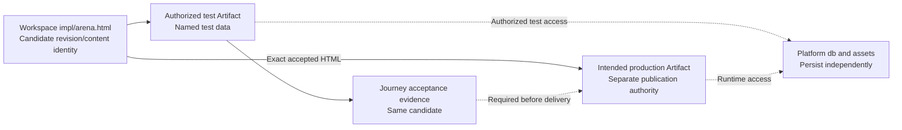

# Deploy support contract

- **Journeys / steps** 0013 3 supplies a test candidate; 0012 1-5 delivers an accepted candidate.
- **Operator and authorization** Target-capable account holder/operator. Test writes need named test scope; production publication needs separate explicit user authorization. Page delivery does not authorize database repair.
- **Environment and dependencies** Identified source candidate, compatible Artifact runtime capabilities, authorized test/production target and test data, matching acceptance evidence for production.

## Artifact flow

Manual supply/publication, not an automated integration. Test targets/data isolation must be established; the diagram does not imply test writes are harmless to production.

## Artifacts and dependencies

| Artifact/dependency | Producer and source | Destination | Lifecycle / container |
|---|---|---|---|
| Page HTML with embedded TAX and logic | Workspace maintainer; `impl/arena.html` | Authorized test and intended production Artifact | One browser page container; identify exact revision/hash |
| db records | Page runtime or separately authorized data operation; DATA owns shapes | Platform db | Outlive page publication; not a bundled deploy/reset |
| Photo assets | Page upload capability | Platform assets | Outlive sessions; publication does not delete/migrate them |
| Platform user/db/assets/sample | External provider | Browser capabilities | Verify compatibility at target; no owned service deployment |
| Knowledge maps/fonts | External reference/presentation providers | Runtime links/fetches | Optional reference or fallback-supported presentation, not packaged source |

The intended production URL recorded by the source header is [Exercise Arena Artifact](https://claude.ai/artifact/626tqFyFmmfXKdMHYnbJAh). This is recorded intent, not verified live target identity/version. The source's runtime declaration is historical evidence; verify actual capabilities before acceptance/delivery.

## Supply an acceptance candidate

- **Prerequisites and scope** Needed once per release candidate for the authorized runtime; a slice accepted on the simulated runtime alone needs no test target. Identify source content/revision, authorized test target, actors/capabilities, named data/asset scope and allowed writes. Do not upload an unaccepted candidate to production merely to obtain acceptance evidence.
- **Success / failure** The test target loads the identified candidate with declared dependencies; inability to supply it leaves runtime acceptance unverified.
- **Verification / recovery** Verify candidate identity and test scope through [acceptance SPEC](../../verify/SPEC.md). Do not invent a sandbox or safe rollback. Test cleanup must be explicitly authorized, not a global data purge.
- **Implementation** Manual platform entry; test-candidate procedure and evidence remain downstream work.

## Publish an accepted page

- **Prerequisites and scope** Confirm exact accepted candidate and matching verification record, intended target, target access and separate publication authorization. Identify prior source/recovery options before writing.
- **Success** Target identity, candidate and affected post-publication behavior match acceptance; record delivery under `record/release/`.
- **Failure / stop** Missing evidence/authority stops publication. Upload failure, wrong target and failed target behavior are distinct failures; never assume upload alone or prior publication comments prove delivery.
- **Verification / recovery** Open actual target and inspect identity/loading/affected journeys. After a failed upload/check, inspect actual state; the old version is not assumed to remain. Restoration needs an available prior candidate/version, a usable entry and established authorization; platform rollback is unverified.
- **Implementation** [Current manual deploy entry](../../../operate/deploy/README.md); no automated deployment or verified rollback tool is registered. Its expanded candidate/target/recovery steps require downstream alignment.

## Records and external boundaries

Acceptance results go to `record/verify/`; release goes to `record/release/`. Do not commit credentials, child question/photo data or field logs. No live deployment, rollback or ownership migration is performed by changing this contract.
