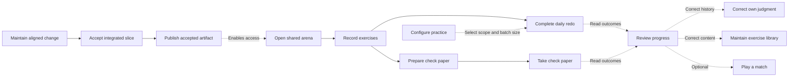
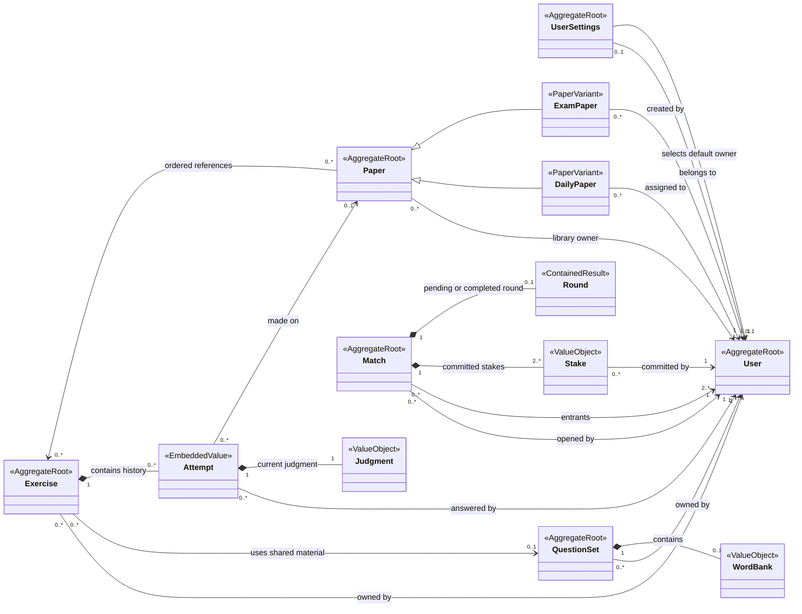
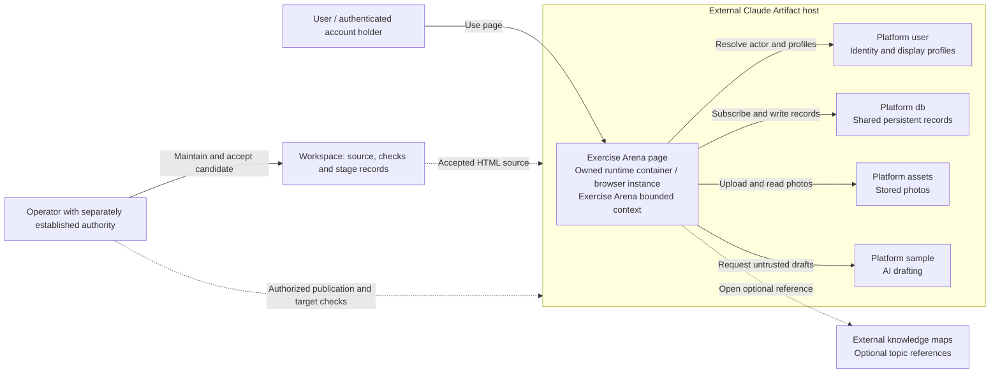
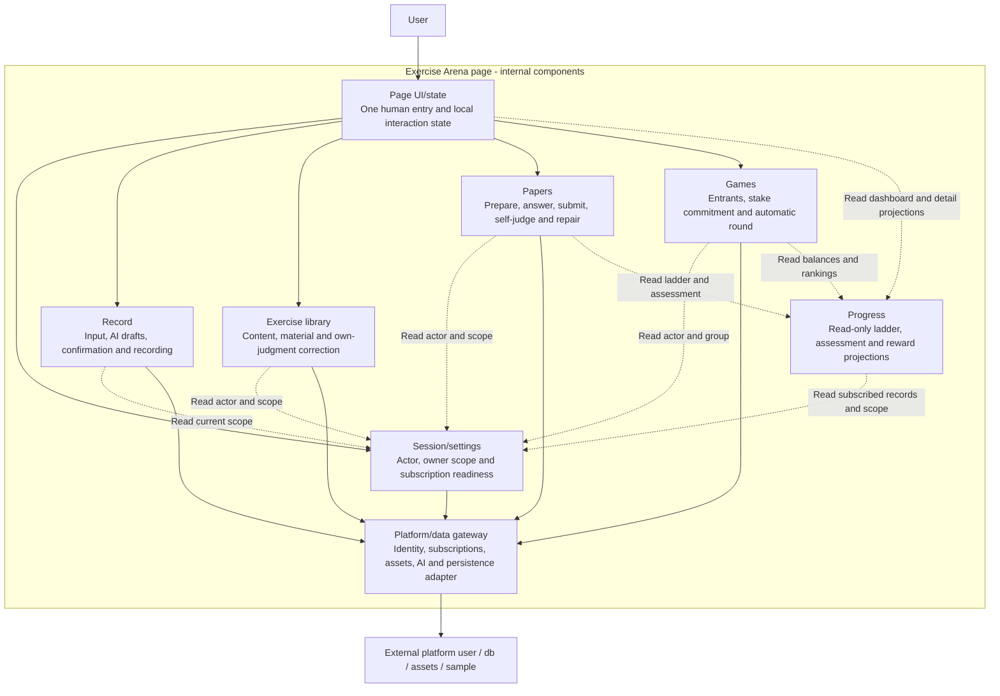

# 0039 Journey-led model review

> status: completed (2026-11-20)
> location: branch `develop`, baseline `e2e5626` (`develop`)
> confirmation: "confirmed. Proceed please." (2026-11-20), full design-only write-off, local verification and scoped commit; application code changes, production migration and publication excluded.

## Background and goal

User request: "review the journeys of this workspace, reshape them if necessary, and refine the model along each journey, reshape the model if necessary."

Review all six user journeys, both operator journeys, glossary, ADRs, domain, architecture, data contract, operation contracts, acceptance contract and their implementation counterparts. The baseline worktree was clean. The journeys and overview models were introduced in the most recent commit; the earlier data contract, glossary and implementation contain substantially more behavior.

Success for this discussion: every retained or added journey describes one person's goal, a meaningful end state, main steps, alternatives and material failures; every step traces to a runtime responsibility or support contract; the model explains identity, state, ownership, collaboration and failure boundaries without duplicating implementation algorithms. No rule is silently changed to match code.

Authorization: the user requested review and proposed reshaping, decided Q1-Q6 individually, and then confirmed the full design-only write-off, local verification and scoped commit. The final write-off below records the applied design. Application code, actual operate/verify entries, publication, production data repair and push remain outside this step.

Constraints and non-goals:

- Keep the Claude Artifact runtime and platform identity, database, assets and AI facilities unless the user explicitly reopens ADR 0001 or 0002.
- Q5 confirms both single-owner questions/sets with no cross-owner sharing and continued other-owner access through default-owner selection. Ownership and access are distinct: default owner is a content filter, not authorization, and selecting another library does not transfer its content. Do not invent student/parent permissions or represent a child as the authenticated account holder.
- Preserve embedded attempts and the known concurrent-write cost in ADR 0004. A logical writer does not imply a transaction, exclusive browser writer or conflict-free database.
- Do not add services, new games, variant questions, an agent-recording channel, live data migration or a generic operations framework.
- Preserve frozen records. Earlier decisions are evidence for reconsideration, not files to rewrite.
- This round proposes design edits. Runtime defects identified below need implementation and acceptance after the design is confirmed; a passing pure-logic test suite does not resolve them.

## Review findings

Findings cite the pre-write-off baseline `e2e5626`; journey/model line positions change during write-off. The marker-initialization qualification in F2 was verified during final fidelity review and corrects the earlier broader inference.

### F1 Shared-set cleanup and validation use an incomplete owner scope (high)

`DATA.md:60` says sets have no owner. `DATA.md:146` restricts exercise subscriptions to the selected owner. `impl/arena.html:1483` checks only those subscribed exercises before deleting a set; the delete and move-out handlers invoke that helper. Word-bank removal validation at `impl/arena.html:2819` also reads only that scope.

Conditional counterexample: a set S has exercise A owned by Alice and B owned by Bob. In Alice's scope, delete A. The helper sees no remaining members and deletes S, even though B still references it. Likewise, removing a word used only by B passes the visible-scope validation. A read-only VM simulation of the cleanup helper confirmed the first consequence; no platform data was accessed. Cross-owner references are permitted by the current schema, not evidence of an explicit sharing workflow. Actual occurrence in real data is unknown. The Q5 ownership clarification below distinguishes shared material among questions, multi-user access to one owner's content, and cross-owner references.

This is a runtime risk, not proof that production data has already been lost. Resolve the model's global-set versus scoped-membership boundary on Q5; do not hide it in an operator cleanup procedure.

### F2 Daily redo promises the wrong resume behavior and an incomplete goal (medium)

`journey/user/0002-do-todays-daily-redo.md:33` promises to resume the latest unsubmitted paper. `DATA.md:95` and `impl/arena.html:2722` instead generate a new current batch, carry matching responses, and delete old unsubmitted papers. The goal says complete today's due exercises, but the main scenario ends after one batch; `dailyLimit` is a per-subject batch size, not a daily cap.

There is a second failure boundary: submission saves attempts before the hand-in marker. In a modern paper with an explicit empty marker map, a failed marker write leaves saved attempts while the paper is still unsubmitted, and replacement can delete that paper. This was simulated with such a fixture, not demonstrated for newly created baseline papers: `makeDailyPaper` at `impl/arena.html:736` and Exam creation at `impl/arena.html:2861` omit the marker field, so `handedInAt` at `impl/arena.html:667` instead applies legacy inference and treats a saved attempt as submission. The final target must initialize new-paper marker maps explicitly to enforce the agreed distinction; absent-field legacy documents retain their inference without migration. The remote-tracking branch `github/claude/awesome-bohr-ur3hj4` advertises related unfinished work; it is not on this baseline and was not fetched, merged or verified.

Resolve the goal and ordinary replacement behavior on Q2, and partial-submission protection on Q4.

### F3 Handed in is not fully assessed (medium)

`impl/arena.html:2774` saves objective attempts and `impl/arena.html:2781` saves the hand-in marker; `impl/arena.html:2787` saves written-answer judgments afterward. A simulated mixed paper with a hand-in marker and only one of two judgments is correctly reported as handed in by `handedInAt`, while `paperProgress` is 1/2. `paperScore` at `impl/arena.html:745` excludes missing/deleted exercises from its denominator, but keeps existing unjudged questions in the denominator; those questions contribute no right/partial/wrong result yet. The distinction is incomplete assessment, not an inflated denominator-based score.

The journey success statements at `journey/user/0002-do-todays-daily-redo.md:6` and `journey/user/0003-take-a-check-paper.md:6` omit this distinction. Daily responses are cleared at hand-in; check-paper drafts are not persisted. Leaving before self-judgment can lose an unsaved written response, and the detail view only offers override for an existing attempt (`impl/arena.html:2455`). Recovery after leaving is not currently established.

Resolve a truthful completion boundary on Q4. Do not claim a hand-in marker establishes a final score or mastery assessment.

### F4 Existing goals have no journey, and actor/owner state is ambiguous (medium)

Editing/deleting exercises and shared material, inspecting attempt history, overriding one's own judgment, first opening with platform identity, and preparing a reusable check paper are established actions (`impl/arena.html:2814`, `impl/arena.html:2848`, `impl/arena.html:2851`, `impl/arena.html:2858`, `impl/arena.html:2949`, `impl/arena.html:3275`). They are absent or mixed into a different goal in the six bodies. `model/domain/DOMAIN.md:11` also omits the existing User aggregate and its relation to settings, exercise ownership, attempts and participation.

`todayScope` uses the acting user's ladder on the selected owner's exercises. Owner selection does not switch the authenticated user or display that owner's personal results as if they were the actor's. All progress remains limited to the subscribed owner scope (`DATA.md:148`).

### F5 Architecture loses the interactions that determine behavior (medium)

`model/arch/SCENARIO.md:39` places "right or partial answers do not" change the ladder under a combined daily/check scenario. This is true only for check answers; daily right answers advance it. The recording scenario omits assets, AI, confirmation, cancellation and partial writes. Settings, identity loading, progress reading and automatic retention have no scenario. Games are combined with repository maintenance/publication despite unrelated triggers and boundaries.

`model/arch/CONTAINER.md` mixes container inventory and component responsibilities; no owning component or runtime specification records session, submission and adapter failures. Resolve on Q3 without adding deployable containers.

### F6 Maintenance/acceptance/delivery boundaries and evidence are insufficient (medium)

`journey/operator/0001-maintain-and-verify.md:25` permits updating the model on drift, while its extension routes drift to discussion. A maintainer cannot decide a new rule merely to get tests passing. The same journey mixes producing an aligned change and accepting integrated behavior.

`model/verify/SPEC.md:22` and `verify/README.md:7` claim local checks cover all journeys. `impl/logic.test.js:4` extracts pure functions into a VM; it does not run DOM handlers, platform identity, subscriptions, uploads, AI, writes or publication. The deploy contract has no artifact inventory, accepted candidate identity or verified rollback entry. Resolve on Q6.

## Target model

Retain one bounded context and one deployed page. Reshape the journeys around goals, not tabs; describe the page's internal responsibility boundaries in one component model. Keep `DATA.md` as the sole owner of stored shapes and compatibility rules. Add a thin runtime specification for observable commands, adapter boundaries and failure behavior, referencing `DATA.md` rather than copying fields.

### Journey map



Edges describe prerequisites or optional use, not proof of implementation/acceptance status. The page can start with existing records; preparing a paper may be done by another user. This is a journey map, not the domain or architecture model; those views follow below. Q1-Q6 and the full design-only plan were confirmed; these views have been applied to authoritative journeys/models as recorded below. No rendering integration is configured; rendering remains unverified.

### Journey-by-journey derivation

Existing IDs are preserved; the new numbers below are now written to the authoritative indexes. Every body will have step-numbered person-facing messages, explicit prerequisites, meaningful success conditions and numbered extensions. Cross-journey dependencies will cite role and ID, not copy another body's steps.

| Journey | Proposed goal and main path | Material extensions and success boundary | Model responsibility and state |
|---|---|---|---|
| user/0001 | Record exercises for practice: choose new input or saved material, read with AI, verify material and drafts, decide duplicates, save, inspect saved exercises | Wrong questions remain the primary input; saved material may supply questions not previously wrong. Cancel/no parse, partial upload, validation and per-draft save failures retain unsaved work in the current session. Save all skips duplicate warnings; individual save is deliberate confirmation. Only successful writes count as recorded; actor chooses owner via settings; initial ladder due next day. New set/member ownership must agree; reject a retained draft's conflicting set reference after scope changes. Legacy sets cannot receive new members before validated ownership repair | Record -> platform AI/assets -> data gateway; Exercise, Question set, transient Draft and Saved material reference |
| user/0002 | Complete today's due redo: inspect actor's due work and any protected unfinished submission in selected owner scope, repair that submission first, start a subject batch, answer, submit, self-judge written items, review outcomes, repeat while due items remain | No due work is not proof all submissions finished; repair remains discoverable without due items. Batch limit does not cap the day; late practice uses actual attempt date. Untouched unfinished batches are replaced with overlapping answers carried. Partial write and incomplete marking are not completion; see Q4. Full goal ends when no due items or protected unfinished submissions remain and started batches are fully assessed, or explicitly reports a partially completed day | Papers + Progress; per-actor Review ladder; Daily paper, responses, attempts, hand-in marker and assessed completeness |
| user/0003 | Take an existing check paper: choose an available paper, answer, hand in, self-judge written answers, review score/details | Creation moves to user/0008. Each actor submits once; deleted questions and no remaining questions are explicit. Check wrong resets ladder; right/partial do not advance it; no coins. Interruption does not promise persisted check drafts or recovered self-assessment | Papers; shared Exam paper references, actor-specific attempts and completion |
| user/0004 | Understand my progress in selected owner scope: inspect workload, ladders, recent activity, weekly progress and newly mastered items, open details and return | No activity, scope changes and expired daily-paper details. Read-only goal; no implied editing. Actor's progress, not owner's personal history. Forecast is conditional on on-time right answers, not a fixed assignment; coin balance reflects spending and may be negative | Progress read-only projections over Exercise/Paper/Match; Streak, Mastery transition, Coin, Balance, weekly Starboard |
| user/0005 | Play one match: inspect eligible entrants and balance, choose opener's extra stake, start, watch or skip automatic round, inspect result/ranking | Only Lift has established playable rules; Sprint/Climb remain unavailable. At least two same-owner-scope eligible users including opener; other users need not be online. Start failure differs from result-write failure; committed stake stays spent if result fails. No guaranteed win, refund or online opponent decision | Games; Match, Stake, Round result; weekly/all-time Starboard |
| user/0006 | Configure my practice scope and batch size: inspect current settings, change one, observe save, wait for correct scope to load | Batch size 1-50, default 10. Malformed/missing owner falls back to actor, not a promise to validate all nonempty IDs. A save failure is not success. Owner change affects all scoped views and recording, not identity or permissions; another-device settings change reloads subscriptions | Session/settings -> data gateway; User settings and owner-scoped page session |
| user/0007 (new) | Keep the exercise library accurate: find an exercise, inspect content/material/history, edit and save or explicitly confirm deletion, verify result | Content edit preserves owner, attempts and creation dates/timestamps; no ownership-transfer feature is added. Validated material edits affect all same-owner members; subject/material/word-pick validity is preserved. Uncertain membership blocks destructive bank edits. Legacy set mutation/new links/cleanup remain blocked pending ownership repair. Deleting an exercise deletes its embedded attempts; set cleanup is separately conditional, and missing paper references remain visible | Exercise library -> data gateway; Exercise/Question set, preserved history and same-owner reference lifecycle |
| user/0008 (new) | Prepare a check paper for the selected library: choose subject/topics/count, preview available questions, create, inspect the saved paper | Insufficient pool reports actual count; zero available means no meaningful test and no successful journey. Before create, validate preview scope and current references against the selected owner's library; scope changes or unavailable/out-of-scope references require re-preview rather than saving old IDs under a new owner. Draw order and grouped layout remain executable rules. Creating is not taking; another user can take once. Paper stores references, not immutable snapshots | Papers -> data gateway; Exam paper, creator, owner scope, ordered exercise references |
| user/0009 (new) | Correct a judgment on my own saved attempt: open exercise history or paper details, inspect response/explanation, override, verify recalculated outcomes | Other users' judgments cannot be changed through this UI; no teacher role is introduced. Failure leaves old result authoritative. Correction replays later ladder effects and may change mastery, score, coins and balance; this is not a new attempt or a coin grant | Exercise library/Papers -> data gateway -> Progress; Attempt judgment mutation and dependent projections |
| user/0010 (new) | Open the shared arena with my account: access published artifact, platform supplies identity/capabilities, register user if needed, read own settings, load owner scope, see usable page | Sharing/sign-in belong to the account holder/platform. Missing db/identity or required snapshot failure is unavailable, not an empty library. Registration/name lookup/AI/assets availability have distinct limits. No guarantee of full large-collection snapshots, child account eligibility, automatic retries or offline use | Session/settings + platform gateway; User root, display-only profile, readiness and subscription generation |
| operator/0001 | Maintain an aligned change: read authorized design and map pairs, change within authority, run checks/tests, inspect affected behavior, record implementation result | New rule/contract gaps return to discussion; do not rewrite a test or model to conceal drift. Toolkit drift goes to design-init. Passing checks finishes maintenance evidence, not integrated acceptance or publication | maintain contract; repository, checker, pure-logic tests and implementation record |
| operator/0002 | Publish an accepted candidate: identify candidate and matching acceptance evidence, confirm target/publication authority, publish, inspect actual target, record delivery | Failed upload, target mismatch and failed post-publication check are different outcomes. Do not assume the previous version remains after a successful upload. Rollback requires an available prior source/version and separately established authority/entry | deploy contract; source HTML -> accepted candidate -> target Artifact; acceptance and delivery records |
| operator/0003 (new) | Accept an integrated slice: select baseline/candidate and implementation record, choose journey coverage, obtain sandbox/runtime prerequisites, execute entries, record verdict and uncovered boundaries | Local VM functions are a substitute for runtime integration. No runtime credentials/authorized test data means that boundary remains unverified. Test writes and publication need explicit scope/authorization. Rejection returns defects or design gaps, not silent fixes | acceptance contract; verification record, deploy-provided test candidate, no new support work group |

### Domain and architecture refinement

- User is the platform-identified participant with a registration root and settings. Owner, paper creator, paper assignee, attempt author and match opener are different stored relations to that participant; none is a permission role. Recorder is the current command actor only: exercises do not store a recorder ID, and this review does not add recorder provenance.
- Keep Exercise, Question set, Paper, Match and User settings roots, and add the already-stored User root. Attempt and Judgment are embedded values; Review ladder, progress, paper completeness, Coin/Balance and Starboard are derived state/read models, not independent aggregates.
- Daily and check papers share the Paper root but have distinct scope, draft durability, completion and ladder effects. Hand-in acknowledgment and full assessment are different facts. Papers reference mutable/deletable exercises; they are not historical content snapshots.
- Q5's agreed target gives each Question set one content owner; every member Exercise must have that same owner, and cross-owner sharing of questions/sets is unsupported. Material may still be reused among questions within that set. The baseline schema has no set owner and permits cross-owner references. Preserve existing legacy practice with a warning, but block set mutation, new member links and automatic set deletion until valid stored ownership and membership are established; repair is deferred and separately authorized. Other authenticated users may still access that owner's library through default-owner selection; access is not ownership transfer or a cross-owner reference. Per-user ladders remain per exercise, not per set; no stronger access enforcement is implied by a content-owner field alone.
- Put conceptual relations and cross-record invariants in `DOMAIN.md`, not stored field tables or copied sort algorithms. Keep glossary definitions brief, with equivalent English/Chinese names; add only missing domain terms used in the model.
- Give the page logical components: Page UI/state (one entry), Session/settings, Record, Exercise library, Papers, Progress (read-only), Games and Platform/data gateway. The gateway is the sole logical persistence adapter; coordinators request validated commands. This is a responsibility map of the existing single HTML page, not a mandate to split source files or serialize multiple browsers.
- Platform db, assets, AI and identity remain external black boxes; knowledge maps are optional references, not boot dependencies. External fonts are presentation dependencies with existing local fallbacks, not a new domain component.
- Separate runtime scenarios: boot/scope reload; new-input recording; saved-material recording; library edits/deletion; daily batch/replacement/submission; check creation; check taking; judgment override; progress reads; match start/result; settings save; page-triggered daily-paper retention. Map each to journey step numbers at write-off.
- Retention is a page runtime trigger, not a server schedule or an operator cleanup service. It deletes only the actor's submitted daily paper documents older than the configured 30-day boundary in the current owner subscription; attempts survive, and failed deletions are currently best-effort.

### Domain model

One bounded context, Exercise Arena, owns the practice and competition rules. The conceptual model below separates six aggregate roots from their contained values and optional references. It does not introduce new collections or make document references database-enforced foreign keys.



The class diagram describes target records and new one-round matches, including the agreed Q5 Question set owner relation, which is absent from the baseline schema. Q5c preserves legacy read/practice compatibility without inventing owners for cross-owner or memberless sets; even a uniquely inferred candidate owner is not written automatically. No live migration is authorized. Legacy missing creators/stakes and historical multi-round matches remain readable under `DATA.md`. A reference can become unresolved after deletion. User settings may have no stored document, in which case effective defaults apply. Daily/Exam paper are variants of the same aggregate, not separate tables. Judgment is part of an Attempt, not a separate audit trail or collection. Recorder provenance and immutable paper snapshots are not added. Detailed classification concepts remain the existing Subject, Topic, Concept, Question type, Answer format and Error cause, with IDs owned by `TAX`.

| Aggregate | Logical write boundary | Journey commands |
|---|---|---|
| User | Platform/data gateway registers platform identity; no stored display-name authority | user/0010 open |
| User settings | Session/settings requests gateway save for the acting user | user/0006 configure, user/0010 read defaults |
| Exercise | Gateway writes content and embedded attempts; other components do not independently persist their own copies | user/0001 record; 0002/0003 answer; 0007 edit/delete; 0009 override |
| Question set | Gateway validates stored owner and same-owner references, material/word-bank edits and conditional last-member cleanup; preserves restricted legacy compatibility without automatic repair | user/0001 record/supplement; user/0007 edit material; existing member practice in 0002/0003 |
| Paper | Gateway writes ordered references, draft state and per-user hand-in acknowledgment; assessment is derived | user/0002 daily; user/0008 prepare; user/0003 take; runtime retention |
| Match | Gateway writes committed entrants/stakes, then the automatic round result | user/0005 play |

"Logical write boundary" identifies one persistence responsibility inside the page. It does not mean one active device, serializable global writes or an atomic transaction across these aggregates. Content edit preserves embedded attempts; override mutates the acting user's existing judgment rather than appending a new answer.

| Derived model | Inputs and rule boundary | Journeys served |
|---|---|---|
| Review ladder and mastery | Exercise creation date plus one actor's daily attempts and wrong check attempts; no set-wide or owner-wide ladder | user/0002, 0003, 0004, 0009 |
| Daily redo selection | Actor's ladder on selected owner's exercises, current local date, subject and effective batch size | user/0002, 0006 |
| Paper assessment | Existing referenced exercises, actor's saved judgments and hand-in acknowledgment; acknowledgment is not complete assessment | user/0002, 0003, 0004, 0009 |
| Progress and streak | Actor's attempts/mastery transitions within subscribed owner scope; forecasts are conditional | user/0004 |
| Coin and Balance | Weekly daily-attempt rewards minus committed match stakes; corrections and concurrent starts can make balance negative | user/0004, 0005, 0009 |
| Star and Starboard | Persisted match rounds, time period and participating users' default-owner grouping; not a prize-money ledger | user/0004, 0005 |

Cross-aggregate invariants and failure limits:

1. Selected owner determines the content scope; the authenticated actor determines whose attempts/ladder are derived. Switching owner does not switch identity or grant permissions (ADR 0002; user/0006 and 0010).
2. Exercise and Question set are separate roots: new/validated members have the set's owner and subject; material is reused within that owner, not across owners. Each actor's per-question ladder progresses independently (ADR 0003; user/0001, 0002 and 0007). Q5's conditional cleanup/edit policies require verified ownership/membership. Q5c's legacy compatibility permits existing references to remain readable without endorsing new cross-owner sharing; ownership repair and concurrent reference-integrity guarantees are not supplied by this review.
3. Paper references are not snapshots. Deleting an Exercise removes every user's attempts on it; paper details show missing references, and scores count remaining exercises only (user/0007; `DATA.md`).
4. A Daily paper is assigned to one actor; an Exam paper can be taken once by each actor in its owner scope. At creation its Exercise references must belong to the selected owner's current library; a retained preview cannot be saved under a different owner. Both store attempts in Exercise, not Paper (ADR 0004; user/0002, 0003 and 0008). This validation does not make paper content immutable or prevent subsequent deletion/concurrent changes.
5. Saving an Attempt and saving Paper hand-in are separate writes. Q4 agrees a protected partial-submission state and discoverable repair entry; it does not change the legacy marker meaning or promise cross-session recovery of unsaved written answers.
6. Match start commits stakes before its round result. Failed result persistence does not cancel the earlier spending; derived eligibility/balance does not provide concurrent overspend prevention (user/0005).

### Architecture model

**Container view.** The only workspace-owned deployed runtime unit is the Exercise Arena page, running in each user's browser inside the Claude Artifact host. Its one domain context lives there. Database, assets, identity and AI are platform-provided services, not additional containers we build or deploy. Repository maintenance/acceptance/publication are support flows, not in-page components.



The dashed support edges indicate manual artifact supply/publication, not a runtime repository dependency or a verified automatic deploy integration. The deploy contract owns the actual source-to-target artifact flow. Platform sharing/account eligibility remain external responsibilities. Missing db/identity prevents ordinary use; assets/AI/profile/reference availability have narrower degradation boundaries described by the runtime SPEC. External font delivery is a presentation dependency with local fallbacks and is omitted from the domain view.

**Component view.** These are logical responsibilities inside the same page, not newly deployed services or a requirement to split the HTML source. The UI is the human entry; coordinators own journey behavior; the gateway owns platform access; progress is read-only. Solid links denote commands/platform calls; dashed links denote read access to session state/projections.



Session owns the current subscribed record view and readiness/generation state; it is not another persistent store. Gateway-delivered snapshots update that view. Coordinators validate requested domain actions and request writes through the gateway. Gateway acknowledgment does not make a multi-root operation atomic. Page-triggered daily-paper retention belongs to the Papers responsibility, using the same gateway and subscribed session view; it is not an operator service. Snapshot refresh causes projections to be derived again, not a durable event bus.

**Interaction view: partial daily submission (agreed Q4 direction).** This interaction exposes the Exercise/Paper write boundary that a static component view cannot show. It illustrates user/0002 and the gateway; the owning scenarios will carry journey step numbers at write-off.

```mermaid
sequenceDiagram
    actor U as User
    participant UI as Page UI
    participant P as Papers component
    participant S as Session and subscribed view
    participant G as Platform/data gateway
    participant D as Platform db
    U->>UI: Hand in a daily paper
    UI->>P: Submit actor's responses
    P->>S: Read paper and actor's already-saved attempts
    loop Each missing objective attempt, stopping at first write failure
        P->>G: Save one judged attempt in its Exercise
        G->>D: Write embedded attempts
        D-->>G: Write acknowledgment or failure
        G-->>P: Per-question outcome
    end
    alt Some attempt write failed
        P-->>UI: Retry in this session; protect on restart only if actor attempts are saved
    else All objective attempts saved
        P->>G: Save actor's hand-in marker on Paper
        G->>D: Write Paper acknowledgment
        D-->>G: Write acknowledgment or failure
        G-->>P: Marker outcome
        alt Marker failed
            alt Paper has saved attempts by this actor
                P-->>UI: Protect unfinished submission; recovery remains available without due questions
            else No saved actor attempts, such as an all-written paper
                P-->>UI: Retry here; untouched-draft replacement policy still applies on restart
            end
        else Marker saved
            P-->>UI: Handed in; written questions may still need judgment
            U->>UI: Self-judge written answers in this session
            UI->>P: Save own written judgments
            P->>G: Save missing written attempts
            G->>D: Write embedded attempts
            D-->>G: Per-write outcomes
            G-->>P: Saved or still incomplete
            P-->>UI: Fully assessed only when every remaining question has a saved judgment
        end
    end
    Note over P,D: Separate document writes, not a transaction; partial effects and concurrent overwrite remain possible
    Note over UI,P: On reopen, restore saved attempts/results and retry missing writes; unsaved written-answer recovery is deferred
```

The pattern also separates acknowledgment from complete assessment for Exam papers, but Q4's protected-paper restart behavior specifically concerns Daily papers. Q5 separately governs owner-scoped set edits/deletion and legacy compatibility. Agreement on those directions does not authorize full-plan write-off. Record/AI/assets, boot/owner reload, check creation/taking, override, progress, matches and retention still require their own owning runtime scenarios rather than being represented as variants of this submission interaction.

### Runtime specification outline

`model/arch/arena/SPEC.md` will own observable runtime contracts and point to `DATA.md` for stored fields, timestamps, deprecated fields and legacy inference. It will not repeat the data tables, taxonomy or test algorithms.

| Contract | Required boundary |
|---|---|
| Open/reload scope | Identity and own settings before owner subscriptions; distinguish not ready, empty and unavailable; cancel old subscription generation. Owner-scoped set loading must retain/fetch referenced legacy material for existing questions, not drop it merely for lacking owner. First scoped snapshot cannot prove complete cross-owner membership; registry/profile failures do not confer permissions |
| Read input/save drafts | AI output is untrusted until confirmed; cancellation and upload/parse failures preserve retryable session input; asset/set/exercise writes are not atomic; enumerate successful and failed draft writes; orphan assets/sets are possible, not automatically cleaned. Validate set/member owner and subject when creating or changing a set reference; a scope change cannot silently relink retained drafts, and unresolved legacy sets cannot receive new members. Ordinary edits may preserve an existing compatible legacy reference and owner/subject under the Exercise edit contract; this does not permit legacy set mutation or ownership repair |
| Edit/delete content | Preserve owner and embedded attempts on edit; delete consequence is explicit. Q5 permits validated same-owner material edits and bank changes preserving every member answer; unchanged fields are not rewritten from stale forms. Last-member cleanup requires valid ownership and complete current empty membership; retain on uncertainty. Q5c blocks legacy set mutation/new links/cleanup pending repair; no implicit concurrent-write safety or immutable-paper promise |
| Start daily batch | Per-actor/owner/subject scope; cap each batch; replace untouched drafts and carry overlapping responses; create before deleting superseded paper; Q4 protects partially saved submissions with a recovery entry independent of current due count; legacy mixed-subject papers remain readable but are not resumed |
| Submit/self-judge/override | Separate draft responses, saved attempts, hand-in marker and full assessment; objective autoscore versus written self-score; in-session retry skips existing actor/paper attempts; failures can have partial effects; override changes own existing attempt. Q5c permits actor attempt/judgment writes on existing legacy references without changing set content or ownership; concurrency risks remain explicit |
| Prepare/take check paper | Preview actual available references; validate preview owner/generation and current owner-scoped references before create. Scope change or unavailable/out-of-scope questions requires re-preview, not silent cross-owner reference creation. Per-user submission; no durable pre-submit check draft at baseline; no award for right/partial check result; wrong resets ladder; incomplete marking is not a final assessment |
| Read progress/rewards | Actor projection in selected content scope; conditional forecast; distinct count denominators; weekly boundaries/device-local date; Q1 authority split; late corrections may change balance |
| Start/finish match | Eligibility and stake captured at start; result persisted before animation; result failure does not refund or resume at baseline; stale concurrent balances can overspend; missing supporting snapshots cannot prove fair eligibility |
| Persist settings/retain papers | Write acknowledgment before saved indication; owner reload across views; retention prerequisites and best-effort deletion; runtime cleanup is not deployment or maintenance authorization |

Internal cache choices, helper layout, animation implementation, exact draw/tie/duplicate algorithms and source modularization remain delegated to implementation within these observable boundaries. Preserve tested numeric behavior and existing source provenance.

## Decisions for the user

Agreement excerpts preserve the one-by-one authorization boundaries at their respective milestones. The header and final write-off record the later full-plan confirmation.

### Q1 Where should refined rules be authoritative?

Evidence: the managed guide makes journeys/models authoritative; the workspace map says page behavior follows `impl/logic.test.js`; frozen discussion 0007 D5 explicitly chose executable page rules, and D6 retained root `DATA.md`. A new runtime spec must not accidentally restore the previously declined duplicate algorithm manual.

**Decision (user, 2026-11-20):** clarify `CLAUDE.md` below the managed block: journeys define intended goals/outcomes; the domain model defines concepts, relationships and invariants; the architecture/runtime model defines responsibilities, interactions and failure boundaries; `DATA.md` owns stored shapes, writing rules and compatibility; code/tests own detailed algorithms and executable cases within those contracts. Tests cannot silently override an agreed journey/model contract. A contradiction is a discussion gap, not an instruction to silently rewrite either side. Keep taxonomy IDs in `TAX`. Keep `DATA.md` at its established path and reference it from the thin owning runtime spec, without duplicating tables or writing an algorithm manual.

Alternative: leave all page semantics in tests and add only relations/trace links to the model. Lower writing cost, but weak failure/interaction contracts remain hard to review. Moving all tables into a new SPEC has no necessary benefit here and is declined.

Agreement excerpt: "It looks good." (2026-11-20), responding to the Q1-only authority proposal. This settles Q1, not Q2-Q6 or permission to apply the full write-off plan. No authoritative file is changed until that plan is confirmed.

### Q2 Reshape into ten user goals without renumbering existing bodies?

**Decision (user, 2026-11-20):** refine user/0001-0006 as above; add library maintenance (0007), check preparation (0008), own-judgment correction (0009) and opening/access (0010). Keep settings together as configuring one's practice; keep recording new input and saved material as alternatives toward the same saved-exercise goal. Split preparing a reusable check paper from taking it, and content correction from saved-judgment correction. Make daily redo cover successive batches, not just one paper. Preserve existing IDs; no new screen or capability is implied by the four additional goal bodies. Submission recovery and shared-set safety remain Q4/Q5 decisions.

Alternative: put the four uncovered goals into extensions of existing bodies. Fewer files, but edits, onboarding and reusable paper creation would remain subordinated to unrelated success conditions. Do not split every screen/button into a journey.

Proposed write-off detail: the first usable loop's current row includes only daily steps 1-4, omitting saved outcomes. Update its scope to opening/access, recording, and the complete daily main path with failures/self-judgment; keep checks, library maintenance, games and configuration outside this minimum loop except their prerequisite settings defaults. This detailed scope row remains subject to full-plan confirmation; do not describe today's baseline as already accepted.

Agreement excerpt: "It looks good. much better than before~" (2026-11-20), responding to the Q2-only ten-goal proposal. This settles journey grouping and stable IDs, not Q3-Q6 or full-plan write-off. New IDs are agreed for the proposed plan but are not yet written to authoritative indexes.

### Q3 Retain one context/page and make the internal model traceable?

**Decision (user, 2026-11-20):** retain ADRs 0001-0004, one bounded context and one deployed page; move internal responsibility descriptions from the container overview to `model/arch/arena/COMPONENT.md`, add the thin runtime SPEC, expand scenarios by actual trigger and complete the conceptual domain model. Distinguish the six existing stored aggregate roots from embedded values and derived state, the owned page from external platform services, and journey coordinators/read-only projections from the logical persistence gateway. No service split, new collection, second database, event bus or formal context map is required; source modularization remains an implementation choice.

Costs: two additional model files and explicit scenario coverage, but no required deployment or source-layout change. Separate practice/competition contexts could live in the same page; they would add ownership and integration contracts without a demonstrated benefit for the current scope. Keeping one context is not a claim that bounded contexts and deployable containers are the same boundary.

Agreement excerpt: "Agreed" (2026-11-20), responding to the Q3-only model-boundary proposal. This settles the structural recommendation, not Q4/Q5 recovery/shared-data rules, Q6 support boundaries or full-plan write-off. The component/contract model is agreed as a design direction; no authoritative file or implementation is changed yet.

### Q4 Make completion truthful, and protect partially saved daily papers?

Walkthrough order: assessment completion (Q4a), then partial-submission protection and its limited recovery scope (Q4b). Both are now agreed individually; neither agreement authorizes full-plan write-off.

#### Q4a Assessment completion

**Decision (user, 2026-11-20):** distinguish "handed in" (the actor's submission marker is persisted) from "fully assessed" (every remaining question has the actor's saved judgment). Preserve the marker's existing/legacy meaning. Daily and check paper-taking success requires full assessment, not just hand-in; pending written judgments must remain explicit and incomplete assessment must not be represented as final. Existing unjudged questions remain in the score denominator; no remaining questions is an empty/deleted-content case, not evidence of mastery. The completion distinction is derived, not a new stored score/status field.

Agreement excerpt: "Yes, I agree" (2026-11-20), responding to the Q4a-only completion proposal. This does not approve response durability, restart protection or full-plan write-off.

#### Q4b Partial-submission protection and recovery scope

**Decision (user, 2026-11-20):** preserve ordinary fresh-batch replacement for untouched drafts, but never delete/replace an unsubmitted daily paper containing this actor's saved attempts. Offer an explicit recovery entry on Today for protected papers in the current actor/owner scope, even when all their objective attempts have already advanced the ladder and no exercise is due (`redoButtons` at `impl/arena.html:1586` currently hides a subject with no due items). Reopen the most recent protected paper for that subject, restore already-saved responses/judgments from attempts, and retry only missing writes/marker before allowing a new batch in that subject; expose additional protected papers if present rather than deleting them. Already-saved answers must not be rejudged from an empty response buffer. No due items alone is not a completion criterion while a protected submission remains. This deliberately changes the destructive restart boundary in `DATA.md:95`; implementation must test it, including another-device deletion and marker failures. External deletion remains an explicit failure, not a promise to reconstruct a removed paper.

Agreed recovery scope: complete written self-judgment in the current session. Persisted cross-session recovery of unsaved written answers/check drafts is **deferred and unverified**, not promised by these edits. Q4a's agreed completion distinction does not imply that this recovery already exists. If the user later needs it in this slice, reopen Q4b and design response retention plus a marking entry before write-off. The agreed protection is not a transaction or concurrent-device conflict solution.

Alternatives: keep the current destructive failure boundary as an explicit limitation; or redesign submission/draft durability end-to-end. The narrow protection prevents a known reference-loss path without claiming transaction safety; full recovery costs wider schema/UI and acceptance work.

Agreement excerpt: "Yes, I agree." (2026-11-20), responding to the Q4b-only targeted-protection and broader-draft-recovery deferral proposal. This settles Q4b, not Q5/Q6 or full-plan write-off. No authoritative design or implementation file changed.

### Q5 Clarify set ownership before cleanup and editing

Walkthrough order: ownership and continued other-owner access (both now agreed), then revised set cleanup (Q5a), material/word-bank editing (Q5b), and necessary legacy ownership handling. Agreement on one must not be recorded as approval of the others. The earlier ownerless/cross-owner-based retention and add-only recommendations below are withdrawn in favor of the user's single-owner/no-sharing rule.

#### Prerequisite: intended set ownership

User question (2026-11-20): "Why 'sets are shared'? I thought 'sets' are imported by a specific user and belong to a specific owner. When and how will a set be shared to another user/owner?"

Verified distinctions:

- ADR 0003's shared material means several questions reuse one passage, diagram or word bank; it does not establish a cross-owner sharing action.
- Current `DATA.md:60` explicitly says sets have no owner and only exercises do. New-set persistence at `impl/arena.html:2986` stores neither owner nor importer ID; member exercises receive the current default owner at save time (`impl/arena.html:3004`). The importing actor and content owner can differ.
- Frozen discussion 0010 D8 explicitly selected no set owner, with one recording batch initially using the same owner and historical per-exercise owner changes allowed. It is evidence of the existing decision, not a record to rewrite. The current edit form no longer exposes an owner selector, although the underlying save path retains an exercise's owner property.
- Another user can select the same default owner and work on that owner's existing exercises/material; this is access to the same content, not sharing/copying a set to a new owner. Current saved-material selection only lists sets with members in the subscribed owner scope (`impl/arena.html:1329`). There is no explicit Share set command or owner-specific set copy in the current UI.
- A cross-owner reference can nevertheless arise incidentally: create supplementary drafts from owner A's saved set; switch default owner to B before saving; the draft retains its set reference, while the new exercise is saved under B. Source chain: `impl/arena.html:3254`, `impl/arena.html:2700`, `impl/arena.html:2912`, `impl/arena.html:1512`, `impl/arena.html:2990`, `impl/arena.html:3004`. A VM simulation of the actual validation/save helpers with a retained set reference and changed default owner confirmed this write is allowed. This is not an end-to-end UI/live-data test.

Correction: "globally shared" was too broad as a product description. The supported current fact is ownerless material referenced by exercises, with no explicit cross-owner sharing lifecycle. Cross-owner reuse is structurally possible but must not be treated as an agreed user goal. The prior cleanup finding remains conditional on such references existing.

**Decision (user, 2026-11-20):** each Question set has one content owner, all its member Exercises have that same owner, and cross-owner sharing of questions and sets is unsupported. Agreement excerpt: "yes. We still don't allow share of questions and sets.", responding to the single-owner invariant question. This replaces the draft's ownerless/cross-owner reference target; it does not approve a copy/share feature, creator-provenance schema, migration, cleanup policy or full-plan write-off.

Ownership write-off must update set relations, owner-scoped loading/reference validation, recording/supplementation and owner changes. Switching default owner must not save a retained A-set draft as a B-owned exercise referencing that A set. Legacy ownerless, mixed-owner and memberless sets require explicitly decided compatibility/repair behavior; no automatic production reassignment is authorized. Q1-Q4 and Q3's single-context/page/component direction remain agreed.

**Access decision (user, 2026-11-20):** continue allowing authenticated users to select another content owner's library through Default owner, with the established view/practice/edit access in ADR 0002. Agreement excerpt: "Yes.", responding to "Should users still be allowed to select another owner's library through 'Default owner'?" No ownership transfer, cross-owner set references, separate share command or stronger access-isolation requirement is introduced. Own-attempt judgment restrictions remain unchanged. This settles the access clarification, not cleanup/editing/legacy-data rules or full-plan write-off.

#### Q5a Owner-scoped set cleanup (reopened)

Superseded recommendation (2026-11-20): retaining all ownerless sets to protect another owner's member is no longer the target policy. With the agreed owner invariant, valid members belong to one owner. The agreed cleanup boundary below replaces the earlier blanket-retention proposal; it is not approval to purge existing orphan/legacy sets.

**Decision (user, 2026-11-20):** after deleting a member Exercise or removing it from its set, automatically remove the set document only when that set has a valid owner and its complete, current owner-scoped membership can be established as empty. If members remain, preserve the material. Missing/ambiguous legacy owner, mixed-owner references, unverified snapshot completeness or failed membership reads defer cleanup and retain the set; the Exercise change may still have succeeded and must be reported separately. This is command-triggered last-member cleanup, not a background purge of all orphan sets, and does not delete assets.

A membership read is not a transaction. Concurrent member creation/removal can race with cleanup; no atomic referential-integrity guarantee is claimed. Before implementation enables the successful deletion branch, verify that the actual runtime can establish complete owner-scoped membership; otherwise use the retain/defer branch. Strong concurrent deletion safety, if required, reopens this choice for a proven write protocol rather than being inferred from an owner field. Any policy that retains ambiguous sets has a storage cost. No production repair, migration or asset deletion is authorized by this proposal.

Agreement excerpt: "yes." (2026-11-20), responding to the Q5a-only conditional last-member cleanup proposal and retain-on-uncertainty boundary. This settles Q5a, not Q5b editing, legacy ownership handling, Q6 or full-plan write-off.

#### Q5b Owner-scoped word-bank and material edits (reopened)

Superseded recommendation (2026-11-20): the add/reorder-only rule based on invisible other-owner members is withdrawn. All valid members now belong to the set's owner.

**Decision (user, 2026-11-20):** routine set-content editing preserves owner, subject, creation dates/timestamps and member Exercise attempts; changing ownership is not part of the material editor. Permit existing title/source/material/photo/word-bank edits only while material remains available and all same-owner members remain valid. A word-bank change may add, reorder or remove words, but every member word-pick answer must still be present. If any answer would be invalidated, reject that set save and identify the affected questions; adjust their answers through the existing Exercise edit path before retrying. Do not automatically rewrite answers, rejudge attempts or reset ladders.

Validate against complete, current same-owner membership for destructive bank changes; when ownership or membership cannot be established (including ambiguous legacy references), block the affected edit rather than assume it is safe. Unrelated title/material edits must not overwrite unchanged owner, subject or word-bank fields from a stale form. Successful deliberate material edits apply to all member questions in that owner's library, not to other owners' content. The exact field-update implementation is delegated within these preservation boundaries; no new edit screen, sharing feature or automatic content migration is implied.

Concurrency limit: the platform has no demonstrated transactional set/word-bank update. Two simultaneous bank additions can still overwrite each other's newly added entries; member edits can race with a set edit. The invariant describes intended serial behavior, not a global concurrent guarantee. Record this distinct residual risk in the runtime/data contract and do not generalize ADR 0004's attempt-specific rationale to claim it is solved. Strong concurrent reference integrity is deferred; if required now, reopen Q3/Q5 for a proven write protocol/platform boundary rather than approve this limited policy.

The confirmed owner relation, cleanup and Q5b editing rules change `DATA.md` and are not cosmetic rewrites. Material changes affect all member questions within the owning library, not a global cross-owner material pool. No global mutation audit or maintenance/repair operation is authorized here.

Previously declined owner-specific sets are now the user's selected target. The earlier alternative of retaining cross-owner references is declined by that decision. Migration and legacy-reference classification are newly required design work, not authorized production operations; the owning-container count and collection count need not change.

Agreement excerpt: "agree." (2026-11-20), responding to the Q5b-only material/word-bank editing proposal. This settles Q5b, not legacy ownership handling, Q6 or full-plan write-off. No authoritative design, implementation or production data changed.

#### Q5c Legacy ownership compatibility and repair

Evidence: existing `sets` records have no owner (`DATA.md:60`), while the page subscribes to only the selected owner's Exercises (`DATA.md:146`; `impl/arena.html:3305`). A single owner's visible member list is not evidence that a legacy set has no other-owner references. The incidental cross-owner save path verified above makes this a material compatibility boundary, although real-data incidence remains unknown.

**Decision (user, 2026-11-20):** preserve legacy records and distinguish read compatibility from ownership repair. For a legacy set without a stored owner, infer a candidate owner only when a complete, current membership read across all owners establishes at least one member and every member has the same valid owner. The candidate is not a stored ownership assignment. Such legacy mixed-owner, memberless, invalid-owner, incomplete or failed-read cases remain unresolved; neither the current actor nor Default owner supplies a missing owner. A conflicting stored owner also remains unresolved rather than being silently replaced. A valid explicitly owned set with verified empty membership instead follows Q5a; it does not require ownership inference.

Existing member questions may still display their referenced legacy material and accept the actor's answers/judgments under the existing practice contract, with an explicit legacy-ownership warning. This read compatibility does not endorse cross-owner sharing. Until a valid stored owner and same-owner membership are established, block set-content/word-bank mutation, new member references and automatic set deletion. Preserve unresolved references visibly rather than inventing missing material; do not alter attempts, ladders or paper history to conceal a compatibility problem.

These restrictions apply to set mutation and new links, not a blanket ban on editing an existing Exercise. An ordinary Exercise edit may preserve its existing compatible legacy reference, owner and subject while satisfying the established content/answer validation and history-preservation contract. Attempt/judgment writes likewise remain permitted. Do not apply new-link ownership validation retroactively to reject these unchanged-reference writes.

Persisting a legacy owner is a separately scoped repair/migration, not an automatic write on page opening or owner selection. A later authorized repair may assign the uniquely evidenced owner after revalidation. Ambiguous cases need explicit resolution; no automatic splitting, copying, owner reassignment, reference detachment, orphan purge or asset deletion is authorized here. This discussion defines the compatibility/repair boundary, not a new repair tool or permission to inspect or mutate production data. Complete cross-owner membership access and revalidation remain implementation prerequisites, not established platform guarantees.

Cost: legacy practice remains available, but supplementation and material editing may be unavailable until ownership is repaired. Declined alternatives: assigning Default owner can misattribute content; silently splitting/copying ambiguous sets introduces unrequested content migration and sharing semantics. The gateway owns this compatibility boundary within Q3's existing single context/page.

Agreement excerpt: "Yes, we keep it for now." (2026-11-20), responding to the Q5c-only conservative compatibility-and-repair proposal. Retain legacy sets with the compatibility limits above and defer ownership repair. This settles Q5c, not Q6 or full-plan write-off, and does not authorize production reads, migration or repair. No authoritative design or implementation changed.

### Q6 Separate maintenance, acceptance and delivery, and stop overstating tests?

**Decision (user, 2026-11-20):** retain operator/0001 for producing an authorized aligned change, retain operator/0002 for delivering an accepted candidate, add operator/0003 for integrated slice acceptance. The same person may perform all three distinct goals; no separate team or approver role is introduced. Use the existing maintain/deploy groups; acceptance belongs in `model/verify/SPEC.md`, not a new operations group. Expand deployment's artifact flow, target identity, candidate/acceptance evidence and stop/rollback boundaries.

Map pure-logic checks to the helpers they actually cover; require runtime walkthrough evidence for identity, AI/assets, scoped subscriptions, actual writes, partial submission, same-owner set edits and legacy compatibility, retention and matches as affected by the slice. Pre-delivery acceptance uses an authorized test candidate, not an unaccepted live production upload. Runtime credentials/test-data scope must be supplied or the boundary stays unverified. Record results under the established stage records; keep child material, field logs and credentials out of the repo.

Alternative: keep maintenance and acceptance in one body but give them separately identifiable outcomes/records. Fewer files, weaker stage boundaries; there is already a distinct acceptance contract and publication requires accepted evidence.

No rollback mechanism is claimed to work until its target entry is verified; no publish authorization is requested in this discussion.

Agreement excerpt: "yes." (2026-11-20), responding to the Q6-only separation and evidence-standard proposal. This settles Q6, not full-plan write-off or publication. Runtime evidence remains required for affected integrated behavior; local logic tests do not establish platform integration. No authoritative design or implementation changed.

## Write-off
<!-- write-off -->

All Q1-Q6 decisions and the full design-only plan were confirmed (2026-11-20). The user's "confirmed. Proceed please." authorized the rows below, the minimum-loop scope, verification and scoped local commit. Agent-selected fidelity details and mapped entries were included. Design edits are applied; Q4/Q5 implementation gaps are explicit, and no runtime acceptance is claimed. Ownership repair, application code and actual operate/verify entry changes remain downstream/separately scoped.

| # | Question | Target | Change | Verification | Actual result and verification |
|---|---|---|---|---|---|
| 1 | Q1, Q6 | `CLAUDE.md`, workspace-owned map below managed block | Clarify authority boundaries, retain root DATA and executable-algorithm precedent; map impl source/tests, active operate maintain/deploy paths and verify entries to paired models and exact commands/manual entry, distinguishing current gaps from accepted evidence | Managed hash unchanged; source/support/acceptance pair and conflict check; ./check.sh | Written; managed block preserved, map pairs and commands checked; local checks pass |
| 2 | Q2 | `journey/user/INDEX.md` | Ten stable/agreed IDs, real actors, dependencies, proposed complete first-loop scope; no attainment claims | Six columns; body links; main/extension coverage | Ten bodies indexed; minimum loop confirmed/written; links and numbered paths checked |
| 3a | Q2 | `journey/user/0001-record-a-wrong-exercise.md` | Recording alternatives, AI/draft confirmation, per-draft save and failures, numbered diagram; preserve wrong/supplementary distinction | Walk steps against DATA/Record source and trace table | Written; source/contract fidelity and local checks pass; runtime evidence not claimed |
| 3b | Q2, Q4 | `journey/user/0002-do-todays-daily-redo.md` | Successive batches, actor/owner scope, protected-submission recovery independent of due count, self-judgment and full completion | Due/partial-write/no-due recovery cases; step-numbered diagram | Written; source/contract fidelity and local checks pass; runtime evidence not claimed |
| 3c | Q2, Q4 | `journey/user/0003-take-a-check-paper.md` | Existing-paper completion; creation cross-link, full judgment, distinct ladder/reward effect and recovery limitation | Objective/open/missing question cases; step-numbered diagram | Written; source/contract fidelity and local checks pass; runtime evidence not claimed |
| 3d | Q2 | `journey/user/0004-review-progress.md` | Read-only progress goal, actor/owner distinction, conditional forecast and details/return | Projection/test fidelity and scope/retention cases | Written; source/contract fidelity and local checks pass; runtime evidence not claimed |
| 3e | Q2 | `journey/user/0005-play-a-match.md` | Lift-only success, offline entrants, extra stake before start and partial-write/spending boundaries | Eligibility/stake/round source/test fidelity | Written; source/contract fidelity and local checks pass; runtime evidence not claimed |
| 3f | Q2 | `journey/user/0006-manage-settings.md` | Own configuration, acknowledged save, range/fallback and subscription reload failures | Settings/boot handlers; step-numbered diagram | Written; source/contract fidelity and local checks pass; runtime evidence not claimed |
| 4 | Q2, Q5 | `journey/user/0007-maintain-exercise-library.md` (new) | Content edit/delete within owning library; same-owner set membership; agreed access, conditional cleanup, edit validation and legacy restrictions; no ownership-transfer feature | Trace existing handlers and Q5 deviations; no new cross-owner references/sharing; delete/edit confirmation | Written; source/contract fidelity and local checks pass; runtime evidence not claimed |
| 5 | Q2, Q5 | `journey/user/0008-prepare-check-paper.md` (new) | Separate reusable paper creation, preview and insufficient pool; validate current owner scope/references and require re-preview on stale scope | Scope-switch retained-preview counterexample, empty pool, reference lifecycle, links to 0003 | Written; source/contract fidelity and local checks pass; runtime evidence not claimed |
| 6 | Q2 | `journey/user/0009-correct-own-judgment.md` (new) | Own-attempt correction, recalculation and failure | Override handler, ADR 0002/0004, coin/balance counterexamples | Written; source/contract fidelity and local checks pass; runtime evidence not claimed |
| 7 | Q2 | `journey/user/0010-open-shared-arena.md` (new) | Platform/account prerequisites, identity, registration, readiness/degradation | Boot dependency order; external account-holder boundary | Written; source/contract fidelity and local checks pass; runtime evidence not claimed |
| 8 | Q6 | `journey/operator/INDEX.md` | Three goal bodies, stable IDs and stage dependencies | Body/index consistency; role-local numbering | Three stable operator IDs indexed; stage dependencies and body links checked |
| 9 | Q6 | `journey/operator/0001-maintain-and-verify.md` | Narrow to aligned authorized maintenance; final rerun/record; route semantic gaps | No unauthorized model rewriting; output distinct from acceptance | Written; source/contract fidelity and local checks pass; runtime evidence not claimed |
| 10 | Q6 | `journey/operator/0002-publish-artifact.md` | Candidate/acceptance/authority before delivery; target checks and honest failed rollback boundaries | Cross-check deploy contract and runtime/artifact inventory | Written; source/contract fidelity and local checks pass; runtime evidence not claimed |
| 11 | Q6 | `journey/operator/0003-accept-integrated-slice.md` (new) | Acceptance baseline, scoped entries, verdict and uncovered boundaries | Evidence types and external-write scope | Written; source/contract fidelity and local checks pass; runtime evidence not claimed |
| 12 | Q1, Q3, Q4, Q5 | `model/domain/GLOSSARY.md` | Brief concepts; actor versus owner; paper submission versus assessment; missing User settings, Judgment, Draft, Saved material and Mastery transition terms | English/Chinese equivalents; no copied algorithms; preserve quantities | Written; source/contract fidelity and local checks pass; runtime evidence not claimed |
| 13 | Q3, Q4, Q5 | `model/domain/DOMAIN.md` | User root, conceptual relations and distinct derived models; per-actor ladder; paper/ref lifecycle and shared-material invariants; single logical adapter with nontransactional limitations | Class diagram; every entity/value traced to journey; ADR consistency | Written; source/contract fidelity and local checks pass; runtime evidence not claimed |
| 14 | Q3 | `model/arch/CONTAINER.md` | One owned runtime page plus platform/external inventory, runtime nodes and ADR links; component detail moves to owning file | C4 boundary and deploy-artifact check | Written; container/platform boundaries inspected; diagram render unverified |
| 15 | Q3-Q6 | `model/arch/SCENARIO.md` | Distinct runtime interactions and error/retention triggers; remove unrelated support actions from Games; trace all runtime journey steps | Step matrix, actor/owner, daily/check distinction, diagrams | Written; source/contract fidelity and local checks pass; runtime evidence not claimed |
| 16 | Q3 | `model/arch/arena/COMPONENT.md` (new) | Entry, journey coordinators, read-only projections and gateway ownership within existing page | One logical adapter per write; no exclusive-writer claim; map to source responsibilities | Created; coordinator/gateway/projection responsibilities inspected; no service/source split |
| 17 | Q1, Q3-Q5 | `model/arch/arena/SPEC.md` (new) | Runtime contract table developed into concrete prerequisites/outcomes/partial effects; references sole DATA shape owner; no duplicated taxonomy/helpers | Existing source and data compatibility; explicit Q4/Q5 implementation gaps | Written; source/contract fidelity and local checks pass; runtime evidence not claimed |
| 18 | Q4, Q5 | `DATA.md`, paper lifecycle/loading/writes | Initialize new Daily/Exam empty marker maps while preserving absent-field legacy inference; protect papers with actor attempts from replacement; document assessed distinction and deferred written-answer recovery; state paper creation's owner-scoped reference validation without promising immutable snapshots | Current/legacy marker cases; failure/restart and scope-switch retained-preview counterexamples; registered logic tests | Written; marker initialization and legacy inference verified with fake-data source comparison; target runtime still pending |
| 19 | Q5 | `DATA.md`, set ownership/lifecycle/loading/writes and legacy compatibility | Add owner-specific set contract and same-owner member validation; prevent retained-draft cross-owner writes; agreed access, conditional cleanup and edit validation; owner-scoped loading also resolves referenced legacy material; preserve legacy practice with restricted mutations and separately authorized repair | Owner-switch draft counterexample; valid same-owner, missing-owner, mixed-owner, memberless and incomplete-membership cases; no production migration/repair authorization | Written; ownership, edits, cleanup and legacy cases checked against confirmed policy; runtime/migration not performed |
| 20 | Q6 | `model/operate/INDEX.md` | Map maintain/deploy groups to reshaped operator journeys and acceptance dependency | No new verification/cleanup group or runtime cleanup duplication | Written; source/contract fidelity and local checks pass; runtime evidence not claimed |
| 21 | Q6 | `model/operate/maintain/SPEC.md` | Authority, entry, final checks, record, stop/routing; separate acceptance handoff | Paired operate README and exact commands | Written; source/contract fidelity and local checks pass; runtime evidence not claimed |
| 22 | Q6 | `model/operate/deploy/SPEC.md` | HTML source/artifact flow and inventory, real target URL from source header, accepted candidate, test/publish environments, authorization and recovery limits | Paired deploy README; no platform rollback assumption | Written; source/contract fidelity and local checks pass; runtime evidence not claimed |
| 23 | Q4-Q6 | `model/verify/SPEC.md` | All reshaped goals; precise local/runtime coverage, substitutes, required defect scenarios and external writes; unknowns not passes | Pair verify README/tests; baseline and upstream evidence types | Written; source/contract fidelity and local checks pass; runtime evidence not claimed |
| 24 | Q3, Q6 | `model/adr/0001-0004` | Unchanged runtime/access/attempt decisions; do not rewrite frozen rationale just to add structure | Trace restored concepts and known costs against ADRs | Unchanged; staged/unstaged ADR diff is empty and rationale remains compatible |

Write-off verification: run `./check.sh` and `node impl/logic.test.js impl/arena.html`; walk journey -> component/scenario -> domain/SPEC/DATA -> source/test/acceptance links both ways; check stale references, owner/actor distinctions, legacy compatibility, numbers and terminology. Render changed Mermaid diagrams with an enabled integration, or disclose no configured renderer. No live runtime, test-account access or test-data mutation has been used in this review.

Freeze will hand confirmed model/design rows to implementation. Downstream implementation must update affected handlers/tests and `operate/`/`verify/` entries and record results; then acceptance must verify integrated behavior before any separately authorized delivery. The baseline's existing migration implementation record is migration evidence, not acceptance evidence for these future changes.

## Evidence

- Baseline: `e2e5626` on `develop`, clean worktree. `./check.sh`: exit 0, "Checks passed". `node impl/logic.test.js impl/arena.html`: exit 0, "all logic tests passed" (2026-11-20).
- Sources read: all journey bodies/indexes, glossary/domain, all four ADRs, container/scenarios, DATA, maintain/deploy/acceptance contracts, all operate/verify READMEs, page handlers/helpers/boot, and logic tests. Frozen 0007 was read for rule/data/taxonomy authority, not reopened or edited.
- No active top-level discussion status found before this draft. Legacy records through 0038 use the recorded cutover convention; embedded historical "pending" quotations do not reopen completed headers.
- No acceptance/delivery records exist at this baseline. Historical source comments say version 88 was published, but the live target and matching accepted baseline were not inspected. Remote refs are local historical evidence only; no fetch/push/merge occurred.
- VM counterexamples exercised actual source helpers for handed-in versus fully judged and scoped set cleanup using fake data/db; no real database writes. The initial helper-extraction attempt failed with a syntax error, then corrected extraction passed both assertions. These are simulations, not real-host acceptance.
- During the Q5 ownership clarification, a further fake-data VM check of the actual `draftToDoc` and `saveDraft` paths passed: an existing-set supplementary draft with default owner B is persisted as a B-owned Exercise referencing that same ownerless set. UI/source tracing establishes the draft survives tab/scope changes; the full UI sequence and real incidence remain untested. No production data was read or changed.
- Final independent review identified a second retained-scope reference path: `impl/arena.html:2855` retains full check-preview objects, scope reset at `impl/arena.html:3302` clears exercises/papers but not the preview, and create at `impl/arena.html:2861` combines the current Default owner with retained preview IDs. Source inspection confirms this permits a stale A-preview to create a B-owned paper referencing A questions. Full UI/live-data incidence remains untested. The target now explicitly requires current owner/reference validation and re-preview, completing the existing selected-library creation invariant rather than introducing paper snapshots or broader recovery.
- Unknowns: complete platform snapshots/query limits, simultaneous browser safety, live data incidence of cross-owner sets, actual target version/runtime behavior, optional knowledge-map hash links, complete English syllabus provenance, and rollback availability. No external-platform claims were refreshed from the network.

## Independent review (2026-11-20)

Reviewer: fresh-context, read-only sub-agent `journey_model_review`, using the inherited model without an override. A stronger-model comparison was not performed. The brief followed the local independent-review template and supplied the original request, workspace, draft and source-verification requirements, not the conversation history. The reviewer did not change files, access production data or rerun tests.

Conclusion after incremental review: **Ready for confirmation.** The six root findings are supported by current sources, and the single-context/single-page target, journey ownership, component/aggregate boundaries and maintenance/acceptance/delivery separation hold. Q1-Q6 remain user decisions, especially the authority split and Q4/Q5 behavioral changes. No additional alternative met all reopening thresholds.

| Finding | Verification | Disposition |
|---|---|---|
| 1 Mechanical: score denominator description was inaccurate | `impl/arena.html:745` counts all existing paper questions, including unjudged questions; only deleted/missing exercises leave the denominator | F3 corrected; incomplete assessment remains the valid finding, with no score-inflation claim |
| 2 Detail: protecting partial submissions alone does not make them discoverable | `redoButtons` at `impl/arena.html:1586` hides subjects without due work; `visiblePapers` at `impl/arena.html:690` hides unsubmitted daily papers | Q4, user/0002 target and runtime outline now provide a recovery entry independent of due count, restoring saved results and exposing multiple protected papers; external deletion is an explicit failure |
| 3 Detail: additive bank policy cannot guarantee concurrent shared-set safety | `impl/arena.html:2822` replaces the whole set; a stale unrelated edit can overwrite a newer word bank | Q5 now excludes rewriting unchanged subject/bank fields, describes intended serial preservation and retains distinct concurrent-addition/member-edit risks; no global-integrity promise |
| 4 Mechanical: creation identity could imply durable recorder provenance | `impl/arena.html:2997` preserves timestamps/attempts; new exercise write has no recorder ID | user/0007 target says creation dates/timestamps; domain proposal states recorder is command actor only, with no new schema |

Root reverified each source before revising the draft. The reviewer checked the revised wording and confirmed all four dispositions. Separate source-fidelity maintenance split the existing-user plan row into one row per body. The checker rejected an individual downstream implementation-record reference in this discussion; the wording now states the migration evidence fact without an impermissible link.

Actual review verification: baseline and draft `./check.sh` passed; registered logic tests passed twice; both corrected VM counterexamples passed with fake data/db. No authoritative design or implementation file changed. Diagram rendering, real-host/runtime acceptance, live target identity and rollback remain unverified. No commit or push was made.

### Incremental target-model completion (2026-11-20)

User correction: "There is only a journey diagram under 'Target model', lacking model for arch and domain."

The earlier target summarized domain and architecture in prose but visualized only journey dependencies. Added an explicit conceptual domain class diagram, aggregate/write-boundary and derived-model tables, invariant/failure limits, a container/dependency view, a component responsibility/read-write view, and a representative partial-submission sequence. These elaborate the existing pending Q1-Q6 recommendations; they do not record confirmation, add a collection/service, or authorize changes to journeys/models/implementation. Q1 remains undecided and the one-by-one decision walkthrough is not advanced to Q2.

Incremental read-only review by the same reviewer concluded **Ready for decision walkthrough**. Source-fidelity corrections make projection identity depend on the authenticated actor, attribute each Stake to its participant, stop objective writes at the first failure, and condition Q4 restart protection on persisted actor attempts (an all-written paper with zero saved attempts is not protected). Flowchart label breaks use `<br/>`. The reviewer verified conceptual relations, multiplicities, single-container/platform boundaries, logical component responsibilities, nested failure branches and preservation of the pending choices by inspection; no new reconsideration finding was raised.

Root verification: `./check.sh` and `node impl/logic.test.js impl/arena.html` pass. No Mermaid CLI or Mermaid package was found in the checked bundled dependency runtime; parser/render verification remains unavailable locally. No dependency was installed and no live runtime was accessed. Only this discussion draft changed; at that incremental review point Q1-Q6 were undecided and authoritative design files unchanged. Subsequent agreements are recorded on their questions above; all Q1-Q6 decisions are now agreed, while full-plan write-off remains pending.

### Q5 ownership revision (2026-11-20)

The user selected one owner per Question set and all its questions, with no cross-owner question/set sharing, and subsequently confirmed continued other-owner access through default-owner selection. The target domain relation, ownership invariant, library/runtime outline and affected plan rows now reflect those decisions; earlier ownerless cross-owner retention/add-only recommendations are superseded, not accepted. New stored ownership and legacy-data handling are required; no migration or external operation is authorized. Prior review readiness describes the pre-revision proposal; these Q5 changes and their eventual lifecycle/compatibility choices require incremental review before full-plan confirmation. Unaffected Q1-Q4 and Q3 structural decisions remain agreed.

### Final Q5/Q6 reconciliation and independent review (2026-11-20)

At this pre-write-off milestone, all Q1-Q6 decisions, including Q5a/Q5b/Q5c and Q6, were individually agreed. Reconciled the journey/domain/runtime summaries and plan with single-owner sets, continued access, conditional cleanup, member-preserving edits, legacy compatibility and separate maintenance/acceptance/delivery. Full-plan confirmation had not yet been given and only the discussion had changed; the subsequent confirmation and actual write-off are recorded here.

Fresh-context read-only reviewer: sub-agent `ownership_final_review`, inherited model, no override. The brief followed the local review template with incremental scope Q5/Q6 and affected Q1-Q4 boundaries, original request summary, current discussion and repository sources, without conversation history. The reviewer inspected sources and diagrams but did not edit files, rerun tests or access live runtime/data/platform services.

Conclusion: **Ready for confirmation.** The target's ownership/access distinction, six aggregate roots, single context/page, gateway responsibility, legacy read compatibility, narrow Q4 recovery and staged Q6 evidence hold. No outstanding reconsideration finding or alternative met the reopening thresholds.

| Finding | Root source verification and disposition |
|---|---|
| 1 Mechanical: retained check-preview scope was not explicit | Verified preview at `impl/arena.html:2855`, retained state on scope reload at `impl/arena.html:3302`, and current-owner creation at `impl/arena.html:2861`. user/0008 target, domain invariant, runtime contract and plan rows now require scope/reference validation and re-preview. This completes the existing selected-library invariant, not a new snapshot/recovery policy |
| 2 Mechanical: new-link validation could accidentally block ordinary legacy Exercise edits | Verified content edits use `saveDraft` at `impl/arena.html:2993`. Runtime/Q5c now distinguish creating/changing links from preserving a compatible existing legacy link on validated content or attempt/judgment writes; no broader edit ban |
| 3 Detail: complete membership is not proven by a selected-owner snapshot | Retain/defer cleanup and block affected destructive edits when completeness/ownership are unverified. Cross-owner owner inference is separate from selected-owner views. Downstream implementation must prove required read capability before successful destructive branches; no transaction or repair tool added |
| 4 Detail: full-plan confirmation must surface minimum-loop scope and mapped entries | Plan row 1 now names source/test/support/acceptance pairs and exact commands/manual entry. Q2's minimum loop includes opening/access, recording and the complete daily path with self-judgment/failures; other goals remain outside this minimum except prerequisite settings defaults. This scope detail still requires full-plan confirmation |

The reviewer checked the latest dispositions and confirmed readiness. Root verification after corrections: `./check.sh` and `node impl/logic.test.js impl/arena.html` both exit 0; `git diff --check` passes. These are workspace/logic checks, not runtime acceptance of the proposed changes. Mermaid parser/rendering, complete platform membership access, actual live target identity, authorized test environment/data and rollback remain unverified. No source implementation, authoritative journey/model, production migration, commit or publication occurred.

The later full-plan confirmation covered the goal, Q1-Q6 target and minimum-loop detail; the planned design/map edits; local verification and disclosed evidence gaps; and scoped design write-off/commit followed by frozen handoff. Runtime implementation/operate/verify entries remain downstream; production ownership repair and publication are separately authorized and outside this write-off.

### Final write-off fidelity and result (2026-11-20)

The same independent reviewer performed read-only incremental QA of the applied ten user/three operator journeys, indexes, domain/glossary, architecture, DATA, support/acceptance contracts and workspace map. Conclusion: **Ready to freeze**, no remaining reconsideration or fidelity finding.

Two final mechanical corrections were verified at source and applied without changing confirmed trade-offs:

- New Daily/Exam papers must initialize the existing submission marker map as `{}`. Baseline creation omits it and therefore invokes absent-field legacy inference after a saved attempt; a fake-data check of the actual helpers confirmed the difference between missing and empty maps. DATA, creation/runtime contracts, domain acknowledgment, scenarios, acceptance cases and handoff now carry initialization. F2 qualifies the earlier simulated modern-paper finding instead of claiming newly created baseline papers demonstrated it. No legacy migration occurs.
- Saved-material recording now traces referenced asset reads and the existing fallback boundary: remaining photos or available set text can be used; a photo-only group with no readable photos stops before AI. Verified `recogniseMore` source; image-limit algorithms remain in implementation.

Final local verification: `./check.sh` and `node impl/logic.test.js impl/arena.html` exit 0; `git diff HEAD --check` passes. A read-only local audit checks internal Markdown links and diagram/main-step numbering for all 13 journey bodies and inventories 31 Mermaid blocks in journeys/models. Independent inspection checks diagrams/trace fidelity, but Mermaid parser/render verification is unavailable and no renderer/dependency was installed. No live-runtime/platform/target or rollback check occurred.

Scope: 28 design/discussion files. Existing application code, tests, actual `operate/` and `verify/` entries, ADRs and managed toolkit files are unchanged in both index/worktree comparisons. Existing staging was preserved and only scoped paths are included in the write-off commit. This completed record is frozen with that scoped local commit; the commit identity is available in Git history. No push, publication, production data access or migration occurred.

### Frozen handoff

The design rows above and current authoritative model are handed to later implementation, not claimed as running behavior:

- Initialize new paper marker maps, implement protected daily-paper discovery/recovery and missing-write retries, and keep incomplete assessment explicit.
- Implement owned set writes, safe retained-draft/check-preview scope validation, compatible legacy material loading and unchanged-reference writes, member-preserving material edits and conditional cleanup.
- Prove required membership/read capabilities before enabling destructive branches; retain/defer or block when unproven. Do not invent transaction guarantees or automatic ownership repair.
- Align actual maintain/deploy/acceptance entries and scoped tests/records, then obtain authorized runtime test-candidate/data evidence before integrated acceptance.
- Keep full unsaved written-answer/check-draft cross-session recovery, production ownership repair and stronger concurrent integrity deferred; delivery/publication still needs separate authorization.

Application code changes are outside this completed design-only step. Acceptance and delivery records must cite actual downstream implementation/candidate evidence, not this design verification as runtime acceptance.
