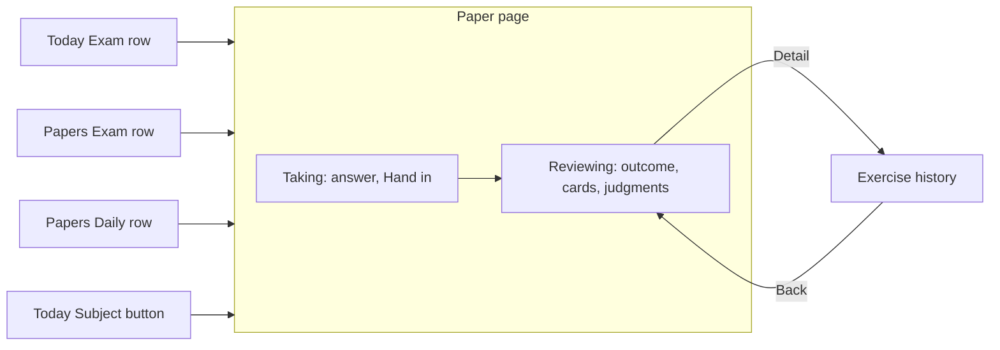

# 0040 Paper page: one model, one implementation

> status: completed (2026-11-21)
> location: branch `develop`, baseline `f987efe` (`develop`)
> confirmation: "Same block everywhere (Recommended)" / "Ladder block, no coins (Recommended)" / "Override inline (Recommended)" / "Confirmed, proceed" (2026-11-21), journey and model write-off plus local implementation, tests and scoped commit on `develop`; publication, push to other branches and production data repair excluded.

## Background and goal

User request: "Along every journey related to 'daily paper detail page', check and refine the model for the page, fix these problems: 1. what are the page's behaviours/functions everywhere, are there any inconsistencies? make them consistent and reasonable. 2. how many implementations of the page, are there duplications? reduce the duplications if any/necessary."

Affected journeys: user/0002 (daily redo), user/0003 (check paper), user/0004 (review progress, step 4), user/0009 (correct own judgment, step 1). Scenarios S5, S7, S8, S9; runtime contracts C4-C6; DATA paper section (unchanged).

Success: one model of "the page for one paper" that the journeys, runtime contract and source all describe the same way; each behavior exists once; no journey promise that the page does not keep. Non-goals: protected-submission recovery on Today, cross-session recovery of unsaved written answers, ownership/legacy work and the other baseline gaps in the runtime SPEC. DATA shapes do not change.

## Evidence

### E1 The paper is shown in three places by three renderers

Source `impl/arena.html` at the baseline:

| Surface | Code | Reached from |
|---|---|---|
| Taking page (answer, then review after hand-in) | `renderPaperRun`, state `S.run` | Today and Papers rows without a hand-in; Daily Subject buttons |
| Detail sheet | `renderPaperSheet`, state `S.paperView`, `S.paperIdx` | Papers Exam row (handed in), Papers Daily row |
| Row listings | Today `todayBlock` Exam rows, Papers Exam rows, Papers Daily rows | n/a |

Both pages draw the same card (`questionBody`, `solutionBlock`, `cardPager`, `cardNav`, `materialBlock`) but each owns its header, index state (`R.idx` vs `S.paperIdx`), page action (`card-go` vs `sheet-go`), back action (`exit-run` vs `paper-view-close`), material toggle store (`S.run.openSets` vs `S.paperOpenSets`) and photo toggle store (`S.run.openPhotos` vs `S.paperOpenPhotos`), with `photoStore()` and the `toggle` handler branching on which page is open. The two state objects are built by two copies of the same literal in `start-daily` and `start-paper`. Score is computed by `tally` over session results in one page and by `paperScore` over stored attempts in the other.

### E2 The same paper behaves differently by where it is opened

| Behavior | Right after hand-in (taking page) | Re-opened (detail sheet) | Today row |
|---|---|---|---|
| Daily coins and ladder | Shown | Not shown | Not applicable |
| Check paper ladder consequences | Not shown | Not shown | Not applicable |
| Fix a judgment | Self-mark locks after one tap; note says "go to detail" | Override dropdown | Not applicable |
| Written answer awaiting judgment | "Mark your written answers" and buttons | Card says "No answer to this question on this paper" and pager says "no answer" | Not applicable |
| Assessment completeness | "N to mark" line | Not shown; score only | Not shown |
| Open a handed-in paper | n/a | Opens from Papers rows | Exam row is inert (`cursor:default`) while the same row in Papers opens |
| Row meaning | n/a | Daily row has no paper name; Exam row has name and created time | Exam row shows progress and "N right" |
| Card "Detail" then Back | No Detail link | Back goes to the Exercises list, not the paper | n/a |

Journey mismatches: user/0003 success promises "ladder consequences" on the page and the page shows only a score; user/0002 6b requires pending judgments to be shown truthfully and not inferred from a hand-in marker, but the sheet describes a pending judgment as "no answer"; user/0004 4 sends the user to paper details to understand an outcome, but the sheet omits coins and ladder movement the same user saw at hand-in.

Decision 0033 D3 left check-paper ladder display as an open gap ("留白") and did not reject it. Decision 0033 D1 and D2 own the ladder block and its "to self-mark" count for daily papers; this discussion extends that block, it does not replace it.

### E3 Facts the page already derives from stored attempts

`paperLadders` handles a paper with existing attempts (it cuts the ladder input at the first attempt with that `paperId`) and applies the check-paper rule through `ladderInput`; `paperCoins` already works from attempts. A re-opened paper can therefore show the same outcome block with no new stored field. Local tests cover these helpers; nothing covers the page handlers.

Unknown: how long a local snapshot takes to reflect an in-session write. The taking page overlays session results until saved; the unified page keeps that overlay and drops it per question once the write is acknowledged.

## Target model

One **Paper page** per paper and actor, with two phases derived from the actor's hand-in marker: Taking (before) and Reviewing (after). Opening the page right after hand-in and re-opening it later are the same page; its content is derived from stored attempts plus unsaved in-session results. All entry rows mean Start or Review by the same rule.

Reviewing shows one outcome block (score with assessment status; the ladder before and after; daily coins), one card per question, and one judgment control per card. Behaviors are stated once in the new runtime contract C10 and glossary term Paper page; the journeys cite them.

User-visible changes after implementation:

- A re-opened daily paper shows coins and ladder movement like the just-handed-in one.
- Check papers show the ladder block with no coins line.
- Self-marked written answers can be corrected inline with the Override dropdown; the lock and "go to detail" note go away.
- A written answer without a saved judgment reads "Not judged yet" and the outcome block says "N to judge".
- Today's handed-in Exam row opens the paper page; all rows follow Start/Review.
- Detail on a card returns to the same card of the paper page.

## Decisions for the user

**Q1 Re-opened daily paper outcome**: decided by the user (2026-11-21), A: re-opened daily papers show coins and ladder like the hand-in view. Alternative B kept two inconsistent views of one paper.

**Q2 Check-paper outcome**: decided by the user (2026-11-21), A: ladder block with no coins line; journey 0003 stays as written in substance. Alternative B reworded the journey to a score only page. This reverses the blank of 0033 D3 for check papers only.

**Q3 Fixing a judgment**: decided by the user (2026-11-21), A: inline Override in both phases, buttons only while a written answer is pending in the session.

## Agent decisions

All five were listed in the confirmation question and confirmed by the user (2026-11-21).

**Q4 One page for taking and reviewing** (confirmed). Merge `renderPaperRun` and `renderPaperSheet` into one renderer over one view state. Declined: keep two pages and share only helpers; the divergences in E2 come from the split.

**Q5 Pending written answers** (confirmed). Existing question, handed in, no saved judgment: card and pager state `pending` ("Not judged yet"), outcome block "N to judge", score keeps it in the denominator. Self-mark buttons appear only while the written response is still in the current session; a reopened paper without it cannot create the attempt (user/0009 1b stays). `none` is reserved for legacy papers with no attempt for an existing question after hand-in; it keeps the "no answer" wording.

**Q6 Entry rows** (confirmed). Every paper row means Start when not handed in and Review when handed in, with the same name, tags and score fields; Daily rows group by day and omit Created. Unhanded daily papers stay out of Papers lists (DATA/C4 unchanged).

**Q7 Navigation** (confirmed). Back returns to the origin (Today, Papers list with its sub-tab, or the exercise Detail's source); Detail on a card opens the exercise and its Back returns to the same card.

**Q8 One implementation** (confirmed). One helper for score and assessment status (replacing `tally` use on pages and `paperScore`/`paperProgress` duplication), one `S.paper` view state with one open-state store, one run-state constructor, one attempt writer for hand-in and self-judgment, one row renderer, one override control. Source structure beyond these is an implementation choice.

## Write-off
<!-- write-off -->

| # | Question | Target | Change | Verification | Actual result and verification |
|---|---|---|---|---|---|
| 1 | Q4-Q7 | `model/domain/GLOSSARY.md` | Added Paper page (卷页) with the avoid list for the old tab names | `./check.sh` | Applied; `./check.sh` exit 0 |
| 2 | Q1-Q3, Q5 | `model/arch/arena/SPEC.md` | Added C10 Open and use a paper page; C5 Override points to it; baseline gaps table has a Paper page row | `./check.sh` | Applied; `./check.sh` exit 0 |
| 3 | Q4, Q6 | `model/arch/arena/COMPONENT.md`, `model/arch/SCENARIO.md` | Papers owns the page and rows; added S13 and coverage rows | `./check.sh` | Applied; `./check.sh` exit 0 |
| 4 | Q1-Q3, Q5-Q7 | `journey/user/0002`, `0003`, `0004`, `0009` | Steps and extensions follow C10 (0002 step 4/6/7 and 7c; 0003 steps 2/6, 1b, 6a; 0004 step 4 and 4d; 0009 steps 1/4 and 1b) | `./check.sh` | Applied; `./check.sh` exit 0 |
| 5 | Q5 | `model/domain/DOMAIN.md` | Added Paper outcome derived model | `./check.sh` | Applied; `./check.sh` exit 0 |
| 6 | Q1-Q8 | `model/verify/SPEC.md`, `verify/README.md` | Named Paper page integration coverage and a changed-boundary case; added the walkthrough entry | `./check.sh` | Applied; not run at runtime, so acceptance stays unverified |
| 7 | Q4-Q8 | `impl/arena.html`, `impl/logic.test.js` | One Paper page renderer and state (`S.run`), `paperRow`, `paperRows`/`paperAssess`/`withLiveAttempts`/`paperMarks`, `saveRunAttempt`; removed `renderPaperRun`/`renderPaperSheet` split, `tally`, `paperAttempts`, `paperProgress`, `runMarks`, `sheetMarks` and the sheet's state | `node impl/logic.test.js impl/arena.html`; scripted Chromium walkthrough on a fake in-memory db | Logic suite prints `all logic tests passed` (new cases for rows, assessment, live overlay, ladder equivalence, check-paper ladder, marks). Walkthrough passed 29 checks (rows from Today and Papers, both phases, pending wording, inline override, Detail then Back, tab locking, no page errors); the harness is not in the repo, it is not platform evidence |

Evidence correction: the plan said Q6 would drop the Created field on Daily rows only; it is also omitted when rows are grouped by day, as written in C10.

Not done, by design: protected-recovery entry on Today (C4), cross-session recovery of unsaved written answers, linking exercise-history attempt rows to their paper, and publication.

## Independent review

Not run: the user did not ask for sub-agents and the change set is one journey area with a single impact path. Reviewed by the author against source at the cited lines; the gap is disclosed here and in the implementation record.
