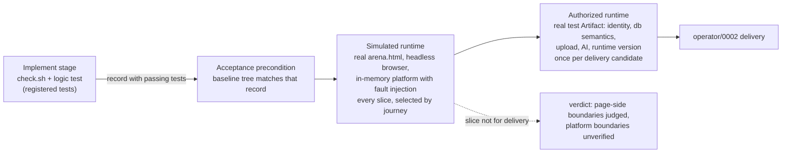

# 0040 Verify phase review

> status: in-progress (2026-11-20)
> location: branch `develop`, baseline `f987efe` (`develop`)

## Background and goal

User request: "review and refine the 'verify' phase for this app: what shall we do in verify, and how we do it efficiently?" The user then decided Q1-Q2 below, asked to open this discussion, and asked that it also settle whether and when real-platform acceptance runs (Q4).

Pain at baseline `f987efe`:

- No acceptance record exists: `record/verify/` and `record/deliver/` are absent, while the page has been published 88 times.
- [model/verify/SPEC.md](../../model/verify/SPEC.md) lists nine entry rows and about ten required changed-boundary cases, but `verify/README.md` registers only two rows, and none of the runtime entries exists.
- `verify/README.md` claims the local checks cover "All journey logic", which the SPEC itself denies; its "manual page walkthrough" has no steps and targets the published page, which operator/0003 extension 3a forbids as a sandbox.
- Every real-platform check needs an authorized test Artifact and data, so a slice is slow to accept and nothing runs between slices.
- The SPEC mixes lasting contract with slice-specific cases from discussion 0039 and a status sentence ("current source/tests have not implemented ...") that goes stale.

Goal: define what verify does, which evidence tiers count, how to size a run, and when the real platform is needed, so acceptance is cheap per slice and honest about what only the real platform can prove.

Non-goals: building the harness (implementation, after freeze); publishing a test Artifact or running anything against the platform; changing journey success conditions of `journey/user/`; changing the platform choice (ADR 0001, 0002).

Affected journeys: operator/0003 (acceptance), operator/0001 (maintain: owns the local checks), operator/0002 (delivery: consumes the verdict); all user journeys as the coverage targets.

## Target model

Acceptance evidence has two tiers; the local checks belong to the implementation stage, not to acceptance.

| Tier | Runs | Proves | Does not prove |
|---|---|---|---|
| Implement-stage checks (`./check.sh`, `node impl/logic.test.js impl/arena.html`) | In implementation, per rule 4 of the guide | Workspace consistency; pure helpers | Not acceptance evidence; acceptance only requires that the baseline tree matches an implementation record whose registered tests passed |
| Simulated runtime | Every accepted slice, entries selected by affected journey steps | The real page's DOM handlers and write sequences against the `DATA.md` contract, including injected failures (Nth write fails, owner or actor switch, document deleted mid-flow, delayed snapshot) | Real platform semantics |
| Authorized runtime | Pre-delivery acceptance of one candidate, on an authorized test Artifact with named test data | Real identity, db snapshot/permission/limit behavior, asset upload, AI recognition, runtime-contract compatibility, fonts | Production state |

Verdict rule: a slice that is not a delivery candidate may be accepted on page-side boundaries from the simulated tier; the record marks each platform boundary `unverified`. A delivery candidate needs the authorized-runtime judgments of the same baseline before an accepted verdict that unlocks delivery.

User-visible behavior does not change. Operator-visible changes: a runnable simulated-runtime entry, a short authorized-runtime checklist, and a stable journey-step to entry map.

## Decisions for the user

**Q1 Where do the local checks sit?** (decided by the user, 2026-11-20)

Evidence: guide rule 4 requires `./check.sh` and the registered tests after any change to a model, implementation or entry; the design-verify skill requires the baseline to match an implementation record with passing tests. Decision: they are implementation-stage tests. Acceptance does not re-run them as its evidence; it checks the baseline match and may re-run them only as a sanity check without counting them.

**Q2 Does the simulated runtime count as acceptance evidence?** (decided by the user, 2026-11-20)

Evidence: E1. The page needs only four platform capabilities and about sixteen db call sites, so a small in-memory fake runs the unmodified page. The fake can inject failures that the real platform cannot on demand, which is what most of the SPEC's required cases need. Decision: yes, for the page-side boundaries it exercises, as a declared substitute; it never certifies platform boundaries. This reverses the SPEC sentence "command/lifecycle acceptance requires actual authorized runtime evidence" for page-side behavior.

**Q3 Can `check.sh` run on Linux, and can it be fixed?** (resolved with evidence, 2026-11-20)

Evidence: E2. It runs on Linux; the failure was this container's Ubuntu default `awk` (mawk 1.3.4-20240123), which cannot compile interval expressions like `^ {0,3}` that the managed `visible-text.awk` uses. With GNU awk installed, `./check.sh` exits 0 and the logic suite passes. Managed files are hash-verified, so the workspace does not patch them. Actions: record the prerequisite in the maintain contract and README; offer a persistent environment setup (Q5); the toolkit defect is recorded here for the toolkit repository.

**Q4 Is the authorized runtime needed, and in which phase?** (recommended, pending user decision)

Evidence: the simulated runtime cannot prove identity, real db semantics, uploads, AI recognition or runtime-contract compatibility (E1). Operator/0003 step 3 already puts the test candidate and environment inside acceptance, and the skill requires pre-delivery acceptance to cover all relevant evidence. Delivery (operator/0002) checks the production target after publication, which is a different check.

| Option | Approach | Cost |
|---|---|---|
| A (recommended) | Required in the verify phase, once per delivery candidate; skipped for intermediate slices, whose record marks platform boundaries unverified | One short authorized run per release; needs separate authorization each time |
| B | Required for every slice | Accurate but slow; one external write per slice |
| C | Never; rely on the simulated tier and production post-publication checks | Cheapest; platform defects reach the target first |

Recommendation: A. It keeps the per-slice loop local and fast, and still gates delivery on real-platform evidence.

**Q5 Persist the awk prerequisite in the cloud environment?** (recommended, pending)

Evidence: the container is ephemeral; a new session reproduces the failure after a stale package index (`apt-get update` was needed before `apt-get install gawk`). Option A (recommended): propose a setup script `apt-get update && apt-get install -y gawk` through the environment tool; the user approves it there. Option B: document the prerequisite only. Cost of A: one approved environment edit.

## Write-off plan
<!-- write-off-plan -->

Design rows only; entries and harness are implementation work after freeze.

| # | Question | Target | Change | Verification | Actual result and verification |
|---|---|---|---|---|---|
| 1 | Q1, Q2, Q4 | `model/verify/SPEC.md` | Add the simulated runtime as a declared substitute; keep Authorized runtime for platform boundaries; state that implement-stage checks are not acceptance evidence and the baseline must match a passing implementation record; add the verdict rule and the sizing rule (entries by affected journey steps; full simulated set plus authorized runtime for delivery candidates); drop the status sentence; reduce the case list to stable boundary classes | `./check.sh` | pending |
| 2 | Q2, Q4 | `journey/operator/0003-accept-integrated-slice.md` | Step 3 and extension 3a apply to the authorized runtime; extension 4b names what the simulated tier may pass | `./check.sh` | pending |
| 3 | Q4 | `model/operate/deploy/SPEC.md` | The test candidate is supplied once per delivery candidate | `./check.sh` | pending |
| 4 | Q3 | `model/operate/maintain/SPEC.md` | Environment: GNU or macOS awk required; mawk fails | `./check.sh` | pending |
| 5 | Q2 | `model/adr/0005-acceptance-runs-the-real-page-on-a-simulated-platform.md` | Record the trade-off: simulated platform for page-side acceptance, real platform only for platform boundaries before delivery | `./check.sh` | pending |
| 6 | Handoff | implementation | Build the harness and entries under `verify/` (command, journey selection, exit code), rewrite `verify/README.md` as a journey-step to entry to tier map with authorized-runtime steps and a synthetic test-data scope, note the awk prerequisite in `operate/maintain/README.md`, update the guide map; first acceptance record follows | `./check.sh`, registered tests | deferred to implementation |

## Evidence

### E1 The page's platform surface is small and a fake runs it

Source: `impl/arena.html` boot (`window.claude.use` for `db`, `assets`, `sample`, `user`; `db.collection().where().onSnapshot`, `db.doc().get/set/update/delete`; `assets.upload`; `sample.json`, `sample.limits`; `user.me`). Spike (scratch only, not in the repo): about thirty lines of in-memory fake plus pre-installed headless Chromium booted the unmodified page with zero page errors and rendered the empty Today screen. Inference: seeded fixtures plus fault injection can drive the journeys. Unknown: whether the fake covers every call used in the recording and match paths (the spike did not exercise them) and whether a private test Artifact has a db isolated from production; verify both when building the harness and the first authorized run, and treat an unproven substitution boundary as `unverified`.

### E2 `./check.sh` failure on Linux

Source: command output in this session. `./check.sh` exited 2 ("REcompile() panic ... Broken link scan failed") under mawk 1.3.4-20240123; the failing patterns are in `.discuss_design/visible-text.awk` (lines 157, 180, 207 and others). After `apt-get update && apt-get install -y gawk`, `./check.sh` printed "Checks passed" (exit 0) and the logic suite printed "all logic tests passed". The checker header assumes the macOS awk. Unknown: whether newer mawk releases fix it.

## Agent decisions

**A1 Entry naming** (effective upon confirmation) The design files say "simulated runtime" and "authorized runtime", not T0-T2.

**A2 Case list placement** (effective upon confirmation) Concrete changed-boundary cases move from the SPEC into executable entries under `verify/`; the SPEC keeps stable boundary classes. Alternative declined: keeping the list in the SPEC, which goes stale after each slice.

**A3 Per-release authorized run** (effective upon confirmation, depends on Q4 option A) Staleness is judged by baseline: an authorized-runtime judgment counts only for the baseline it ran on.

**A4 Process** The light path is used: the decisions are the user's or mechanical consequences, and no independent review has run. The user may ask for one before confirming.
