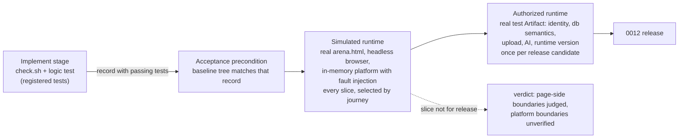

# 0040 Verify phase review

> status: completed (2026-11-20)
> location: branch `develop`, baseline `b640595` (`develop`)
> confirmation: "Q4 A, Q5 yes, Q6 A, go ahead and confirm" (2026-11-20), the write-off plan rows 1-5 and 7, agent decisions A1-A4, the environment setup of Q5 (still subject to the approval prompt of the environment tool), and implementation of row 6 in this session; light path, no independent review requested; external actions (test Artifact, publication, data writes) excluded.

Revised 2026-11-20 (second pass): after `origin/develop` moved to toolkit v0.44.0 (flat journey numbering, `deliver` renamed `release`, `OFFLINE`/`ONLINE` environments), journey IDs and terms below follow the new layout: operator/0001-0003 are now 0011-0013, the authorized runtime is an `OFFLINE` environment run, production is `ONLINE`. Earlier: the first draft was written on `f987efe`. When pushing, `origin/develop` turned out to hold parallel work (acceptance records, a fake-platform smoke entry, release records 91 and 92). It was merged without conflict (`e0c6598`) and the background, E1-E2 and the plan below were corrected against it; E3 and Q6 are new.

## Background and goal

User request: "review and refine the 'verify' phase for this app: what shall we do in verify, and how we do it efficiently?" The user then decided Q1-Q2 below, asked to open this discussion, and asked that it also settle whether and when real-platform acceptance runs (Q4).

Pain at baseline `b640595` (E3 lists the sources):

- The practice already ran ahead of the contract. A fake-platform smoke entry exists and four acceptance records exist, one of them on a private test Artifact with its own database. Yet [model/verify/SPEC.md](../../model/verify/SPEC.md) is unchanged: it knows no simulated tier, still says command/lifecycle acceptance "requires actual authorized runtime evidence", and still carries slice-specific cases from discussion 0039 and a status sentence ("current source/tests have not implemented ...") that went stale.
- `verify/README.md` now labels the fake-platform smoke "a substitute, not integrated acceptance", which the user's Q2 decision reverses for page-side boundaries.
- Release 92 was published without matching acceptance, by the user's explicit waiver. The waiver is honest, but nothing in the contract says what a candidate needs to avoid one: neither the sizing nor the once-per-candidate real-platform run is defined, so each slice re-decides what to run.
- `./check.sh` exits 1 on the current `origin/develop` tip, independent of this discussion (E3, Q6). Release 92 also records that the checker could not run in its session container (mawk, E2).

Goal: define what verify does, which evidence tiers count, how to size a run, and when the real platform is needed, so acceptance is cheap per slice and honest about what only the real platform can prove.

Non-goals: building the harness (implementation, after freeze); publishing a test Artifact or running anything against the platform; changing journey success conditions of `journey/`; changing the platform choice (ADR 0001, 0002).

Affected journeys: 0013 (acceptance), 0011 (maintain: owns the local checks), 0012 (release: consumes the verdict); all user journeys as the coverage targets.

## Target model

Acceptance evidence has two tiers; the local checks belong to the implementation stage, not to acceptance.

| Tier | Runs | Proves | Does not prove |
|---|---|---|---|
| Implement-stage checks (`./check.sh`, `node impl/logic.test.js impl/arena.html`) | In implementation, per rule 4 of the guide | Workspace consistency; pure helpers | Not acceptance evidence; acceptance only requires that the baseline tree matches an implementation record whose registered tests passed |
| Simulated runtime | Every accepted slice, entries selected by affected journey steps | The real page's DOM handlers and write sequences against the `DATA.md` contract, including injected failures (Nth write fails, owner or actor switch, document deleted mid-flow, delayed snapshot) | Real platform semantics |
| Authorized runtime | Pre-release acceptance of one candidate, on an authorized test Artifact with named test data | Real identity, db snapshot/permission/limit behavior, asset upload, AI recognition, runtime-contract compatibility, fonts | Production state |

Verdict rule: a slice that is not a release candidate may be accepted on page-side boundaries from the simulated tier; the record marks each platform boundary `unverified`. A release candidate needs the authorized-runtime judgments of the same baseline before an accepted verdict that unlocks release.

User-visible behavior does not change. Operator-visible changes: a runnable simulated-runtime entry, a short authorized-runtime checklist, and a stable journey-step to entry map.

## Decisions for the user

**Q1 Where do the local checks sit?** (decided by the user, 2026-11-20)

Evidence: guide rule 4 requires `./check.sh` and the registered tests after any change to a model, implementation or entry; the design-verify skill requires the baseline to match an implementation record with passing tests. Decision: they are implementation-stage tests. Acceptance does not re-run them as its evidence; it checks the baseline match and may re-run them only as a sanity check without counting them.

**Q2 Does the simulated runtime count as acceptance evidence?** (decided by the user, 2026-11-20)

Evidence: E1. The page needs only four platform capabilities and about sixteen db call sites, so a small in-memory fake runs the unmodified page. The fake can inject failures that the real platform cannot on demand, which is what most of the SPEC's required cases need. Decision: yes, for the page-side boundaries it exercises, as a declared substitute; it never certifies platform boundaries. This reverses the SPEC sentence "command/lifecycle acceptance requires actual authorized runtime evidence" for page-side behavior.

**Q3 Can `check.sh` run on Linux, and can it be fixed?** (resolved with evidence, 2026-11-20)

Evidence: E2. It runs on Linux; the failure was this container's Ubuntu default `awk` (mawk 1.3.4-20240123), which cannot compile interval expressions like `^ {0,3}` that the managed `visible-text.awk` uses. With GNU awk installed, `./check.sh` exits 0 and the logic suite passes. Managed files are hash-verified, so the workspace does not patch them. Actions: record the prerequisite in the maintain contract and README; offer a persistent environment setup (Q5); the toolkit defect is recorded here for the toolkit repository.

**Q4 Is the authorized runtime needed, and in which phase?** (decided by the user, 2026-11-20: option A)

Evidence: the simulated runtime cannot prove identity, real db semantics, uploads, AI recognition or runtime-contract compatibility (E1). 0013 step 3 already puts the test candidate and environment inside acceptance, and the skill requires pre-release acceptance to cover all relevant evidence. Release (0012) checks the production target after publication, which is a different check.

| Option | Approach | Cost |
|---|---|---|
| A (recommended) | Required in the verify phase, once per release candidate; skipped for intermediate slices, whose record marks platform boundaries unverified | One short authorized run per release; needs separate authorization each time |
| B | Required for every slice | Accurate but slow; one external write per slice |
| C | Never; rely on the simulated tier and production post-publication checks | Cheapest; platform defects reach the target first |

Recommendation: A. It keeps the per-slice loop local and fast, and still gates release on real-platform evidence.

**Q5 Persist the awk prerequisite in the cloud environment?** (decided by the user, 2026-11-20: yes, option A)

Evidence: the container is ephemeral; a new session reproduces the failure after a stale package index (`apt-get update` was needed before `apt-get install gawk`). Option A (recommended): propose a setup script `apt-get update && apt-get install -y gawk` through the environment tool; the user approves it there. Option B: document the prerequisite only. Cost of A: one approved environment edit.

**Q6 What to do about the failing checker on frozen release record 92?** (decided by the user, 2026-11-20: option A)

Evidence: E3. The record is frozen; the guide allows only discussion renumbering as a freeze exception, and `.discuss_design/checker.sh` is managed (hash-verified), so neither side can be edited here without breaking a rule. Rule 4 of the guide requires `./check.sh` to pass after any change.

| Option | Approach | Cost |
|---|---|---|
| A (recommended) | Leave record 92 as written; record the evidence here, raise the waiver case in the toolkit repository (a waived release needs a representable upstream), and until then treat this one reported error as a known pre-existing failure, run and report `./check.sh` with it listed | No rule bent; the checker stays red for every future change |
| B | Edit record 92 to drop or change its upstream line | Fixes the checker; rewrites a frozen record, which the guide forbids without your explicit exception |
| C | Make a local, hash-breaking change to the managed checker | Fixes it locally; drifts from the toolkit, undone by the next upgrade |

Recommendation: A, with your explicit say-so for B if you prefer a green checker now.

## Write-off
<!-- write-off -->

Design rows only; entries and harness are implementation work after freeze.

| # | Question | Target | Change | Verification | Actual result and verification |
|---|---|---|---|---|---|
| 1 | Q1, Q2, Q4 | `model/verify/SPEC.md` | Add the simulated runtime as a declared substitute; keep Authorized runtime for platform boundaries; state that implement-stage checks are not acceptance evidence and the baseline must match a passing implementation record; add the verdict rule and the sizing rule (entries by affected journey steps; full simulated set plus authorized runtime for release candidates); drop the status sentence; reduce the case list to stable boundary classes | `./check.sh` | Applied: tier table, platform boundary list, verdict rule, boundary classes, sizing; status sentence removed. `./check.sh`: only the known record 92 error |
| 2 | Q2, Q4 | `journey/0013-accept-integrated-slice.md` | Step 3 and extension 3a apply to the authorized runtime; extension 4b names what the simulated tier may pass | `./check.sh` | Applied to steps 1, 3, 4, extensions 3a and 4b and the diagram. `./check.sh`: same |
| 3 | Q4 | `model/operate/deploy/SPEC.md` | The test candidate is supplied once per release candidate | `./check.sh` | Applied to the acceptance-candidate prerequisites. `./check.sh`: same |
| 4 | Q3 | `model/operate/maintain/SPEC.md` | Environment: GNU or macOS awk required; mawk fails | `./check.sh` | Applied to the environment line. `./check.sh`: same |
| 5 | Q2 | `model/adr/0005-acceptance-runs-the-real-page-on-a-simulated-platform.md` | Record the trade-off: simulated platform for page-side acceptance, real platform only for platform boundaries before release | `./check.sh` | Applied as ADR 0005, linked from the SPEC. `./check.sh`: same |
| 6 | Handoff | implementation | Extend `verify/fake-platform-smoke.js` into journey-selectable entries (command, journey selection, exit code) for the SPEC's boundary classes, covering the paths README lists as uncovered; rewrite `verify/README.md` as a journey-step to entry to tier map, drop the "substitute, not acceptance" wording, give the authorized-runtime run concrete steps and a synthetic test-data scope; `operate/maintain/README.md` already notes the awk prerequisite as of `b640595` (confirm wording); update the guide map | `./check.sh`, registered tests | Handed to implementation (entries, README, guide map); continues in this session |
| 7 | Q6 | none in this workspace unless the user chooses B | Option A: no file change; record the toolkit report | none | No file change; the toolkit report is not opened here because the toolkit repository is outside this session's scope, the evidence is in E3 for the user to raise upstream |

## Evidence

### E1 The page's platform surface is small and a fake runs it

Source: `impl/arena.html` boot (`window.claude.use` for `db`, `assets`, `sample`, `user`; `db.collection().where().onSnapshot`, `db.doc().get/set/update/delete`; `assets.upload`; `sample.json`, `sample.limits`; `user.me`). Spike (scratch only, not in the repo): about thirty lines of in-memory fake plus pre-installed headless Chromium booted the unmodified page with zero page errors and rendered the empty Today screen. Inference: seeded fixtures plus fault injection can drive the journeys. Superseded by E3 for the "does it work" part: the repository's `verify/fake-platform-smoke.js` already does this and acceptance record `20261120-first-loop-test-artifact` shows a separate private test Artifact with its own database was used. Remaining unknown: whether the fake covers the match, retention and photo paths (README names them as not covered).

### E2 `./check.sh` failure on Linux

Source: command output in this session. `./check.sh` exited 2 ("REcompile() panic ... Broken link scan failed") under mawk 1.3.4-20240123; the failing patterns are in `.discuss_design/visible-text.awk` (lines 157, 180, 207 and others). After `apt-get update && apt-get install -y gawk`, `./check.sh` printed "Checks passed" (exit 0) and the logic suite printed "all logic tests passed". The checker header assumes the macOS awk. Unknown: whether newer mawk releases fix it.

### E3 What `origin/develop` already holds

Sources: `verify/README.md`, `verify/fake-platform-smoke.js` (`node verify/fake-platform-smoke.js impl/arena.html`, needs `playwright`), and the `record/implement/`, `record/verify/` and `record/release/` directories (six implementation records, four acceptance records, two release records at `b640595`). Facts: the simulated tier and a real-test-Artifact acceptance have both been run, so the design here ratifies and sizes existing practice rather than inventing it. The test-Artifact acceptance judged some conditions from database state only, because the user reported no on-screen observations; conditions without a database trace stayed unverified. The latest release (version 92) rests on the user's explicit waiver of acceptance; its `## Upstream` lists the previous release, while the checker expects an acceptance record, so `./check.sh` fails at `origin/develop` tip `b640595` with "Upstream record does not exist" for that release record. Both release records are completed and therefore frozen. Inference: the template lists covered acceptance records as upstream; with no acceptance there was nothing valid to list. Unknown: whether the toolkit intends waived deliveries to be representable.

## Agent decisions

**A1 Entry naming** (confirmed 2026-11-20) The design files say "simulated runtime" and "authorized runtime", not T0-T2.

**A2 Case list placement** (confirmed 2026-11-20) Concrete changed-boundary cases move from the SPEC into executable entries under `verify/`; the SPEC keeps stable boundary classes. Alternative declined: keeping the list in the SPEC, which goes stale after each slice.

**A3 Per-release authorized run** (confirmed 2026-11-20, depends on Q4 option A) Staleness is judged by baseline: an authorized-runtime judgment counts only for the baseline it ran on.

**A4 Process** The light path is used: the decisions are the user's or mechanical consequences, and no independent review has run. The user may ask for one before confirming.
