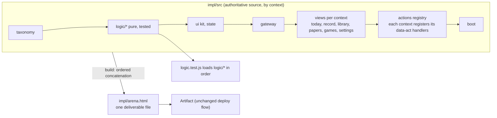

# 0041 Split the page source and review the load path

> status: in-progress (2026-11-20)
> location: branch `develop`, baseline `96f460b` (`develop`); renumbered from 0040 on 2026-11-20 after `origin/develop` took 0040 for the verify-phase review, and merged onto toolkit v0.44.0

## Background and goal

User request: "review the impl and refine the model to improve it: `arena.html` is so big, and I'm afraid it takes a very long time for the browser to load it. Can we split it by component/module/context/page?"

Current state: `impl/arena.html` is one 3,342-line, 272,714-byte file (88,730 bytes gzipped) holding CSS, the embedded taxonomy, ~850 lines of tested pure logic and ~2,000 lines of DOM/state/event/AI code. `impl/logic.test.js` extracts the `LOGIC:BEGIN…END` region from it. The model currently says "source modularization remain[s] an implementation choice" (`model/arch/arena/COMPONENT.md`) and the deploy contract publishes "exact accepted HTML" of this one file.

Goal: (1) a source layout the maintainer can navigate and change per context, with the model stating the layout's rules; (2) a first open that is as fast as the platform allows, based on measured causes, not on file size alone.

Non-goals: new user-visible features, data-shape changes (`DATA.md`), new services, publishing or any write to the live Artifact or db. User journeys do not change; only operator support contracts (maintain, deploy, acceptance) and the component model do.

## Evidence

### E1 File size is probably not the first-open bottleneck (measured locally)

Method: Chromium (Playwright, bundled), `file://` load of the current `impl/arena.html`, Google Fonts blocked, no `window.claude` (page shows its no-platform state after first render). Five cold loads: `load` event at 121 ms (first, cold cache) then 32–39 ms. That is parse + execute + first render of all 272 KB. Local script work is therefore tens of milliseconds; network transfer of ~89 KB gzipped is the only size-driven cost, and it is the same bytes however the source is split.

Not measured (no authorized test Artifact, no platform access): the host's transfer time, the iframe/capability handshake, platform response times. Unknown, so the remaining wait cannot be attributed from here.

### E2 Where the first-open wait is spent (from `boot()`, source inspection)

Order in `impl/arena.html` `boot()` today: `await` four `claude.use()` calls in parallel → `await user.me()` → `await db.doc('users/<me>').get()` (and a `set` on first open) → `await sample.limits()` → only then the settings and exercise/paper/set subscriptions start. After the subscriptions start, readiness waits for three first snapshots (exercises, papers, sets).

Inference (confidence: medium): the registration read and the AI-limits read are two sequential round-trips that readiness does not depend on. `COMPONENT.md`/runtime SPEC C1 requires only that own settings are read before owner-scoped subscriptions. Verification: compare time-to-ready on an authorized test Artifact before/after (not available now). Recovery if disproved: restore the order; no data effect.

Also: the stylesheet `fonts.googleapis.com` `<link rel="stylesheet">` is render-blocking; the page has local fallbacks (`CONTAINER.md`, "Font delivery"). Prior evidence on data scale: discuss 0032 measured rendering, not download, as the cost at thousands of exercises, and already cached per document.

### E3 Natural seams in the source (source inspection)

| Part | Bytes | Seam |
|---|---|---|
| CSS | 35,659 | one block; per-context sections possible |
| `TAX` taxonomy | 20,041 | one generated-looking line, owned by `DATA.md` |
| Pure logic (`LOGIC`) | 51,005 | ladder/view, judging/duplicates, daily & paper, progress/settings/review, paper lists/names, coins & matches, materials |
| Shared UI kit, state, users, sets | 14,758 | globals `S`, `store`, helpers |
| Today + ladder animation + paper run | 35,530 | Papers/Progress views |
| Record UI | 25,782 | Record component |
| Exercises, detail, Papers, Settings | 26,654 | Library/Papers/Session views |
| Games | 14,956 | Games component |
| Gateway writes | 1,961 | platform/data gateway |
| Event handlers | 21,299 | one `click` listener with a 62-case `switch` on `data-act`, plus `input`/`change`/`toggle`/`keydown` listeners |
| Save + AI recognition | 19,041 | Record component |
| Prune + `boot()` | 3,978 | Session/Papers |

All code is classic-script globals sharing one scope (no modules, no inline `onclick`), so a split into ordered classic scripts needs no rewrite of cross-references. The single event `switch` is the one real cross-context coupling.

### E4 Platform capability for multi-file Artifacts (primary source: Artifact tool description)

The Artifact tool documents multi-file publishing (`files` map; separate scripts/stylesheets referenced by relative path, up to 255 files per publish). Unknown: whether the host serves them with useful caching, and whether `window.claude` capabilities and the `<title>`/skeleton behave identically for a multi-file page. Verifying needs an authorized test Artifact (deploy SPEC: "Supply an acceptance candidate"), which this discussion does not have or request.

### E5 On-demand loading by tab is technically possible; gain is modest (source inspection)

User question (2026-11-20): can the page be split into several files that load on demand?

- Seams are already clean. `render()` picks a view through `renderManage()` by `S.tab`; only the Today tab and the paper run (`renderPractice`) are needed at first render. Outside each lazy region only a few names are referenced: Record → `addPhotos`, `recognise`, `saveDraft`, `newDraft`, `draftForm`, `setForm`, `resetRecMode`; Games → `startMatch`, `histPlay`, `liftTimer`; Library/Papers/Settings → `coinInfo`, `myGroup`, `shownMatches`, `weekCoins`, `weekStars`, `paperPool` (the first five and `paperPool` would move down to shared code). The rest of the coupling is the event `switch`, which would become the per-context action registry already proposed in Q4.
- Candidate lazy contexts: Record (UI 25.8 KB + save/AI 19.0 KB), Games (15.0 KB), Exercises/Papers/Settings (26.7 KB): ≈ 86 KB of 272 KB raw (≈ 32%, ≈ 28 KB of 89 KB gzipped). Eager: CSS, taxonomy (Today's mastery list names topics), pure logic, UI kit/state, Today/paper run, gateway, dispatcher, `boot()`. CSS stays eager (splitting it adds render-blocking requests). The first render lands on the remembered tab (`arena.tab` in localStorage), so that tab's file must be fetched first.
- It requires the multi-file Artifact form (Q1 option B/D) and a script injected at run time. Unknown (E4): whether the host serves sibling files from the page's origin to dynamically injected scripts, what each extra request costs through the host, and whether caching helps. A small probe Artifact would settle this; it needs authorization (a private test Artifact, no production target, no db data).
- New costs: a first-visit delay on each lazy tab (one request, needs a loading state), a new failure boundary (module fetch fails or offline → the tab cannot render; Today and the rest must keep working; to be stated in the runtime SPEC), and deploy/acceptance identity becomes a file set.
- Inference (confidence: medium): saving ≈ 28 KB gzipped on first open is small next to the platform handshake and snapshot waits in E2; it grows in value only if host requests are cheap and the transfer is slow (mobile). Not measurable without the probe.

### E6 Probe results: on-demand loading works, but each extra request is slow on this host (measured 2026-11-20)

Source: the probe page (private test Artifact, since deleted or kept per the user) opened by the user in the Claude desktop app (Electron, macOS, HTTP/3); the user pasted one run's JSON. The pasted run is a warm run (the big file shows 0.3 KB transferred, which is cache revalidation), not a confirmed cold first visit; the second run asked for was not provided.

| Finding | Evidence |
|---|---|
| Own sibling files work as static `<script src>` and as run-time injected scripts | T1, T2, T3 `ran`; no CSP violations |
| `fetch()` of siblings works; fetched text can run as inline script, Blob-URL script or `new Function` | T4–T7 `ran`; no CSP violations |
| Lazily loaded scripts see the host runtime | T3 `typeof window.claude = object`; T8 `claude.use("user")` available |
| A 27 KB-gzipped (86 KB raw) file cost 349–763 ms per request even when cached (revalidation, 0.3 KB transferred) | Resource timing for `lazy-big.js`: 763 ms (script tag), 349 ms (`fetch`) |
| Small files and the host's own hashed files cost about 0 ms | `static.js`, `lazy-small.js` and the host's `*.DWCNmu2k.js`-style files: transfer 0, 0 ms (served without a network round-trip) |

Inference (confidence: medium): the host revalidates our unversioned file names on every load but caches its own content-hashed names without a request; this host's per-request cost is hundreds of milliseconds, far above the transfer time of 27 KB (tens of milliseconds on ordinary broadband). Content-hashed file names from the build would probably be cached without a request like the host's own files; not tested. Consequences: (1) publishing the split files as separate eager scripts (Q1 option B) would add one such request per file on first open and is ruled out by this evidence; (2) on-demand loading (option D) would save ≈28 KB gzipped at first open (tens of ms) and cost a ≈350–760 ms wait the first time a lazy tab is opened each session unless the files are prefetched after the page is ready; (3) the same per-request cost plausibly applies to the platform round-trips in E2, which supports Q2 but is not measured.

Unknown and impact: cold first-visit cost, whether content-hashed names remove the revalidation, mobile behavior. They only matter if D is chosen; verify with the same probe republished with hashed names. Recovery if disproved: stay on option A.

## Target model

If the user chooses option A of Q1 (recommended below): `impl/src/` holds the source split by the `COMPONENT.md` contexts; a dependency-free Node build script concatenates it, in a fixed order, into `impl/arena.html`, which stays the single published file; the build has a `--check` mode that fails when the committed `impl/arena.html` is stale. Load order is the dependency direction: taxonomy → pure logic (no DOM, no `S`) → UI kit/state → gateway → context views → action registry → `boot()`. A context may use a lower layer, never a higher one or a sibling's private helpers; shared helpers move down. The 62-case `switch` becomes one dispatcher over a registry that each context fills.

User-visible changes: none intended (behavior preserving); faster readiness if Q2 is accepted.

## Decisions for the user

**Q1 What shape should the split deliverable take?** Decided: A, split source, one built HTML (user, 2026-11-20, after reading E6; D stays a later option). History: (user decides) — reopened 2026-11-20 after the user asked about on-demand loading (E5); first asked options A–C below, the user did not choose and asked about on-demand loading instead.

Evidence E1 says splitting does not by itself make the transferred bytes smaller; E4/E5 say multi-file hosting and on-demand loading are possible in principle but unverified for this page.

| Option | Approach | Cost |
|---|---|---|
| A (recommended) | Split source into `impl/src/*` by context with the Q4 layering and action registry; build one `impl/arena.html`; publish exactly as today. Contexts are written so a later build output can load them on demand | Adds a small build script and a staleness check; deploy, acceptance and publication unchanged; maintainability gain full; no load gain from the split itself |
| B | Split source and publish all files as a multi-file Artifact, all eager | No build step; candidate identity is a file set; contracts change; unverified host; more requests on first open |
| C | Keep one file; only the load path (Q2) | No maintainability gain |
| D | Source as in A, plus a build output of core file + lazy per-context files published as a multi-file Artifact, loaded when a tab is first opened (E5) | First open ≈ 28 KB gz smaller (unmeasured effect); new failure boundary and loading state; deploy/acceptance/identity change; host behavior proven to work (E6) but each request costs ≈350–760 ms, so tabs need background prefetch or accept a wait on first visit |

Recommendation (revised after E6): A. The probe shows on-demand loading works, but each extra request costs ≈350–760 ms on this host while the bytes saved by D are ≈28 KB gzipped; B is ruled out by the same cost. D can be added later as a second output of the same build (with content-hashed file names and background prefetch after the page is ready), so deciding A does not close it. Revisit D only if first-open bytes, not round-trips, become the measured bottleneck.

**Q2 Include the load-path fixes in this round?** Decided: A, include them (user, 2026-11-20, after Q1). History: deferred by the user until Q1 was decided.

Fixes (contract-preserving, details in E2): start the settings/exercise/paper/set subscriptions right after `user.me()`; run first-open registration and `sample.limits()` concurrently with them; make the Google Fonts stylesheet non-render-blocking. Benefit unmeasured until a test Artifact exists.

| Option | Approach | Cost |
|---|---|---|
| A (recommended) | Include them | Small behavior-preserving edits to `boot()`/`<head>`; benefit can only be measured at acceptance |
| B | Split only | Keeps the two sequential round-trips |

**Q3 What safety net should guard the refactor?** Decided: B, no new test (user, 2026-11-20). Premise corrected after the merge (2026-11-20): when Q3 was asked, no automated test ran the page's handlers. `origin/develop` has since added `verify/fake-platform-smoke.js` (discussion 0040 verify review, ADR 0005): it runs the unmodified `impl/arena.html` in headless Chromium against an in-memory db/user fake, about 25 s for all cases, selectable by journey. Under Q1 option A the build output is still `impl/arena.html`, so that smoke runs unchanged on the built page and is the safety net; no new test is needed, which matches the user's choice B. Its gaps stay: no case for user journeys 0003 (take a check paper), 0005 (match), 0006 (settings), 0009 (own-judgment override), the progress projections of 0004, multiple protected papers, and owner switch before save, so a split that touches those views leans on manual walkthrough on the test Artifact. Under Q1 option D the smoke would have to run against the multi-file build (lazy files served by a local server), which is extra work; flagged to the user with Q1.

**Q7 Probe the host with a throwaway test Artifact?** Decided: yes (user, 2026-11-20: "Yes, publish the probe"; scope: private, no data, no production target). Done: private probe published at https://claude.ai/artifact/TLHfxVv1tKthUutfvGtJ4m (declares only `user`; reads and writes no data; deleted at the user's request on 2026-11-20 after the results were read). Results: the user pasted the JSON on 2026-11-20; see E6. Manual evidence already in hand (Artifact page contract): the frame allows `fetch()` of files published alongside the page by relative URL; external scripts are limited to a CDN allowlist and own-file `<script src>` is not stated either way. The probe tests: T1 static `<script src>`, T2/T3 dynamic injection of a 1 KB and an 86 KB file (the size of the lazy contexts), T4 `fetch` of the same file, T5 inline injection of fetched text, T6 Blob-URL script, T7 `new Function`, T8 `claude.use("user")`, plus per-file resource timing and CSP violations, and a reload to show cache behavior. Original question text: (user decides, external action) A private page with one relative script, one dynamically injected script and one `window.claude.use` call, no data, to answer E4/E5 unknowns (do siblings load, dynamic injection works, per-request cost). Publishing sends content to an external service, so it needs your explicit go-ahead; not done.

## Agent decisions

**Q4 Source modules and rules** (effective upon confirmation) Modules follow `COMPONENT.md` contexts and the E3 seams. Pure logic is split by theme into DOM-free files that must not read page state `S`. The built file keeps the existing `/* LOGIC:BEGIN … LOGIC:END */` and `TAXONOMY:BEGIN…END` markers, so `node impl/logic.test.js impl/arena.html` and `DATA.md`'s taxonomy pointer keep working unchanged. `COMPONENT.md` states the layering (taxonomy → pure logic → UI kit/state → gateway → context views → action registry → `boot()`; a layer uses only lower layers; shared helpers move down) and the action-registry contract (each context registers its `data-act` handlers; one dispatcher keeps the shared error handling; unknown actions are ignored as today). Exact file names, the load-order list and build internals are delegated to implementation. Declined: ES modules (needs `import/export` rewrite of shared globals and would break the VM test extraction, no load gain); a test that loads logic files separately (the markers make it unnecessary); one file per view function (too fine, no ownership gain).

**Q5 Generated file is committed** (effective upon confirmation) `impl/arena.html` stays committed so the exact published candidate is inspectable and hashable, as the deploy contract requires; `impl/src/` is authoritative and a staleness check keeps them equal. Declined: not committing the output (publication would need a build first and candidate identity would depend on tool versions).

**Q6 ADR** (effective upon confirmation) Record the lasting trade-off (split source, single published file; why not minified, multi-file or on-demand now) in a new ADR 0006 (0005 is the acceptance ADR), and reword the "no required source split" lines in `COMPONENT.md`.

**Q8 The first split is a pure move** (effective upon confirmation) Implementation first splits the current `impl/arena.html` into `impl/src/` with no behavior change and proves it by building back a file byte-identical to the current one (empty diff). Only then, as a separate step, apply the Q2 `boot()`/`<head>` edits, checked by the logic suite and the existing simulated-runtime smoke. Reason: concatenation-only is correct by construction, which is the safety net that replaces a DOM test (Q3 = B). Declined: doing both in one step (a regression could not be attributed to the split or the startup change).

## Write-off plan
<!-- write-off-plan -->

Q1 = A, Q2 = A, Q3 = B and Q7 (probe) are the user's decisions; Q4, Q5, Q6, Q8 are agent decisions awaiting confirmation. No design file has been changed yet. Journeys are unchanged (the split and the startup order change no user step).

| # | Question | Target | Change | Verification | Actual result and verification |
|---|---|---|---|---|---|
| 1 | Q1, Q4 | `model/arch/arena/COMPONENT.md` | Replace the opening "no required source split" and the closing "source modularization remain implementation choices" with a "Source modules" section: layer order and dependency rule, action-registry contract, one built file with LOGIC/TAXONOMY markers; file names delegated | `./check.sh` | pending |
| 2 | Q1, Q5, Q6 | `model/adr/0006-page-source-is-split-and-built-into-one-file.md` | New ADR: split source by context, built into one committed published file; declined ES modules, multi-file/eager publishing (E6 request cost) and on-demand tabs now (E5/E6), with the condition to revisit | `./check.sh` | pending |
| 3 | Q1, Q5 | `model/operate/maintain/SPEC.md` | Registered local checks gain a build staleness check (`node impl/build.js --check`: fails if the committed `impl/arena.html` differs from a fresh build of `impl/src/`); dependency stays Node only | `./check.sh` | pending |
| 4 | Q1, Q5 | `model/operate/deploy/SPEC.md` | Artifact inventory: page HTML is the built `impl/arena.html` generated from `impl/src/`; candidate identity is that file's hash; `impl/src/` is never published; a passing build check is a candidate prerequisite | `./check.sh` | pending |
| 5 | Q2 | `model/arch/arena/SPEC.md` (C1) | Readiness depends on actor identity, own settings and the first snapshots of the scoped views; first-open registration and the AI-limits read start concurrently with them and do not gate readiness; their failures keep their distinct effects | `./check.sh` | pending |
| 6 | Q3 | `model/verify/SPEC.md` | One sentence: logic and simulated-runtime suites run against the built `impl/arena.html`; no new suite | `./check.sh` | pending |
| 7 | Q4, Q5 | `DATA.md` (taxonomy pointer) | The taxonomy pointer names the built page's `TAXONOMY:BEGIN…END` and the `impl/src/` taxonomy file as its source | `./check.sh` | pending |
| 8 | Q1, Q5 | `CLAUDE.md` workspace map (below the managed block) | Add rows for `impl/src/` (authoritative source) and `impl/build.js`; mark `impl/arena.html` as the generated, committed deliverable | `./check.sh` | pending |
| 9 | — | `journey/` | Unchanged | — | n/a |

Handoff to implementation (not design rows; `design-implement` traces these): create `impl/src/` and `impl/build.js` and make the first split a pure move (Q8); then the Q2 `boot()`/`<head>` edits (non-blocking fonts, subscriptions right after `user.me()`, registration and `sample.limits()` concurrent); update `operate/maintain/README.md`, `operate/deploy/README.md`, `verify/README.md` and the workspace map rows; run `./check.sh`, `node impl/logic.test.js impl/arena.html`, `node impl/build.js --check` and `node verify/fake-platform-smoke.js impl/arena.html`. The time-to-ready effect of Q2 stays unmeasured until the authorized test Artifact is available at acceptance. Not authorized: publication, any db write, on-demand tab loading (option D), minification.
