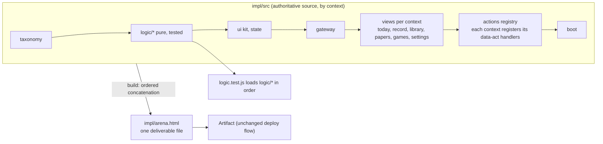

# 0041 Split the page source and review the load path

> status: in-progress (2026-11-20)
> location: branch `develop`, baseline `96f460b` (`develop`); renumbered from 0040 on 2026-11-20 after `origin/develop` took 0040 for the verify-phase review, and merged onto toolkit v0.44.0

## Background and goal

User request: "review the impl and refine the model to improve it: `arena.html` is so big, and I'm afraid it takes a very long time for the browser to load it. Can we split it by component/module/context/page?"

Current state: `impl/arena.html` is one 3,342-line, 272,714-byte file (88,730 bytes gzipped) holding CSS, the embedded taxonomy, ~850 lines of tested pure logic and ~2,000 lines of DOM/state/event/AI code. `impl/logic.test.js` extracts the `LOGIC:BEGIN…END` region from it. The model currently says "source modularization remain[s] an implementation choice" (`model/arch/arena/COMPONENT.md`) and the deploy contract publishes "exact accepted HTML" of this one file.

Goal: (1) a source layout the maintainer can navigate and change per context, with the model stating the layout's rules; (2) a first open that is as fast as the platform allows, based on measured causes, not on file size alone.

Non-goals: new user-visible features, data-shape changes (`DATA.md`), new services, publishing or any write to the live Artifact or db. User journeys do not change; only operator support contracts (maintain, deploy, acceptance) and the component model do.

## Evidence

### E1 File size is probably not the first-open bottleneck (measured locally)

Method: Chromium (Playwright, bundled), `file://` load of the current `impl/arena.html`, Google Fonts blocked, no `window.claude` (page shows its no-platform state after first render). Five cold loads: `load` event at 121 ms (first, cold cache) then 32–39 ms. That is parse + execute + first render of all 272 KB. Local script work is therefore tens of milliseconds; network transfer of ~89 KB gzipped is the only size-driven cost, and it is the same bytes however the source is split.

Not measured (no authorized test Artifact, no platform access): the host's transfer time, the iframe/capability handshake, platform response times. Unknown, so the remaining wait cannot be attributed from here.

### E2 Where the first-open wait is spent (from `boot()`, source inspection)

Order in `impl/arena.html` `boot()` today: `await` four `claude.use()` calls in parallel → `await user.me()` → `await db.doc('users/<me>').get()` (and a `set` on first open) → `await sample.limits()` → only then the settings and exercise/paper/set subscriptions start. After the subscriptions start, readiness waits for three first snapshots (exercises, papers, sets).

Inference (confidence: medium): the registration read and the AI-limits read are two sequential round-trips that readiness does not depend on. `COMPONENT.md`/runtime SPEC C1 requires only that own settings are read before owner-scoped subscriptions. Verification: compare time-to-ready on an authorized test Artifact before/after (not available now). Recovery if disproved: restore the order; no data effect.

Also: the stylesheet `fonts.googleapis.com` `<link rel="stylesheet">` is render-blocking; the page has local fallbacks (`CONTAINER.md`, "Font delivery"). Prior evidence on data scale: discuss 0032 measured rendering, not download, as the cost at thousands of exercises, and already cached per document.

### E3 Natural seams in the source (source inspection)

| Part | Bytes | Seam |
|---|---|---|
| CSS | 35,659 | one block; per-context sections possible |
| `TAX` taxonomy | 20,041 | one generated-looking line, owned by `DATA.md` |
| Pure logic (`LOGIC`) | 51,005 | ladder/view, judging/duplicates, daily & paper, progress/settings/review, paper lists/names, coins & matches, materials |
| Shared UI kit, state, users, sets | 14,758 | globals `S`, `store`, helpers |
| Today + ladder animation + paper run | 35,530 | Papers/Progress views |
| Record UI | 25,782 | Record component |
| Exercises, detail, Papers, Settings | 26,654 | Library/Papers/Session views |
| Games | 14,956 | Games component |
| Gateway writes | 1,961 | platform/data gateway |
| Event handlers | 21,299 | one `click` listener with a 62-case `switch` on `data-act`, plus `input`/`change`/`toggle`/`keydown` listeners |
| Save + AI recognition | 19,041 | Record component |
| Prune + `boot()` | 3,978 | Session/Papers |

All code is classic-script globals sharing one scope (no modules, no inline `onclick`), so a split into ordered classic scripts needs no rewrite of cross-references. The single event `switch` is the one real cross-context coupling.

### E4 Platform capability for multi-file Artifacts (primary source: Artifact tool description)

The Artifact tool documents multi-file publishing (`files` map; separate scripts/stylesheets referenced by relative path, up to 255 files per publish). Unknown: whether the host serves them with useful caching, and whether `window.claude` capabilities and the `<title>`/skeleton behave identically for a multi-file page. Verifying needs an authorized test Artifact (deploy SPEC: "Supply an acceptance candidate"), which this discussion does not have or request.

### E5 On-demand loading by tab is technically possible; gain is modest (source inspection)

User question (2026-11-20): can the page be split into several files that load on demand?

- Seams are already clean. `render()` picks a view through `renderManage()` by `S.tab`; only the Today tab and the paper run (`renderPractice`) are needed at first render. Outside each lazy region only a few names are referenced: Record → `addPhotos`, `recognise`, `saveDraft`, `newDraft`, `draftForm`, `setForm`, `resetRecMode`; Games → `startMatch`, `histPlay`, `liftTimer`; Library/Papers/Settings → `coinInfo`, `myGroup`, `shownMatches`, `weekCoins`, `weekStars`, `paperPool` (the first five and `paperPool` would move down to shared code). The rest of the coupling is the event `switch`, which would become the per-context action registry already proposed in Q4.
- Candidate lazy contexts: Record (UI 25.8 KB + save/AI 19.0 KB), Games (15.0 KB), Exercises/Papers/Settings (26.7 KB): ≈ 86 KB of 272 KB raw (≈ 32%, ≈ 28 KB of 89 KB gzipped). Eager: CSS, taxonomy (Today's mastery list names topics), pure logic, UI kit/state, Today/paper run, gateway, dispatcher, `boot()`. CSS stays eager (splitting it adds render-blocking requests). The first render lands on the remembered tab (`arena.tab` in localStorage), so that tab's file must be fetched first.
- It requires the multi-file Artifact form (Q1 option B/D) and a script injected at run time. Unknown (E4): whether the host serves sibling files from the page's origin to dynamically injected scripts, what each extra request costs through the host, and whether caching helps. A small probe Artifact would settle this; it needs authorization (a private test Artifact, no production target, no db data).
- New costs: a first-visit delay on each lazy tab (one request, needs a loading state), a new failure boundary (module fetch fails or offline → the tab cannot render; Today and the rest must keep working; to be stated in the runtime SPEC), and deploy/acceptance identity becomes a file set.
- Inference (confidence: medium): saving ≈ 28 KB gzipped on first open is small next to the platform handshake and snapshot waits in E2; it grows in value only if host requests are cheap and the transfer is slow (mobile). Not measurable without the probe.

## Target model

If the user chooses option A of Q1 (recommended below): `impl/src/` holds the source split by the `COMPONENT.md` contexts; a dependency-free Node build script concatenates it, in a fixed order, into `impl/arena.html`, which stays the single published file; the build has a `--check` mode that fails when the committed `impl/arena.html` is stale. Load order is the dependency direction: taxonomy → pure logic (no DOM, no `S`) → UI kit/state → gateway → context views → action registry → `boot()`. A context may use a lower layer, never a higher one or a sibling's private helpers; shared helpers move down. The 62-case `switch` becomes one dispatcher over a registry that each context fills.

User-visible changes: none intended (behavior preserving); faster readiness if Q2 is accepted.

## Decisions for the user

**Q1 What shape should the split deliverable take?** (user decides) — reopened 2026-11-20 after the user asked about on-demand loading (E5); first asked options A–C below, the user did not choose and asked about on-demand loading instead.

Evidence E1 says splitting does not by itself make the transferred bytes smaller; E4/E5 say multi-file hosting and on-demand loading are possible in principle but unverified for this page.

| Option | Approach | Cost |
|---|---|---|
| A (recommended) | Split source into `impl/src/*` by context with the Q4 layering and action registry; build one `impl/arena.html`; publish exactly as today. Contexts are written so a later build output can load them on demand | Adds a small build script and a staleness check; deploy, acceptance and publication unchanged; maintainability gain full; no load gain from the split itself |
| B | Split source and publish all files as a multi-file Artifact, all eager | No build step; candidate identity is a file set; contracts change; unverified host; more requests on first open |
| C | Keep one file; only the load path (Q2) | No maintainability gain |
| D | Source as in A, plus a build output of core file + lazy per-context files published as a multi-file Artifact, loaded when a tab is first opened (E5) | First open ≈ 28 KB gz smaller (unmeasured effect); new failure boundary and loading state; deploy/acceptance/identity change; depends on host behavior being proven first |

Recommendation: A now, because it is a prerequisite for B and D and costs the same either way; take D after a probe (Q7) shows the host cost per file is low. Deciding A does not close D.

**Q2 Include the load-path fixes in this round?** (user decides, scope) — deferred by the user until Q1 is decided (2026-11-20).

Fixes (contract-preserving, details in E2): start the settings/exercise/paper/set subscriptions right after `user.me()`; run first-open registration and `sample.limits()` concurrently with them; make the Google Fonts stylesheet non-render-blocking. Benefit unmeasured until a test Artifact exists.

| Option | Approach | Cost |
|---|---|---|
| A (recommended) | Include them | Small behavior-preserving edits to `boot()`/`<head>`; benefit can only be measured at acceptance |
| B | Split only | Keeps the two sequential round-trips |

**Q3 What safety net should guard the refactor?** Decided: B, no new test (user, 2026-11-20). Premise corrected after the merge (2026-11-20): when Q3 was asked, no automated test ran the page's handlers. `origin/develop` has since added `verify/fake-platform-smoke.js` (discussion 0040 verify review, ADR 0005): it runs the unmodified `impl/arena.html` in headless Chromium against an in-memory db/user fake, about 25 s for all cases, selectable by journey. Under Q1 option A the build output is still `impl/arena.html`, so that smoke runs unchanged on the built page and is the safety net; no new test is needed, which matches the user's choice B. Its gaps stay: no case for user journeys 0003 (take a check paper), 0005 (match), 0006 (settings), 0009 (own-judgment override), the progress projections of 0004, multiple protected papers, and owner switch before save, so a split that touches those views leans on manual walkthrough on the test Artifact. Under Q1 option D the smoke would have to run against the multi-file build (lazy files served by a local server), which is extra work; flagged to the user with Q1.

**Q7 Probe the host with a throwaway test Artifact?** Decided: yes (user, 2026-11-20: "Yes, publish the probe"; scope: private, no data, no production target). Done: private probe published at https://claude.ai/artifact/TLHfxVv1tKthUutfvGtJ4m (declares only `user`; reads and writes no data; delete it after use). The results appear on the page; they are not readable from this session, so they are pending the user's read-back. Manual evidence already in hand (Artifact page contract): the frame allows `fetch()` of files published alongside the page by relative URL; external scripts are limited to a CDN allowlist and own-file `<script src>` is not stated either way. The probe tests: T1 static `<script src>`, T2/T3 dynamic injection of a 1 KB and an 86 KB file (the size of the lazy contexts), T4 `fetch` of the same file, T5 inline injection of fetched text, T6 Blob-URL script, T7 `new Function`, T8 `claude.use("user")`, plus per-file resource timing and CSP violations, and a reload to show cache behavior. Original question text: (user decides, external action) A private page with one relative script, one dynamically injected script and one `window.claude.use` call, no data, to answer E4/E5 unknowns (do siblings load, dynamic injection works, per-request cost). Publishing sends content to an external service, so it needs your explicit go-ahead; not done.

## Write-off plan
<!-- write-off-plan -->

Drafted after Q1–Q3 are decided; the plan below assumes the recommendations.

| # | Question | Target | Change | Verification | Actual result and verification |
|---|---|---|---|---|---|
| 1 | Q1, Q4 | `model/arch/arena/COMPONENT.md` | Replace "no required source split" with the source-module layering and action-registry rule | `./check.sh` | pending |
| 2 | Q1, Q5, Q6 | `model/adr/0006-*.md` | New ADR: split source, one built published file, rejected alternatives | `./check.sh` | pending |
| 3 | Q1, Q5 | `model/operate/maintain/SPEC.md` | Registered checks include the build staleness check | `./check.sh` | pending |
| 4 | Q1, Q5 | `model/operate/deploy/SPEC.md` | Artifact source is the built `impl/arena.html` generated from `impl/src/`; identity is the built file | `./check.sh` | pending |
| 5 | Q1, Q3 | `model/verify/SPEC.md` | Logic suite loads split logic files; existing simulated-runtime smoke runs unchanged on the built `impl/arena.html`; no new test (Q3 = B) | `./check.sh` | pending |
| 6 | Q2 | `model/arch/arena/SPEC.md` (C1) | State that readiness depends on identity, settings and first snapshots only; registration/limits are concurrent | `./check.sh` | pending |
| 7 | Q1–Q5 | `CLAUDE.md` workspace map | Add `impl/src/`, build script rows; adjust `impl/arena.html` row to "generated" | `./check.sh` | pending |
| 8 | — | `journey/` | Unchanged | — | n/a |
