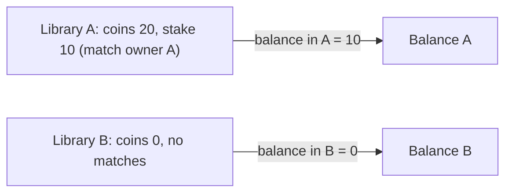

# 0044 Balance follows the selected owner scope

> status: completed (2026-11-22)
> location: branch `develop`, baseline `418bf99` (`develop`; written at `f987efe`, renumbered from 0040 on merge collision)
> confirmation: "refine the model along each journey to fix this bug" with Q1 and Q2 answered (both recommended options) (2026-11-22), design write-off for 0004, 0005, 0006 and the contract files below, plus the `coinsFor` code fix and its tests; no data migration, commit or publication authorized.

## Background and goal

User report: "When I change my default owner, my score shows a negative number." The user asks to refine the model along each journey to fix it. "Score" is read as the weekly **Balance** shown in Games (the only number that can be negative; Stars cannot).

Success: after any Default-owner change, Balance is never negative because of the change itself; the model says which scope coins and stakes belong to, so journeys 0004, 0005 and 0006 can state the outcome and acceptance can test it.

Non-goals: reopening the 0032 decision that exercises are subscribed per owner; storing coins or balances (DOMAIN: no durable projection store); changing stake amounts, Lift rules or Starboard grouping; repairing existing data.

Affected journeys: 0004 (step 3, ext 3b), 0005 (steps 1-3, ext 4c), 0006 (step 4, 4b, new extension). Scenarios S9, S10, S11; contracts C7, C8, C9.

## Target model

Coins and stakes must be derived from the same scope. Today they are not: Coin is derived from attempts on the *subscribed* owner library only (DATA "加载": attempts on other owners' exercises "不计入"), while Stake is subtracted from every match this week that lists the user (DATA 余额; `coinsFor` in `impl/arena.html`). The glossary defines Balance with no scope at all, so the model has a hole where the two definitions disagree.

Proposed rule: a match belongs to the library (Default owner) its opener had at start, stored as `matches.owner`. Balance in a scope = Coins earned in that library this week − stakes of this week's matches that belong to that library. Switching owner shows the other library's own purse; switching back restores the first one.

User-visible: after switching owner, Games shows that library's earned coins, stakes and balance; a match played under A no longer deducts in B.

## Decisions for the user

**Q1 Which scope should Balance use?**

Decision (user, 2026-11-22): Option A, per-library purse.

Evidence: root cause above; reproduced by reading `coinsFor` (coins from `S.exercises`, subscribed with `where('owner','==',defaultOwner)`; spent from global `matches`). Example: earn 20 under A, play a 10-coin match (balance 10), switch to B: coins 0, spent 10, balance -10.

| Option | Approach | Cost |
|---|---|---|
| A (recommended) | Per-library purse: add `matches.owner` (opener's Default owner at start); stakes count only in the matching scope | One new stored field; coins earned under A cannot be spent under B (matches Starboard and match groups, which are per Default owner) |
| B | Count coins from all libraries | Reverses 0032: needs every owner's exercises subscribed; data load grows with library count |
| C | Clamp the display at 0 | Hides the symptom only: stakes still deduct, "earned − used ≠ balance", eligibility lies |

**Q2 How do existing matches without `matches.owner` count?**

Decision (user, 2026-11-22): Option A, infer from players (not persisted).

Evidence: all current matches lack the field; DATA already treats missing stakes on old matches as a compatible legacy shape.

| Option | Approach | Cost |
|---|---|---|
| A (recommended) | Infer from players: a legacy match counts in a scope only when every player's current Default owner equals that scope's owner | No data write; wrong only if players moved on separately after the match (then the stake drops out of every scope) |
| B | Count legacy matches in every scope | Keeps the negative balance for legacy data |
| C | Count them in no scope | Past stakes disappear everywhere; free coins |

## Write-off plan
<!-- write-off-plan -->

| # | Question | Target | Change | Verification | Actual result and verification |
|---|---|---|---|---|---|
| 1 | Q1 | `model/domain/GLOSSARY.md` | Coin limited to selected library; Balance per library; Match belongs to opener's Default-owner library | `./check.sh` | Applied; `./check.sh` passes |
| 2 | Q1, Q2 | `DATA.md` | New `matches.owner`; balance counts only matches of the scope; legacy inference rule, not persisted | `./check.sh` | Applied; `./check.sh` passes |
| 3 | Q1 | `model/domain/DOMAIN.md` | Match "library owner" relation, Coin/Balance row, invariant 11 | `./check.sh` | Applied; `./check.sh` passes |
| 4 | Q1 | `model/arch/SCENARIO.md` S9, S10, S11 | One sentence each on scoped balance, match library, recompute after owner change | `./check.sh` | Applied; `./check.sh` passes |
| 5 | Q1 | `model/arch/arena/SPEC.md` C7, C8, C9 | Same scope for coins and spending; start records owner; owner change cannot cause negative balance | `./check.sh` | Applied; `./check.sh` passes |
| 6 | Q1, Q2 | `journey/0004`, `0005`, `0006` | 0004 step 3 + ext 3c; 0005 step 1, 3 + ext 1a; 0006 step 4 + ext 5b | `./check.sh` | Applied; `./check.sh` passes |
| 7 | Q1, Q2 | `verify/README.md` (`offline-identity-owner`) | Owner-switch balance step in the manual walkthrough (legacy match and stored owner remain logic-test only) | `./check.sh` | Applied; runtime evidence still required from acceptance |
| 8 | Q1, Q2 | `impl/arena.html`, `impl/logic.test.js` | `matchInScope`, scoped `coinsFor`, `coinInfo` passes scope/owners, `startMatch` writes `owner` | `node impl/logic.test.js impl/arena.html` | Passes ("all logic tests passed"); new assertions exercise A-to-B switch, legacy inference and unscoped compatibility |

Verification: before the merge `./check.sh` could not run in this container (mawk regex panic, identical on the baseline). After merging the upstream toolkit upgrade it runs and passes (exit 0), and `node impl/logic.test.js impl/arena.html` passes.

Not covered: runtime acceptance (no platform data touched); matches written by older page versions keep working through the legacy rule.
