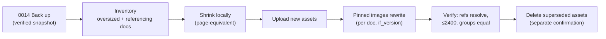

# 0044 Shrink legacy oversized photos

> status: in-progress (2026-11-22)
> location: branch `develop`, baseline `6692327` (`develop`)

## Background and goal

The user noticed that some photos in the production Arena are larger than the photo size limit ("we limited the size of the pictures, but some of them are larger than the limit", 2026-11-22) and asked to open this discussion.

Discussion 0031 (completed 2026-10-29) set the limit: new photos are shrunk on the client to a JPEG whose long edge is at most 2400 px, and originals are not kept ([DATA.md](../../DATA.md) `images`). Its implementation row 2 settled the legacy side explicitly: "已经上传的旧照片不动、不迁移" (photos already uploaded stay untouched and are not migrated). **This discussion reopens that one settled point.** Everything else in 0031 stands.

Measured on the local backup of 2026-11-22 (E1–E3): 128 stored photos exceed 2400 px. All were uploaded 14–27 Oct, before the shrink went live (page version 75). Every photo uploaded since then is within the limit. 114 of the oversized photos are referenced by 125 records (83 exercises, 42 sets); 14 are unreferenced.

Goal: make the stored photo set conform to the 2400 px limit without losing or altering any exercise, set, attempt, grouping or ownership, with every production write covered by a verified backup and an explicit operation contract.

Success conditions:
- Every photo referenced by an exercise or set has a long edge of at most 2400 px, shows upright and stays legible.
- Exercises and sets are unchanged apart from their `images` ids; derived photo groupings (`photoGroups`) are unchanged.
- No attempt, owner, set membership or legacy-set ownership state is lost or altered.
- A verified backup taken before the change can restore every original photo and document.

Non-goals: changing `PHOTO_MAX_SIDE` or the page's shrink code; legacy-set ownership repair (DATA.md "旧题组归属"); daily-paper retention; restoring from backup.

Constraints: production writes and asset deletion are irreversible external actions that need separate confirmation ([CLAUDE.md](../../CLAUDE.md) rule 1). Child material and field results stay out of the repo ([model/operate/maintain/SPEC.md](../../model/operate/maintain/SPEC.md)).

Affected: user journeys 0001 (record; saved-photo supplementation), 0007 (maintain library), 0002/0003 (photos shown while answering); operator journeys (new support entry); [DATA.md](../../DATA.md) `images`, "写入规则" and "旧题组归属"; [DOMAIN.md](../../model/domain/DOMAIN.md) invariant 4 and [arena SPEC](../../model/arch/arena/SPEC.md) C3 limits ("no asset deletion"), which constrain the *page*, not an operator.

## Target model

Pending user decisions Q1–Q4. Draft for recommended answers:

1. **One-off operator repair, `capacity` group.** New `model/operate/capacity/SPEC.md` contract "Shrink legacy oversized photos": read-only inventory → shrink → upload → pinned `images` rewrite → verify → delete superseded assets. Each stage has explicit stop and recovery boundaries. The page's runtime rule "no asset deletion" stays unchanged; this is an authorized operator action outside the page.
2. **Backup becomes a contract, `recover` group.** New `model/operate/recover/SPEC.md` and operator journey 0014 "Back up the production library", formalizing the existing `backups/` tool (full db snapshot, incremental content-addressed asset store, manifest, verify). A verified backup is a hard prerequisite for any repair.
3. **DATA.md** keeps the 2400 px rule and drops "此前上传的可能是原图" once the repair is verified. It adds that an authorized operator repair may replace an `images` id with a shrunk copy of the same photo (same order, same grouping), and that photos of unresolved legacy sets may be replaced but never removed.

No user-visible behavior changes, except that legacy photos load faster.

## Decisions for the user

**Q1 Reopen 0031 and shrink the legacy photos?**

Evidence: E1–E5. The limit already applies to new photos (E2). The legacy originals cost:
- Phone loading: 1.3–3.7 MB per photo, against about 0.77 MB for post-limit photos (E3).
- Saved-photo supplementation: these originals are sent to AI as-is, and the platform shrinks to about 1.2 MP anyway (0031 Q1).
- Storage: about 110 MB could be recovered (E4).

The cost is about 125 production document writes plus irreversible asset deletion, mitigated by the verified backup (E6) and pinned writes.

| Option | Approach | Cost |
|---|---|---|
| A | Keep 0031: legacy photos stay as they are | Nothing to do; legacy photos stay slow to load and send to AI; ~110 MB not recovered |
| B (recommended) | Shrink every referenced oversized photo with the page's own rule, relink, then delete the originals | One supervised operation; production writes to 125 docs; needs Q2–Q4 |
| C | Shrink, relink, but keep the originals in the platform as well | Same writes, storage not recovered, orphans grow by 114 |

Recommendation B: it restores one consistent rule for all photos, and the backup makes the deletion recoverable locally.

**Q2 Include the 42 legacy sets that have no `owner`?** (only if Q1 = B or C)

Evidence: E5. Under DATA.md "旧题组归属", unresolved legacy sets cannot be edited by the page, and "不自动…删照片". The repair would change only their `images` ids (the same photos, shrunk) and would never write or infer `owner`.

| Option | Approach | Cost |
|---|---|---|
| A (recommended) | Include them; write only `images`, leave owner absent | Needs a DATA.md sentence allowing operator photo replacement on legacy sets |
| B | Exclude them | About 40 of the 114 oversized photos stay oversized (all shared photos of those sets stay as originals) |

**Q3 What to do with unreferenced assets?**

Evidence: E3. 44 assets (47 MB) are referenced by nothing: 14 oversized originals, 2 tiny 7 KB thumbnails and other failed or replaced uploads. The page never deletes assets (arena SPEC C3).

| Option | Approach | Cost |
|---|---|---|
| A (recommended) | Delete them in the same operation, after the backup verifies they are all stored locally | Irreversible on the platform; recoverable only from the local backup |
| B | Leave them | 47 MB stays used |
| C | Separate discussion | Delay |

**Q4 Formalize backups as a contract and journey in this discussion?**

Evidence: E6. `backups/` exists (commit `6692327`) by direct user instruction without a `model/operate/` contract, and the repair depends on it.

| Option | Approach | Cost |
|---|---|---|
| A (recommended) | Yes: add operator journey 0014 and a `recover` contract that describes the existing tool | Two small design files |
| B | No: the repair contract only names "a verified backup" as a prerequisite | Backup stays an uncontracted map row |

## Write-off plan
<!-- write-off-plan -->

Drafted after Q1–Q4 are decided.

| # | Question | Target | Change | Verification | Actual result and verification |
|---|---|---|---|---|---|

## Evidence

### E1 The limit and when it went live

Facts: `PHOTO_MAX_SIDE = 2400` and `shrinkPhoto()` in [impl/arena.html](../../impl/arena.html) (around lines 2322–2344):
- It decodes the photo with the browser's own EXIF orientation.
- It shrinks only when the long edge is over 2400, onto a white background, saved as `toBlob('image/jpeg', 0.85)`.
- If decoding fails or times out after 10 s, it keeps the original.

It was added in commit `5bd2104` (2026-10-29), discussion 0031 Q1. 0031 row 17 records publication as page version 75 (`1793246956-94ef`). 0031 row 2 states legacy photos are not migrated.

### E2 Measurement (local backup 2026-11-22)

Source: `backups/assets/` measured with `sips`, against the platform's asset listing (count 346, 412,096,799 bytes, matching the snapshot manifest). Long edge distribution of the 344 files present:

| Long edge (px) | Count | Upload dates |
|---|---|---|
| 4032–5712 | 128 | 14–27 Oct |
| 2400 | 189 | 5–22 Nov |
| ≤1707 | 27 | 14 Oct |

All 128 oversized files are JPEG. No photo uploaded after version 75 exceeds 2400 px; the decode-failure fallback has not produced an oversized photo so far.

### E3 Scope and sizes

- Referenced oversized photos: 114 files, 220.1 MB. Unreferenced oversized photos: 14 files, 26.3 MB.
- All unreferenced assets: 44 files, 47.2 MB.
- Post-limit photos average 765 KB.
- Documents to rewrite: 125 (83 exercises, 42 sets).
- 41 of the oversized photos are shared by more than one document (set material and the exercises read from it).

### E4 Storage effect (inference)

The platform reports 412 MB used of 1 GB (limit 5,000 files).
- Shrinking 114 originals to about 0.8–1 MB each saves roughly 110 MB. Deleting the 44 unreferenced assets saves 47 MB.
- Post-limit uploads added 141 MB from 5 to 22 Nov, so the quota is reached in roughly 2–3 months either way. The repair buys about 3–4 weeks of runway; it is not a capacity solution.
- Unknown: real growth rate (the 21 Nov batch was large). Reassess when usage passes 800 MB.

### E5 Data rules that the repair touches

- [DATA.md](../../DATA.md): `images` holds asset ids, and "此前上传的可能是原图" (earlier uploads may be originals).
- `photoGroups` derives a supplementation group from independent exercises with *identical* `images` (same ids, same order) and the same subject. Replacing ids with a consistent one-to-one mapping preserves groupings.
- "旧题组归属": no automatic ownership writes and no photo deletion for unresolved legacy sets. All 42 affected sets lack `owner`; all 83 affected exercises have the same owner. No affected document has `test: true`.
- `attempts` are embedded, and other users may write concurrently (ADR 0004). An `images`-only update must therefore be pinned with `if_version` and retried on conflict, so concurrent attempts are never overwritten.

### E6 Backup available

Commit `6692327` provides `backups/` (README, `backup.mjs`). Snapshot `20261122` held all 1,479 documents and 346 assets and verified on 2026-11-22. Since then, 2 unreferenced thumbnail files (`761720b1…`, `cbfa4846…`) were removed from the local asset store by someone other than the agent, so `verify 20261122` currently fails on those two files. A fresh verified snapshot is required before any production write.

## Agent decisions

**A1 Shrink rule parity** (effective upon confirmation): the repair produces the same result the page would have produced at upload:
- EXIF orientation applied.
- Long edge 2400 px, aspect ratio kept, no upscaling.
- White background, JPEG quality 0.85.

The tool choice is delegated to implementation. Verification compares orientation on a sample of shrunk photos against the originals. Declined: re-encoding with a different size or quality. That would create a second rule.

**A2 Ordering and stop points** (effective upon confirmation):
1. Upload all new assets before any document write.
2. Rewrite each document with a pinned `images`-only update.
3. Verify every reference before deleting anything.
4. Delete superseded and unreferenced assets as a separate confirmed step.

Any failure before step 4 leaves production readable: old ids still resolve, and new uploads become orphans that the step 4 cleanup removes.

**A3 Contract group** (effective upon confirmation): the repair goes in `capacity` (storage efficiency) and backup in `recover`, following the design method's group list. Declined: extending `maintain`. Its contract forbids production writes.
