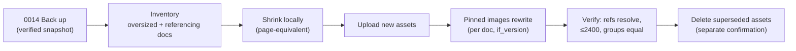

# 0044 Shrink legacy oversized photos

> status: in-progress (2026-11-22)
> location: branch `develop`, baseline `6692327` (`develop`)

## Background and goal

The user noticed that some photos in the production Arena are larger than the photo size limit ("we limited the size of the pictures, but some of them are larger than the limit", 2026-11-22) and asked to open this discussion.

Discussion 0031 (completed 2026-10-29) set the limit: new photos are shrunk on the client to a JPEG whose long edge is at most 2400 px, and originals are not kept ([DATA.md](../../DATA.md) `images`). Its implementation row 2 settled the legacy side explicitly: "已经上传的旧照片不动、不迁移" (photos already uploaded stay untouched and are not migrated). **This discussion reopens that one settled point.** Everything else in 0031 stands.

Measured on the local backup of 2026-11-22 (E1–E3): 128 stored photos exceed 2400 px. All were uploaded 14–27 Oct, before the shrink went live (page version 75). Every photo uploaded since then is within the limit. 114 of the oversized photos are referenced by 125 records (83 exercises, 42 sets); 14 are unreferenced.

Goal: make the stored photo set conform to the 2400 px limit without losing or altering any exercise, set, attempt, grouping or ownership, with every production write covered by a verified backup and an explicit operation contract.

Success conditions:
- Every photo referenced by an exercise or set has a long edge of at most 2400 px, shows upright and stays legible.
- Exercises and sets are unchanged apart from their `images` ids; derived photo groupings (`photoGroups`) are unchanged.
- No attempt, owner, set membership or legacy-set ownership state is lost or altered.
- A verified pre-repair backup holds every original photo and pre-change document byte-for-byte, and the operation map allows reversing the `images` changes (review F2).

Non-goals: changing `PHOTO_MAX_SIDE` or the page's shrink code; legacy-set ownership repair (DATA.md "旧题组归属"); daily-paper retention; restoring from backup.

Constraints: production writes and asset deletion are irreversible external actions that need separate confirmation ([CLAUDE.md](../../CLAUDE.md) rule 1). Child material and field results stay out of the repo ([model/operate/maintain/SPEC.md](../../model/operate/maintain/SPEC.md)).

Affected: user journeys 0001 (record; saved-photo supplementation), 0007 (maintain library), 0002/0003 (photos shown while answering); operator journeys (new support entry); [DATA.md](../../DATA.md) `images`, "写入规则" and "旧题组归属"; [DOMAIN.md](../../model/domain/DOMAIN.md) invariant 4 and [arena SPEC](../../model/arch/arena/SPEC.md) C3 limits ("no asset deletion"), which constrain the *page*, not an operator.

## Target model

Q1=B, Q2=A, Q3=A, Q4=A, Q5 app-access freeze, Q6=B, Q7=B, Q8=A (user, 2026-11-22):

1. **One-off operator repair, `capacity` group.** New `model/operate/capacity/SPEC.md` contract "Shrink legacy oversized photos" (Q7=B), run while nobody uses the app (Q5): pre-repair snapshot → canary → shrink → upload → pinned `images` rewrite → verify → guarded deletion → post-repair snapshot (A2). Each stage has explicit stop and recovery boundaries. The page's runtime rule "no asset deletion" stays unchanged; this is an authorized operator action outside the page.
2. **Backup becomes a contract, `recover` group.** New `model/operate/recover/SPEC.md` and operator journey 0014 "Back up the production library", formalizing the existing `backups/` tool (full db snapshot, incremental asset store keyed by asset id and checked against sha256, manifest, verify). A verified backup is a hard prerequisite for any repair.
3. **DATA.md** keeps the 2400 px rule and drops "此前上传的可能是原图" once the repair is verified. It adds that an authorized operator repair may replace an `images` id with a shrunk copy of the same photo (same order, same grouping), and that photos of unresolved legacy sets may be replaced but never removed.

No user-visible behavior changes, except that legacy photos load faster.

## Decisions for the user

**Q1 Reopen 0031 and shrink the legacy photos?**

Evidence: E1–E5. The limit already applies to new photos (E2). The legacy originals cost:
- Phone loading: 1.3–3.7 MB per photo, against about 0.77 MB for post-limit photos (E3).
- Saved-photo supplementation: these originals are sent to AI as-is, and the platform shrinks to about 1.2 MP anyway (0031 Q1).
- Storage: about 110 MB could be recovered (E4).

The cost is about 125 production document writes plus irreversible asset deletion, mitigated by the verified backup (E6) and pinned writes.

| Option | Approach | Cost |
|---|---|---|
| A | Keep 0031: legacy photos stay as they are | Nothing to do; legacy photos stay slow to load and send to AI; ~110 MB not recovered |
| B (recommended) | Shrink every referenced oversized photo with the page's own rule, relink, then delete the originals | One supervised operation; production writes to 125 docs; needs Q2–Q4 |
| C | Shrink, relink, but keep the originals in the platform as well | Same writes, storage not recovered, orphans grow by 114 |

Recommendation B: it restores one consistent rule for all photos, and the backup makes the deletion recoverable locally.

**Decision:** B, user (2026-11-22), adopting the recommendation. 0031 row 2 ("已经上传的旧照片不动、不迁移") is superseded by this decision only.

**Q2 Include the 42 legacy sets that have no `owner`?** (only if Q1 = B or C)

Evidence: E5. Under DATA.md "旧题组归属", unresolved legacy sets cannot be edited by the page, and "不自动…删照片". The repair would change only their `images` ids (the same photos, shrunk) and would never write or infer `owner`.

| Option | Approach | Cost |
|---|---|---|
| A (recommended) | Include them; write only `images`, leave owner absent | Needs a DATA.md sentence allowing operator photo replacement on legacy sets |
| B | Exclude them | 66 of the 114 referenced oversized photos stay oversized: every oversized photo used by a set belongs only to these 42 legacy sets (review F7) |

**Decision:** A, user (2026-11-22), adopting the recommendation.

**Q3 What to do with unreferenced assets?**

Evidence: E3. 44 assets (47 MB) are referenced by nothing: 14 oversized originals, 2 tiny 7 KB thumbnails and other failed or replaced uploads. The page never deletes assets (arena SPEC C3).

| Option | Approach | Cost |
|---|---|---|
| A (recommended) | Delete them in the same operation, after the backup verifies they are all stored locally | Irreversible on the platform; recoverable only from the local backup |
| B | Leave them | 47 MB stays used |
| C | Separate discussion | Delay |

**Decision:** A, user (2026-11-22), adopting the recommendation.

**Q4 Formalize backups as a contract and journey in this discussion?**

Evidence: E6. `backups/` exists (commit `6692327`) by direct user instruction without a `model/operate/` contract, and the repair depends on it.

| Option | Approach | Cost |
|---|---|---|
| A (recommended) | Yes: add operator journey 0014 and a `recover` contract that describes the existing tool | Two small design files |
| B | No: the repair contract only names "a verified backup" as a prerequisite | Backup stays an uncontracted map row |

**Decision:** A, user (2026-11-22), adopting the recommendation.

**Q5 Pause recording and editing during the repair?** (from review F1)

Evidence: E5, review F1. Three normal page actions can reintroduce old ids or create unrecorded new ones between inventory and deletion: saving an Exercise edit form opened before the rewrite (whole-document `set`), supplementing from a not-yet-rewritten photo group, and uploading photos for a draft that is not saved yet. Practising is safe: it writes only `attempts`. The contract guard (re-read all `exercises` and `sets` just before deleting, never delete an asset still referenced or absent from the pre-repair snapshot) catches almost all of this. One race remains: an edit saved between that final read and the deletion.

| Option | Approach | Cost |
|---|---|---|
| A (recommended) | Agree a window (about 1–2 hours) in which nobody records, supplements or edits exercises or sets on any device; practising is fine. Plus the guard | Family coordination for one evening |
| B | Guard only, no window | Small remaining chance that one record points at a deleted photo, fixable only from the backup |

**Decision:** user (2026-11-22): "we will not access the online app util this repair is finished." Stronger than option A: nobody opens the production app from the pre-repair snapshot until the post-repair snapshot. The A2 deletion guard stays as a cheap second check.

**Q6 Require an off-machine backup copy before deleting?** (from review F2)

Evidence: E6, review F2. After deletion the originals exist only in `backups/assets/` on this Mac, and 2 files there have already been removed once.

| Option | Approach | Cost |
|---|---|---|
| A (recommended) | Before the deletion step, copy the pre-repair snapshot and asset store to an external disk or private cloud folder and verify the copy | A disk or cloud space of about 0.5 GB and a few minutes |
| B | Accept the single local copy | One lost or damaged Mac loses the originals |

**Decision:** B, user (2026-11-22). The single local copy is accepted explicitly; the recover contract recommends an off-machine copy but does not require it.

**Q7 One-off repair or reusable operation?** (from review F3)

Evidence: E1. The page keeps an original if decoding fails or takes over 10 s, so an oversized photo can still appear in future, although none has so far.

| Option | Approach | Cost |
|---|---|---|
| A (recommended) | Reusable "Shrink oversized photos" operation, triggered when a backup inventory finds a photo over the limit; run now on the legacy photos. DATA keeps the decode-failure exception | The contract is written once, generally |
| B | One-off for the 14–27 Oct photos | A future oversized photo needs a new discussion |

**Decision:** B, user (2026-11-22): "B. I'll refine the app to not accept a oversized photo." The repair is one-off for photos uploaded before the limit. Changing the page to reject an oversized photo instead of keeping the decode-failure original is new page semantics; it is a follow-up outside this discussion. Until it lands, DATA keeps the decode-failure exception.

**Q8 How to prove the upload path before the bulk run?** (from review F6)

Evidence: review F6. The page stores raw 32-hex ids from its own upload and shows `/_blob/<id>` (`impl/arena.html` around line 1520). The operator would upload through the Artifact tool's asset upload. It is not yet verified that those uploads land in the same id space and display in the page. Also: deleting assets through the Artifact tool asks you to confirm each one, about 158 confirmations (114 superseded + 44 unreferenced).

| Option | Approach | Cost |
|---|---|---|
| A (recommended) | Production canary: one shrunk photo for one independent exercise, check it in the page and in supplementation, keep the original until the bulk verification; stop if the id shape or display differs | One extra supervised step; touches one real record |
| B | Rehearse on an authorized `OFFLINE` test Artifact with synthetic photos first | A test Artifact must be created and authorized; slower |

**Decision:** A, user (2026-11-22), adopting the recommendation, including the per-asset delete confirmations.

## Write-off plan
<!-- write-off-plan -->

| # | Question | Target | Change | Verification | Actual result and verification |
|---|---|---|---|---|---|
| 1 | Q4 | `journey/0014-back-up-production-library.md` (new), `journey/OPERATOR.md` | Operator journey 0014: goal, trigger (user-scheduled or before any production repair), main steps (snapshot db and page, list assets, fetch only new assets, finalize, verify), extensions (listing/count mismatch, missing referenced asset, verify failure, removed local file), success = a verified snapshot that can restore every document and asset. Index row and diagram link 0014 → repair prerequisite | `./check.sh` | |
| 2 | Q4, A3 | `model/operate/recover/SPEC.md` (new) | Recover contract: operator/authorization (read-only production access as owner), environment (local checkout, Node, Artifact tools), objects (db collections, assets, page), layout (full db snapshot, incremental asset store keyed by asset id and checked against sha256 hashes, manifest), success/failure/stop/verification boundaries, retention (local only, git-ignored, never in repo; never prune an asset a retained snapshot lists; keep the pre-repair snapshot indefinitely; off-machine copy recommended, not required, per Q6), restore = separately authorized, asset ids not reproducible on re-upload, `images`-only reverse rewrite instead of whole-document `set` | `./check.sh` | |
| 3 | Q1–Q3, A1–A3 | `model/operate/capacity/SPEC.md` (new) | Capacity contract "Shrink legacy oversized photos" (one-off per Q7, access freeze per Q5, canary per Q8, single local backup accepted per Q6): prerequisite verified 0014 snapshot taken immediately before; inventory (referenced oversized, unreferenced); shrink rule parity (A1); stages and stop points (A2); `images`-only pinned updates preserving order/one-to-one mapping and `photoGroups`; legacy sets written only in `images`, never `owner`; verification (every reference resolves, ≤2400 px, orientation sample, groups equal, attempt counts unchanged); deletion of superseded and unreferenced assets as a separately confirmed step; recovery (old ids resolve until deletion; after deletion only local backup) | `./check.sh` | |
| 4 | Q4, A3 | `model/operate/INDEX.md` | Add `recover` (0014) and `capacity` (trigger: one-off user-authorized repair of photos stored before the 2400 px limit took effect; no record citation, per rule 2) rows; replace "Only maintain/deploy groups are active" and qualify "not an operator purge service" (page runtime does not purge; an authorized capacity operation may) | `./check.sh` | |
| 5 | Q1, Q2 | `DATA.md` `images` (exercises, sets), "写入规则", "旧题组归属" | `images`: replace "此前上传的可能是原图" with: photos stored before the limit were shrunk by a one-off operator repair; the page's decode-failure fallback may still store an original; an authorized operator repair may replace an id with a shrunk copy of the same photo, preserving order. 旧题组归属: allow that repair on unresolved legacy sets (only `images`, owner untouched); keep "no automatic photo deletion" for the page; revise its last paragraph ("本次不新增修复工具，也不授权生产读取或迁移") to point at the capacity contract | `./check.sh`; `node impl/logic.test.js impl/arena.html` | |
| 6 | Q1, Q3 | `model/domain/DOMAIN.md` invariant 4, `model/arch/arena/SPEC.md` C3 Limits | Qualify "no orphan purge or asset deletion" as page runtime behavior; operator deletion is governed by the capacity contract | `./check.sh` | |
| 7 | Q4 | `CLAUDE.md` map row `backups/` | Point the row to the recover contract instead of "no model/operate contract yet" (mechanical) | `./check.sh` | |
| 8 | Q1, Q3 | `journey/0001-record-a-wrong-exercise.md` 6a, `journey/0007-maintain-exercise-library.md` 6b | Same page-only qualifier as row 6 for "not globally purged" / "do not … delete assets" | `./check.sh` | |
| 9 | Q4 | `journey/OPERATOR.md` text, `model/verify/SPEC.md` operator list (line 8) and exemption (line 54) | "Three" → "Four distinct goals"; add 0014; state that recover and capacity operations are verified by their own contracts, not slice acceptance | `./check.sh` | |
| 10 | Q1 | `model/operate/deploy/SPEC.md` artifact table, Photo assets row | Name the capacity operation as the only authorized migration of stored photos | `./check.sh` | |

Follow-up outside this discussion: the page rejects an oversized photo instead of keeping the decode-failure original (user direction under Q7).

Handoff to implementation (not design rows): `operate/README.md` rows and group READMEs for recover/capacity; `CLAUDE.md` map rows for wherever the repair tool lives; correcting "content-addressed" in `backups/README.md`; `CLAUDE.md` map rows for wherever the repair tool lives; correcting "content-addressed" in `backups/README.md`; the repair tool (inventory, shrink, relink plan, verify) and running it, which needs a fresh verified backup and separate confirmation for the production writes and for the deletions.
## Evidence

### E1 The limit and when it went live

Facts: `PHOTO_MAX_SIDE = 2400` and `shrinkPhoto()` in [impl/arena.html](../../impl/arena.html) (around lines 2322–2344):
- It decodes the photo with the browser's own EXIF orientation.
- It shrinks only when the long edge is over 2400, onto a white background, saved as `toBlob('image/jpeg', 0.85)`.
- If decoding fails or times out after 10 s, it keeps the original.

It was added in commit `5bd2104` (2026-10-29), discussion 0031 Q1. 0031 row 17 records publication as page version 75 (`1793246956-94ef`). 0031 row 2 states legacy photos are not migrated.

### E2 Measurement (local backup 2026-11-22)

Source: `backups/assets/` measured with `sips`, against the platform's asset listing (count 346, 412,096,799 bytes, matching the snapshot manifest). Long edge distribution of the 344 files present:

| Long edge (px) | Count | Upload dates |
|---|---|---|
| 4032–5712 | 128 | 14–27 Oct |
| 2400 | 189 | 5–22 Nov |
| ≤1707 | 27 | 14 Oct |

All 128 oversized files are JPEG. No photo uploaded after version 75 exceeds 2400 px; the decode-failure fallback has not produced an oversized photo so far.

### E3 Scope and sizes

- Referenced oversized photos: 114 files, 220.1 MB. Unreferenced oversized photos: 14 files, 26.3 MB.
- All unreferenced assets: 44 files, 47.2 MB.
- Post-limit photos average 765 KB.
- Documents to rewrite: 125 (83 exercises, 42 sets).
- 41 of the oversized photos are shared by more than one document: 30 among independent exercises (83 exercises in 39 photo groups) and 11 across 2–3 sets. No set-member exercise carries `images`. 66 oversized photos are used only by sets and 48 only by exercises (review F7).
- Units: sizes in this record are MiB (1 MiB = 1,048,576 bytes); the platform's "412 MB" is 412,096,799 bytes ≈ 393 MiB (review F8).

### E4 Storage effect (inference)

The platform reports 412 MB used of 1 GB (limit 5,000 files).
- Shrinking 114 originals to about 0.8–1 MB each saves roughly 110 MB. Deleting the 44 unreferenced assets saves 47 MB.
- Post-limit uploads added 141 MB from 5 to 22 Nov, so the quota is reached in roughly 2–3 months either way. The repair buys about 3–4 weeks of runway; it is not a capacity solution.
- Unknown: real growth rate (the 21 Nov batch was large). Reassess when usage passes 800 MB.

### E5 Data rules that the repair touches

- [DATA.md](../../DATA.md): `images` holds asset ids, and "此前上传的可能是原图" (earlier uploads may be originals).
- `photoGroups` derives a supplementation group from independent exercises with *identical* `images` (same ids, same order) and the same subject. Replacing ids with a consistent one-to-one mapping preserves groupings.
- "旧题组归属": no automatic ownership writes and no photo deletion for unresolved legacy sets. All 42 affected sets lack `owner`; all 83 affected exercises have the same owner. No affected document has `test: true`.
- `attempts` are embedded and written with `update({attempts})` (`writeAttempts`, `impl/arena.html` around line 2922). An `images`-only `update` cannot overwrite attempts even unpinned; pinning guards concurrent `images` edits. The real concurrency risk runs the other way: the page's Exercise edit saves the whole document with `set(doc)` (around line 3269), so a form opened before the rewrite and saved after it writes old ids back (review F1, F12).

### E6 Backup available

Commit `6692327` provides `backups/` (README, `backup.mjs`). Snapshot `20261122` held all 1,479 documents and 346 assets and verified on 2026-11-22. Since then, 2 unreferenced thumbnail files (`761720b1…`, `cbfa4846…`) were removed from the local asset store by someone other than the agent, so `verify 20261122` currently fails on those two files. A fresh verified snapshot is required before any production write.

## Agent decisions

**A1 Shrink rule parity** (effective upon confirmation; revised after review F4): the repair produces what the page's canvas produces, checked on **every** output, not a sample:
- Pixels upright; Orientation tag absent or 1. The originals mix Orientation 6 (70), 1 (50) and none (8).
- Aspect equals the correctly oriented original; long edge = min(2400, oriented long edge).
- No EXIF or GPS metadata (7 originals carry GPS location).
- sRGB colour (120 originals carry a Display P3 profile).
- JPEG quality 0.85, white background.

The tool is delegated to implementation. Running the page's own `shrinkPhoto` in local Chromium is a good fit (`verify/` already supports `CHROME_PATH`). Declined: a different size or quality, which would create a second rule.

**A2 Ordering, stop points and verification** (effective upon confirmation; revised after review F1, F2, F5, F12):
1. Take a fresh verified 0014 snapshot; it is the pre-repair snapshot and is kept indefinitely.
2. Canary (Q8), then shrink and upload all new assets before any document write.
3. Rewrite each document with a pinned `images`-only update, keeping order and a one-to-one old→new mapping. Keep a local operation map outside the repo: per document its id, old `images`, new `images` and the version written, plus old→new asset ids.
4. Verify: every reference resolves; every referenced photo passes A1; for every pre-repair document, its pre-repair attempts are a prefix of its current attempts and all fields except `images` are unchanged; `photoGroups` over the current documents, restricted to pre-repair documents, equals `photoGroups` of the pre-repair documents with ids mapped.
5. Deletion set = (superseded ids ∪ unreferenced ids listed in the pre-repair snapshot) minus every id referenced in a fresh full read of `exercises` and `sets` taken just before deletion. Never delete an asset absent from the pre-repair snapshot. A document still holding an old id is rewritten and read again first. Deletion is a separately confirmed step.
6. Take a post-repair verified snapshot as the closing check and new baseline.

Recovery: until step 5, old ids still resolve, and new uploads that end up unused are removed by the next run's step 5. After step 5, re-upload originals from the backup and reverse-rewrite only `images` from the operation map; never restore a whole document with `set`, which would drop later attempts.

**A3 Contract group** (effective upon confirmation): the repair goes in `capacity` (storage efficiency) and backup in `recover`, following the design method's group list. Declined: extending `maintain`. Its contract forbids production writes.

## Independent review (2026-11-22)

Reviewer: fresh-context general-purpose sub-agent on Opus (the strongest model offered), read-only. Verdict: **Reconsideration needed**, because the deletion step could break live records through normal page use, and recovery rested on one partly unverifiable local copy. The shape of the target model and Q1–Q4 held. The agent verified each finding at the source.

| Finding | Verification | Disposition |
|---|---|---|
| F1 Deletion ignores concurrent page writes | Confirmed: Exercise edit saves with whole-document `set(doc)` (`impl/arena.html` ~3269); draft uploads precede document writes; supplementation copies group `images` | A2 steps 5 and 3 revised (guarded deletion set, never delete unknown assets); quiet window raised as Q5 |
| F2 Recovery rests on one local copy; "restore" overstated | Confirmed: 2 asset files already removed locally; re-upload yields new ids; snapshot `set` drops later attempts | Success condition 4 reworded; operation map and `images`-only reverse rewrite in A2; retention added to row 2; off-machine copy raised as Q6 |
| F3 Row 5 would make DATA claim full conformity | Confirmed: `shrinkPhoto` keeps the original on decode failure or a 10 s timeout | Row 5 keeps the exception; reusable vs one-off raised as Q7 |
| F4 Parity must be checkable on every output | Accepted from the reviewer's measurements (Orientation 6/1/none = 70/50/8; 7 with GPS; 120 Display P3) | A1 revised |
| F5 Verification rules fail under normal use | Confirmed: attempts are appended daily via `update({attempts})` | A2 step 4 uses prefix and restricted-groups rules |
| F6 Upload path unverified; ~158 delete confirmations | Confirmed: page displays `/_blob/<id>` from its own upload ids; the Artifact tool confirms each delete | Raised as Q8 with the confirmation cost |
| F7 Q2/E3 numbers | Confirmed by recount: 66 oversized photos used only by sets, 48 only by exercises, 0 both; no set member carries `images` | Q2 option B cost and E3 corrected; the Q2 decision stands |
| F8 Mixed units | Confirmed | E3 states MiB and the 412 MB conversion |
| F9 "content-addressed" inaccurate | Confirmed in `backup.mjs` (files named by asset id) | Target model and row 2 corrected; README fix handed to implementation |
| F10 Rule 2: model must not cite a record | Confirmed against CLAUDE.md rule 2 | Row 4 trigger restated without a record citation |
| F11 Omitted references | Confirmed each location | Rows 5, 8, 9, 10 added or extended; map rows handed off |
| F12 Post-repair snapshot, thumbnails, pinning rationale, glossary | Accepted; glossary entries optional | A2 step 6 added; E5 rationale corrected; thumbnails are in the Q3 deletion set and the fresh snapshot re-downloads them; glossary declined as non-essential (no domain rule depends on the terms) |
