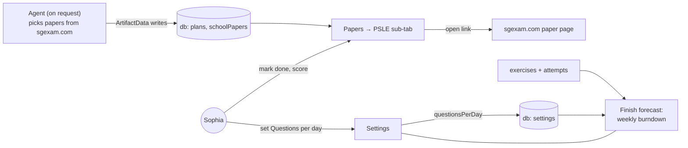

# 0050 Plan: weekly school papers to PSLE and a finish-date forecast

> status: completed (2026-11-25)
> location: branch `develop`, baseline `1d48095` (`develop`)
> confirmation: "Confirm and implement" (2026-11-25), confirming the write-off plan rows 1–16, every user decision and every agent decision below, and authorizing implementation in the same session. Not covered (each needs its own confirmation): agent writes of the paper plan to production `db` (Q17), any `ONLINE` deploy or release.

## Background and goal

The discussion opened on 2026-11-24 as "Finish-date forecast". The user had asked "when can I finish all the questions?" with a pasted requirement: given a planned `questions_per_day`, return the finish date and days remaining for every question in the arena, each needing 4 completions, optionally with a daily growth rate. Pasted example: 100 × 4 = 400 attempts at 20 a day → 20 days.

On 2026-11-25 the user widened the scope into one feature called **Plan**:

1. "I'm going to do 3 papers each week, from now to PSLE, including one Math, one English, one Science. Please show me the plan and history of my papers before PSLE." Pick papers from sgexam.com: "choose Preliminary papers first, choose papers from top schools first, choose recent papers first."
2. "I want to adjust the number of questions I need to review everyday. Please show me how long will it take for me to finish all the questions if I review x questions everyday." Consider "the new questions I record every week" and "the 'correct rate' from my recent questions reviewed."

On 2026-11-25 the user also placed the two parts: "please add the 'Weekly papers up to PSLE' to Paper page as a sub-tab, besides 'Exam' and 'Daily'" and "please add 'How long to finish all the questions at x a day' to 'Settings' page. Add a setting for 'Questions per day', and when I adjust it, show me the Burndown Chart by weeks. On each week, show the number of questions left."

- **Who:** Sophia (the actor), preparing for PSLE 2027 as a P5 student who moves to P6 in January 2027.
- **Success:** (1) On a PSLE sub-tab of Papers she sees this week's three papers, the weeks ahead up to PSLE, and her history of done papers with dates and optional scores. She can open each paper on sgexam.com and mark it done. (2) In Settings she sets Questions per day and sees a weekly burndown of questions left and the week by which all current unmastered exercises would be Mastered. The projection uses her recent right rate and recent weekly recording.
- **Non-goals:** hosting or copying sgexam PDFs; marking papers in the arena (papers stay on paper); changing the ladder, coins, daily redo selection or batch size; plans for users who have not asked for one.
- **Constraints:** 0015 D4a removed the batch-based simulation ("At N a day you'll be caught up by …"). 0018 D1 brought back a 7-day projection that assumes every redo is right, with no cap; 0030 D1 renamed it "This week" (calendar week, planned bars on Today). The forecast part reopens 0015 D4a for a finish date only. "Exam paper（检验卷）" and "Daily paper" are existing terms, so the sgexam papers need a different name (E7).

## Target model (draft)

No new top-level tab (Q1). The feature lives in two existing places.

**Papers → PSLE sub-tab** (next to Exam and Daily). A **School paper（学校卷）** (new glossary term) is an external past paper the user does on paper. A **Paper plan（备考计划）** assigns school papers to calendar weeks (Monday to Sunday) up to the PSLE date: one Maths, one English and one Science each week. The sub-tab is a week × subject grid (Q18): one row per week, Maths, English and Science across, past weeks as history (done in green with the score, behind in red), this week outlined and future weeks plain. A top line reads, for example, "16 of 129 done · 2 behind · 37 weeks to PSLE". Tapping a cell opens that paper below the grid: open it on sgexam.com, mark it done with an optional score (marks / total), undo, or Record mistakes. A "Record mistakes" action opens Record with the paper as the source (Q10).

**Settings → Questions per day and burndown.** A new setting, **Questions per day（每日题量）**, sits under Questions per batch. It is a − / + stepper with her recent pace beside it (Q19). Changing it redraws a **Finish forecast（完成预测）** right below it:
- a weekly **burndown chart** of vertical bars, one per week, with the questions left at the end of that week written above each bar (Q14);
- one line, for example "At 20 a day you'll master today's 100 in the week of 4 Jan (6 weeks) — at your recent 78 % right, with about 12 new a week".

It is a day-by-day projection of the actor's unmastered exercises in the selected library under the real ladder rules, not `4 × backlog ÷ x` (E2, E3). Questions per day only drives the forecast; Today is not limited by it (Q2a).

Data (draft, finalized in `DATA.md` at write-off):
- `settings/{userId}` gains `questionsPerDay` (Q2). The rule "Settings writes both fields together" becomes "writes all its fields together".
- `plans/{userId}`, one per planned user: `psleDate` (first written PSLE paper, assumed 2027-09-23 until CF-1), `startWeek`, `perWeek` (Q8a). "Week n of N" counts the weeks that hold assigned papers, not a date calculation.
- `schoolPapers/{id}`, one per assigned paper: `for` (user id), `subject`, `school`, `year`, `kind` (`"prelim"` …), `url`, `week` (Monday date, or null for reserve), `rank`, `doneOn` (date or null), `score` and `total` (numbers or null).

## Decisions for the user

**Q1 Where the feature lives** (user decision 2026-11-25: "add the 'Weekly papers up to PSLE' to Paper page as a sub-tab, besides 'Exam' and 'Daily'" and "add 'How long to finish all the questions at x a day' to 'Settings' page")

School papers go in a third Papers sub-tab and the forecast goes in Settings. This replaces the 2026-11-24 options (a line on Today, or on Exercises) and the recommendation of 2026-11-25 (a new Plan tab). The tab bar stays at six.

**Q2 Where x (`questions_per_day`) comes from** (user decision 2026-11-25: "Add a setting for 'Questions per day', and when I adjust it, show me the Burndown Chart by weeks")

A saved setting, `settings/{userId}.questionsPerDay`, on the Settings page. This replaces the 2026-11-25 recommendation (`plans/{userId}.dailyTarget` on a Plan tab) and the what-if option. It sits next to Questions per batch (E9); the hint text separates the two (Q2a).

**Q3 Right rate** (user decision 2026-11-25: "consider the 'correct rate' from my recent questions reviewed" → option A of 2026-11-24)

Use the actor's recent right rate (window in agent decision Q3a). This changes journey 0004 3a ("assumes on-time right answers") for this forecast only. Today's This week bars stay as they are (0018 D1, 0030 D1), so the two use different right-rate assumptions on purpose: This week shows the work due, the forecast shows how long it takes.

**Q4 New questions** (user decision 2026-11-25: "consider the new questions I record every week" → option A of 2026-11-24, as a weekly rate)

New exercises arrive at the recent weekly recording rate (Q4a) and take a share of x, oldest due first. The finish date is when every exercise that exists today is Mastered. If new work alone would use x up, the line says so instead of giving a date (E2).

**Q7 Order of papers in the weeks** (user decision 2026-11-25: option A, oldest first)

Which papers are chosen is Q11. About 43 papers per subject are needed and 54–55 prelims exist from 2023–2026 (E5), so all chosen papers are prelims. This question is when to do them.

| Option | Approach | Cost |
|---|---|---|
| A (recommended) | Oldest first: 2023 papers now, 2026 papers in the last ~11 weeks before PSLE as final mocks | Recent top-school papers come only near the end |
| B | In priority order: 2026 top-school papers first, oldest last | Uses the freshest, hardest papers while P6 topics are still untaught (E8), leaving older ones for the run-in |

A keeps the latest papers for when she has finished the P6 syllabus, which is when they test her best.

**Q8 Where the paper list comes from** (user decision 2026-11-25: "A, and pick more papers than '3 each week', in case we adjust our weekly paper plan from 3 to more" → A with a reserve pool, Q8a)

| Option | Approach | Cost |
|---|---|---|
| A (recommended) | The agent selects the papers on request from sgexam.com and writes `plans` / `schoolPapers` with `ArtifactData`; the page reads and updates them. New operation contract `model/operate/plan/SPEC.md` (selection rules, re-plan, PSLE date update) | Re-planning needs the agent, but no republish |
| B | Embed a curated paper catalogue in the page source (like `TAX`) and let the page build the plan | Every catalogue change needs a release; the page holds ~160 URLs |

Plans are data about one person, so they belong in `db`.

**Q9 Start week** (user decision 2026-11-25: option A, this week)

The user said "from now". Sophia is in P5 until January (E8).

| Option | Approach | Cost |
|---|---|---|
| A (recommended) | This week (Mon 23 Nov 2026): 43 weeks, 129 papers | Dec papers include P6 topics not yet taught; she skips those questions |
| B | Mon 4 Jan 2027 (P6 Term 1): 37 weeks, 111 papers | Loses six weeks of practice |

A follows what the user asked. Q7 A reduces the cost because the oldest papers come first.

**Q10 What "done" records** (user decision 2026-11-25: "yes, the 'Record mistakes' button is needed to open 'Record' page and fill in Source" → A)

"Source" is the existing exercise field `source`, shown as "Source" on Record, for example "2026 P5 SA2 Paper 2 Q7" (`DATA.md` `exercises.source`; `impl/arena.html` Record form). The user then asked whether she still has to photograph the paper. Yes: recording itself is unchanged (journey 0001). She photographs or types each wrong question as today, and the button only pre-selects the subject and fills Source. AI drafting already adds "the paper name and question number if visible" (`impl/arena.html` drafting prompt), so a typed question number is only a fallback (Q10a).

| Option | Approach | Cost |
|---|---|---|
| A (recommended) | Done date, optional score (marks / total), and a "Record mistakes" button that opens Record with the source filled in, for example "2023 P6 Prelim Nanyang Maths" | Small touch on journey 0001 (source prefill) |
| B | Done date and optional score only | Mistakes from papers are recorded with the source typed by hand |

Papers are where most new mistakes come from, so prefilling the source keeps them traceable.

**Q11 How "top school" and "recent" combine** (reopened 2026-11-25 after independent review finding 1; user decision 2026-11-25: option A, "Newest year first")

The user's order was "Preliminary papers first, … top schools first, … recent papers first". Inside 2023–2026 any reading gives nearly the same 43 papers. Readings differ once the reserve pool (Q8a) reaches older years, and the syllabus matters (E10): the arena's topic list follows the MOE 2021 Maths and 2023 Science syllabuses, which reach P6 only in 2026, so the older a paper, the more it may test topics outside her syllabus.

| Option | Sort key (prelims always first) | 43 scheduled per subject | Reserve | Cost |
|---|---|---|---|---|
| A (recommended) | Newest year first; GEP-centre schools first within a year | All 2026, 2025 and 2024 prelims, plus 4–5 GEP-centre 2023 ones (E5) | Rest of 2023, then 2022, 2021 … | Some top-school 2023 papers wait in reserve behind non-GEP 2024 ones |
| B | Recent window first (2023 and later), then GEP-centre, then year; older years only after the window | All 27 GEP-centre 2023–2026 papers, then other schools 2026 → 2024 | Rest of the window, then 2022 and older by the same rule | A fixed window to explain and revisit each year |
| C | GEP-centre schools across all years, then year | Only GEP-centre prelims, 2026 back to about 2020 | GEP-centre back to about 2014, then other schools | Oldest-first (Q7) would start her on 2020 papers, furthest from her syllabus |

A puts recency first because the syllabus changed; school only breaks ties within a year.

**Q18 PSLE sub-tab layout** (user decision 2026-11-25: "For the PSLE sub-tab I choose design B (week by subject grid)", chosen from three mockups: A week list, B week × subject grid, C this week first)

- Rows are weeks (Monday date), columns are Maths, English and Science. Each cell shows a short school name and, when done, the score.
- Colours: done = green, behind = red, this week = blue with the row outlined, future = plain.
- Tapping a cell opens a panel under the grid with the full paper name and Open paper, Mark done (with optional score), Undo and Record mistakes.
- The top line shows done of total, behind and weeks to PSLE. The grid opens scrolled to this week, and the reserve list folds away below it.
- Short school names, colours and scrolling details are delegated to implementation within this layout.

**Q19 Settings forecast layout** (user decision 2026-11-25: "For the Settings burndown I choose design A (stepper and weekly bars)", chosen from three mockups: A stepper and weekly bars, B slider and area, C quick picks and a week list)

- Questions per day is a − / + stepper (1–150) under Questions per batch, with "recent pace N" beside it and the Q2a hint under it.
- Below it sit the finish line, then vertical stacked bars per week (dark = today's questions, light = new ones) with the dark count above each bar. Week labels thin out when there are many weeks, and the PSLE week has a dashed marker (Q14).

## Write-off plan
<!-- write-off -->

Journey and model changes only. `verify/` belongs to acceptance and is not changed here. Unchanged: Today's This week bars (0018 D1, 0030 D1), daily redo selection and batch size (0002, 0006), ladder and coins. Implementation adds the `operate/plan/` tools and their workspace map row.

| # | Question | Target | Change | Verification | Actual result and verification |
|---|---|---|---|---|---|
| 1 | Q1, Q7, Q9, Q10, Q12, Q13, Q15, Q18 | `journey/0015-follow-psle-paper-plan.md` (new) | User journey "Follow my PSLE paper plan". Prerequisites: 0010 and a plan built by 0016. Steps: open Papers → PSLE; see the top line (week n of N, done, behind), this week's three papers, weeks ahead and history; open a paper on sgexam.com; mark it done with an optional score; Record mistakes → 0001. Extensions: no plan; behind; done ahead or late; undo done; reserve list; link fails; write fails (unsaved, not done). Success conditions as in Background | `./check.sh` | Applied; `./check.sh` passed |
| 2 | Q8, Q8a, Q11, Q11a, Q17 | `journey/0016-build-paper-plan.md` (new) | Operator journey "Build or re-plan a PSLE paper plan": the agent, on the user's request, selects a ranked pool from sgexam.com, schedules it from the start week, shows the rows, writes after confirmation and reads back counts. Extensions: PSLE date announced (CF-1); weekly amount changes; a URL stops working (CF-4); pool shortfall (CF-5); write fails part-way (re-run is idempotent by document id) | `./check.sh` | Applied; `./check.sh` passed |
| 3 | Q1 | `journey/USER.md`, `journey/OPERATOR.md` | Index rows for 0015 and 0016; diagram edges 0016 → 0015 and 0015 → 0001 | `./check.sh`; no mermaid integration configured, diagram validation gap disclosed | Applied; `./check.sh` passed; Mermaid not validated (no integration) |
| 4 | Q2, Q2a, Q3, Q4, Q14, Q19 | `journey/0006-manage-settings.md` | The goal adds Questions per day and the finish forecast; step 2 can change Questions per day; a new step reads the burndown and finish line. Extensions: unset → recent pace; fewer than 20 recent attempts → assumed 80 %; not within a year; not a cap on Today; owner change recomputes the forecast for the new library | `./check.sh` | Applied; `./check.sh` passed |
| 5 | Q3 | `journey/0004-review-progress.md` 3a | Scope 3a to Today's This week bars and point to 0006 for the finish forecast, which uses the recent right rate | `./check.sh` | Applied; `./check.sh` passed |
| 6 | Q10, Q10a | `journey/0001-record-a-wrong-exercise.md` | Extension 2b: opened from a school paper, with subject pre-selected and the paper label as default Source; AI-reported question numbers are appended; recording is otherwise unchanged | `./check.sh` | Applied; `./check.sh` passed |
| 7 | Q2, Q8a, Q14 | `model/domain/GLOSSARY.md` | New terms: School paper（学校卷, including reserve）, Paper plan（备考计划）, Questions per day（每日题量）, Finish forecast（完成预测）. Each with an Avoid list (School paper avoids 试卷 and "exam paper") | `./check.sh` | Applied; `./check.sh` passed |
| 8 | Q2, Q5, Q6, Q8, Q12, Q17 | `model/domain/DOMAIN.md` | Aggregates Paper plan and School paper, with writers: agent (create, assign, re-plan) and Papers (done, score); User settings adds questions per day; derived Finish forecast (inputs per Q3a, Q4a, Q5, Q6); new invariant: the page writes only done, score and total on the actor's own school papers, and a re-plan keeps done papers' weeks and marks; replace "No new collection … is introduced" | `./check.sh`; no mermaid integration configured, diagram validation gap disclosed | Applied (aggregates, class diagram, derived models, invariant 12 added and old 12 renumbered 13); `./check.sh` passed; Mermaid not validated (no integration) |
| 9 | Q8 | `model/arch/CONTAINER.md` | Add sgexam.com as an optional external link target (opened in a new tab, not fetched by the page), like the knowledge maps | `./check.sh`; no mermaid integration configured, diagram validation gap disclosed | Applied (sgexam.com node and operator plan edge); `./check.sh` passed; Mermaid not validated (no integration) |
| 10 | Q1, Q2, Q10a, Q14 | `model/arch/arena/COMPONENT.md` | Papers: PSLE sub-tab and done marks; Session/settings: subscribe to the actor's plan and school papers, store questions per day; Progress: Finish forecast and burndown; Record: prefill entry; gateway: eight roots; line 3 ("no … new service/collection") changes to name the two plan collections | `./check.sh` | Applied (also diagram node and Record prefill edge); `./check.sh` passed; Mermaid not validated (no integration) |
| 11 | Q1, Q2, Q10a, Q14 | `model/arch/SCENARIO.md` | New S14 "Follow the paper plan" (read, open link, mark or undo done, Record mistakes); S11 adds Questions per day and the forecast redraw; S2 notes the prefill entry; coverage rows for 0015 and 0016 (support → operate plan) | `./check.sh`; no mermaid integration configured, diagram validation gap disclosed | Applied (S14 added, S2/S11 notes, coverage rows incl. 0001 → S14); `./check.sh` passed; Mermaid not validated (no integration) |
| 12 | Q2, Q2a, Q5, Q10a, Q12, Q14 | `model/arch/arena/SPEC.md` | New C11 "Follow the paper plan": inputs, outcomes, writes limited to `doneOn` / `score` / `total` on own documents, failure (write fails → unsaved; no plan document → "No plan yet"; read failure → "Plan unavailable", never an empty plan). Presentation per Q18 and Q19. C9: Questions per day. C7: finish-forecast rules and limits (deterministic, 365-day cap, not a cap on Today). C2: prefill | `./check.sh` | Applied; `./check.sh` passed |
| 13 | Q2, Q2a, Q8, Q8a, Q10a | `DATA.md` | `settings.questionsPerDay` (1–150, absent = unset; a save writes the stored value back or leaves it absent, never the recent-pace placeholder); new `plans/{用户 id}` and `schoolPapers/{id}` shapes; subscription `where('for', '==', actor)`; write split between agent and page; validation (malformed score is ignored, `week` null = reserve, `doneOn` not in the future); deterministic ids; `subject` enum as exercises; page writes `doneOn` / `score` / `total` only; agent re-plans `update` only `week` / `rank` | `./check.sh` | Applied; additionally `schoolPapers.short` (grid short name) and `plans.updatedAt`, both agent-written; derived note added; `./check.sh` passed |
| 14 | Q7, Q8, Q8a, Q9, Q11, Q11a, Q17 | `model/operate/plan/SPEC.md` (new), `model/operate/INDEX.md` | Work group "plan": trigger (user request), authority (per-write confirmation), selection key, pool size, schedule order and start, re-plan rules, PSLE-date update, read-back verification, stop and recovery (re-run by deterministic id; re-plan after a verified backup; never delete papers, unfinished ones move to reserve); which planned papers predate the current syllabus (CF-6) | `./check.sh` | Applied; `./check.sh` passed |
| 15 | Q16 | `model/adr/0006-paper-plan-is-agent-curated-data.md` (new) | Context, decision (Q8 A), alternatives (page catalogue) and consequences | `./check.sh` | Applied; `./check.sh` passed |
| 16 | Q17 | `model/operate/recover/SPEC.md` | Add `plans` and `schoolPapers` to the backed-up collections (implementation updates `operate/recover/backup.mjs`) | `./check.sh` | Applied; journey 0014 step 2 and trigger updated to match; `./check.sh` passed |

## Evidence

### E1 Ladder rules (primary: `model/domain/GLOSSARY.md` Review ladder, Mastered; `impl/arena.html` `deriveState`, `GAPS = [0, 1, 2, 4, 7]`)

- A new exercise is due 1 day after creation at level 1. A right redo moves it up a level and sets the next redo 2, 4, then 7 days later. A right redo at level 4 makes it Mastered. So "4 completions" means 4 right redos at the ladder's spacing.
- Partly right keeps the level and waits that level's gap again. Wrong goes back to level 1, due the next day. Wrong check-paper answers also go back to level 1; right ones change nothing.
- Right redos still needed for one exercise = 5 − level.

### E2 Why `4 × backlog ÷ throughput` is wrong here (inference from E1)

- **Spacing floor:** an exercise at level 1 needs at least 1 + 2 + 4 + 7 = 14 days, whatever x is. With 100 questions at 20 a day, the last batch starts on day 5 and needs 2 + 4 + 7 more days, so 22 days, not 20.
- **Wrong answers** reset to level 1 and add attempts, so accuracy dominates (E3).
- **Growth:** when new questions × 4 ≥ x, the backlog never clears.

### E3 Projection with the real ladder (scratchpad simulation, 2026-11-24; 100 new questions, 20 redos a day, oldest due first, random right/wrong at the given rate)

| Right rate | New per day | Days to master the original 100 |
|---|---|---|
| 100 % | 0 | 22 |
| 90 % | 0 | 41 |
| 60 % | 0 | 185 |
| 100 % | 3 | 29 |
| 100 % | 5 | 34 |
| 60 % | 3 | never (within 10 years) |

### E4 Settings and earlier decisions

- Journey 0006: batch size is 1–50 per subject batch, default 10, "not a cap on the whole day". No per-day amount is stored anywhere today.
- 0015 D4a (2026-10-15) deleted `simulatePlan` / `planForecast` / `planLine`. The cost accepted then was that the page "no longer says how many a day catches up".
- 0018 D1 (2026-10-16): Next 7 days projects "every redo right on its due day", with no daily cap. 0030 D1 renamed it This week (Monday to Sunday); the planned bars still assume every redo right (`impl/arena.html` future-day counts).
- Journey 0004 3a: "A forecast is shown. It assumes on-time right answers; it is not a fixed assignment."

### E5 sgexam.com P6 prelims (research `record/research/0002-sgexam-p6-prelims-and-psle-dates.md`, fetched 2026-11-25)

- Prelims 2023–2026: Maths 55, English 54, Science 54. 2026 has 11 per subject.
- PDFs on Google Drive, with no login seen and no answer key seen on the one page checked.
- GEP-centre prelims in Maths per year: 2026: 6, 2025: 7, 2024: 8, 2023: 6 (27 in all).
- Under Q11 option A (newest year first, GEP schools first within a year), Maths takes all of 2026 (11), 2025 (14) and 2024 (14), then 4 of the 6 GEP-centre 2023 papers: 43. English takes 11 + 13 + 14 + 5 and Science 11 + 14 + 14 + 4. The reserve continues with the rest of 2023, then 2022, 2021 and so on.
- The 2026-11-25 draft example (all 27 GEP-centre papers first, then other schools by recency) only held inside a 2023–2026 window; across all years the literal key picks GEP-centre papers back to about 2020 (independent review finding 1).

### E6 PSLE dates (same research)

- 2026 written papers: Thu 24 Sep to Wed 30 Sep 2026. 2027 dates are not published. Assuming the 2026 pattern, written papers start around Thu 23 Sep 2027, so the plan runs 43 weeks, from the week of 23 Nov 2026 to the week of 13 Sep 2027.

### E7 Name collision (primary: `model/domain/GLOSSARY.md`)

- "Exam paper（检验卷）" is the arena's in-app check paper. Its Avoid list includes 试卷. "Daily paper（每日卷）" and "Paper page" also exist, so a plain "paper" would be ambiguous.

### E8 Syllabus timing (inference)

- Sophia is P5 in 2026, and P6 Term 1 starts in January 2027. P6 prelims cover the whole P6 syllabus, so papers done before about Term 3 will contain untaught topics. This holds for either order in Q7, but it hurts most with the newest papers.

### E10 Syllabus change (primary: `DATA.md` 归类体系 sources; inference for the roll-out years)

- `DATA.md` says TAX comes from the Science knowledge map (MOE 2023 syllabus) and the Maths knowledge map (MOE 2021 syllabus).
- Inference, unverified (CF-6): the 2021 Maths syllabus started at P1 in 2021 and the 2023 Science syllabus at P3 in 2023, so both reach P6 in 2026. P6 prelims from 2025 and earlier would then follow the previous syllabuses, and some of their questions may have no TAX topic when she records them.

### E9 Current Settings (primary: `DATA.md` `settings/{用户 id}`; `impl/arena.html` Settings form)

- Stored: `dailyLimit` (default 10, 1–50), labelled "Questions per batch (1–50)", and `defaultOwner`. Settings writes both fields together on any change. Legacy `practiceDays` and `papersPerWeek` are ignored and overwritten on the next write, so the new field must not reuse those names.
- A day can hold up to one batch per subject, so "per batch" and "per day" are different numbers that will sit side by side.

## Carry-forward

- CF-1 open — When SEAB publishes the PSLE 2027 timetable, update `plans/{userId}.psleDate` and re-check that the last planned week is the week before the written papers.
- CF-2 open — Confirm the GEP-centre school list against MOE before the first selection (Q11a).
- CF-3 open — Measure Sophia's actual unmastered count, 30-day right rate and weekly recording rate from production and show the resulting forecast in acceptance. The local backups from 2026-11-22 were empty, so the figures above are illustrative.
- CF-5 open — Count sgexam P6 prelims for 2022 and earlier per subject. If 2016–2026 cannot fill about 86 per subject, fill the rest of the pool with the newest non-prelim papers by the chosen Q11 key and report the shortfall.
- CF-4 open — Spot-check that each selected sgexam URL opens (paper pages may move).
- CF-6 open — Confirm against MOE that the 2021 Maths and 2023 Science primary syllabuses first reach P6 in 2026, and note in the plan contract which planned papers predate them (E10).

## Agent decisions

**Q3a Right-rate window** (confirmed 2026-11-25) The actor's own daily-redo attempts on the selected library over the last 30 days. Right = 1, partly right = 0.5 for the share, though partly right still keeps the level in the projection. With fewer than 20 attempts, assume 80 % and say "assumed". Declined: all-time (stale) and the last 7 days (noisy).

**Q4a Weekly recording rate** (confirmed 2026-11-25) Exercises created in the selected library over the last 28 days ÷ 4, shown as "about N new a week" and spread evenly over days. Not editable: x is the single knob the user asked for.

**Q5 Algorithm** (confirmed 2026-11-25) Day-by-day projection from today: each day take up to x due unmastered exercises, oldest due first, apply the ladder with right / partly right / wrong drawn at the recent rates, add new exercises at the Q4a rate, and stop when every exercise that exists today is Mastered. Run an odd, fixed number of seeded projections, so the same inputs always give the same result. Each week's bar is the median of the runs for that week, and the finish week is the first week whose median dark part is zero, so the line and the chart always agree. Beyond 52 weeks, show "not within a year — try more a day" instead of a date. Seed count and data structures are delegated to implementation. Declined: the closed formula (E2).

**Q6 Scope** (confirmed 2026-11-25) The forecast uses the actor's own ladders on the selected owner's library, all subjects together. Another library gives another forecast, the same as balance (0044). The paper plan belongs to the actor whatever library is selected.

**Q11a GEP centres as "top school"** (confirmed 2026-11-25) MOE publishes no ranking; the nine GEP centres are an objective, stable proxy (research §4). Declined: a hand-picked "top 10" (subjective) and Phase 2C oversubscription (changes yearly and is not on sgexam).

**Q8a Reserve pool and changing the weekly amount** (confirmed 2026-11-25)
- The agent saves a ranked pool large enough for **2 papers per subject per week** (about 86 per subject), not just the 43 it schedules.
- `schoolPapers.week` is null for reserve papers, and each paper keeps its selection `rank`. Document ids are deterministic (`<user>-<subject>-<year>-<kind>-<school slug>`), so a re-run finds the same documents. `subject` uses the exercise values `math` / `english` / `science`.
- `plans/{userId}` gains `perWeek` (papers per subject per week, currently 1).
- To change the weekly amount, the agent re-plans on request: done papers keep their weeks, and the unfinished and reserve papers are spread again from the current week by rank, using the Q7 order.
- The PSLE sub-tab shows the scheduled weeks and a collapsed "Reserve: N" list.
- 2023–2026 prelims give 54–55 per subject, so the pool continues into 2022 and earlier prelims under the chosen Q11 key (CF-5).
- Declined: letting the page change `perWeek` itself (re-planning stays one agent operation under Q8 A).

**Q10a Prefill on Record** (confirmed 2026-11-25) "Record mistakes" opens Record in "New photos or text" mode with the paper's subject selected and a paper label (for example "2023 P6 Prelim Nanyang Maths") as the default Source for the batch. Each AI draft's Source starts with that label. From the AI's free-text `source`, a paper number ("Paper 2" / "P2") and a question number ("Q7" / "Question 7") are appended when found, giving for example "2023 P6 Prelim Nanyang Maths Paper 2 Q7". The rest of the AI text is dropped, and it never replaces the label. The matching patterns are delegated to implementation. She can edit any Source before saving. Nothing else on Record changes, and exercises store no link to the school paper (Source text is the trace). Declined: a `schoolPaperId` field on exercises (a data change nobody asked for).

**Q12 Missed weeks** (confirmed 2026-11-25) An unfinished paper keeps its week and shows as "behind" (counted in the top line). It can be done any time; `doneOn` defaults to today and can be set to an earlier date, never a future one; papers can also be done ahead. There is no automatic reshuffle; the agent re-plans on request. A done mark can be undone (clearing date and score) to fix a mistaken tap.

**Q16 Plan rationale as an ADR** (confirmed 2026-11-25) Record Q8 (plans are agent-curated data in `db`, not a page catalogue) as ADR 0006, because it sets a lasting split: the agent writes plans and assignments, the page writes only done marks and scores.

**Q17 Production writes for the plan** (confirmed 2026-11-25) Each agent write to production `plans` / `schoolPapers` (first build and every re-plan) is a separate operation. The agent shows the planned rows and asks for confirmation before writing. It writes only those two collections and never touches exercises, papers or settings. The first build needs no backup (it only creates documents). A re-plan first takes a verified backup (journey 0014, with `plans` and `schoolPapers` added to the recover contract) and lists the documents it will change. It `update`s only `week` and `rank` on existing documents, so done marks written meanwhile by the page survive (independent review finding 5). Unfinished papers are never deleted, only moved to reserve (`week` null).

**Q13 Who has a plan** (confirmed 2026-11-25) Only users with a `plans/{id}` document. Others see "No plan yet" on the PSLE sub-tab; the forecast in Settings works for everyone. Anyone in the arena can read the plan (the same openness as other `db` data), but only the page's actor marks their own papers.

**Q2a Questions per day: range, default, not a cap** (confirmed 2026-11-25) Range 1–150 (three subjects × the batch maximum of 50). If unset, the field shows her recent pace: the actor's daily-redo attempts in the selected library over the last 7 calendar days (idle days count) ÷ 7, rounded, minimum 1, marked "your recent pace". A settings save writes the stored `questionsPerDay` back unchanged, or leaves it absent, and never writes the recent-pace placeholder (independent review finding 4). The hint reads "For the forecast below. Today isn't limited by this." Declined: driving Today's selection (journey 0002 change, not asked).

**Q14 What the burndown shows** (confirmed 2026-11-25)
- One bar per week, starting this week, showing the questions left (unmastered) at the end of that week.
- Each bar is split in two: exercises that exist today (dark) and projected new ones not yet mastered (light). With steady recording the light part never reaches zero, because a new exercise needs at least 14 days to master (E2). So the finish week is when the dark part reaches zero, and the line above the chart names it.
- The chart runs until that week, capped at 52 weeks. If the dark part is still above zero at 52 weeks, the line says "not within a year — try more a day".
- The PSLE week is marked on the axis.
- The chart is inline SVG in the page (no library); the drawing details are delegated to implementation.
- Declined: a single line of all questions left (it hides why it never reaches zero) and a daily axis (the user asked for weeks).

**Q15 Sub-tab label** (confirmed 2026-11-25) "PSLE", with the count of this week's unfinished papers beside it, in the same style as Exam and Daily (`impl/arena.html` Papers sub-tabs). Declined: "Weekly papers up to PSLE" (too long for the bar).

## Independent review (2026-11-25)

Reviewer: a fresh-context, read-only general-purpose sub-agent on Opus (the strongest model available here), given `assets/review-brief.md`. Verdict: "Reconsideration needed": the Q11 key did not produce the E5 example once the pool reaches back before 2023. Target-model tracing (0015 → S14/C11, 0016 → operate plan, 0006 → S11/C9/C7, 0001 → S2/C2), numbering and the absence of term or ADR conflicts were confirmed. Findings were checked at their sources.

| Finding | Verification | Disposition |
|---|---|---|
| 1 reconsideration: the Q11 key and the E5/Q7 example disagree beyond 2023 | Confirmed: research §3 shows prelims from 2012, and the literal key ranks every GEP-centre year ahead of non-GEP 2026 | Q11 reopened for the user with options A–C; E5 restated; the agent part kept as Q11a |
| 2 reconsideration: syllabus change | `DATA.md` 归类体系 cites the MOE 2021 Maths and 2023 Science syllabuses; roll-out years inferred | E10 and CF-6 added; folded into Q11's options for the user |
| 3 mechanical: backups miss the new collections | `model/operate/recover/SPEC.md` objects list and `operate/recover/backup.mjs` `COLLECTIONS` list the six existing collections | Row 16 added; Q17: re-plan after a verified backup |
| 4 detail: settings save with Questions per day unset | `impl/arena.html` saves with `set(readSettings(...))`, replacing the document | Q2a and row 13: write back the stored value or leave it absent, never the placeholder |
| 5 detail: re-plan races done marks | Inference from `set` semantics | Q17, Q8a, rows 13–14: `update` of `week`/`rank` only, deterministic ids, subject enum, no deletion |
| 6 detail: no interface for the question number | `impl/arena.html` drafting prompt returns one free-text `source` | Q10a: append the paper and question numbers found in the AI text; patterns delegated; label format unified |
| 7 mechanical: "Next 7 days" was renamed | 0030 D1 renamed it This week | Constraints, Q3, E4, the Unchanged line and row 5 corrected |
| 8 mechanical: numbers | Recounted: 4 Jan to 13 Sep 2027 is 37 weeks; GEP counts 6/7/8/6 | Q9 B and E5 corrected |
| 9 mechanical: diagram check | `.discuss_design/config.yaml` has no mermaid integration | Rows 3, 8, 9 and 11 disclose the validation gap |
| 10 mechanical: COMPONENT line 3 | `model/arch/arena/COMPONENT.md:3` says "no … new service/collection" | Row 10 extended |
| 11 detail: read failure vs no plan | `DATA.md` load rule: a failed read is not a missing document | Row 12: "No plan yet" vs "Plan unavailable" |
| 12 detail: open definitions | Inference | `psleDate` and N (data draft), `doneOn` (Q12), recent pace (Q2a), odd runs and per-week medians (Q5) settled |

## Write-off result (2026-11-25)

- All 16 rows applied as planned; deviations are noted per row (rows 8, 10, 11, 13, 16).
- `./check.sh` passed after the write-off. New and changed Mermaid diagrams (journeys 0015/0016 and both indexes, DOMAIN class diagram, CONTAINER, COMPONENT, SCENARIO S14) were not machine-validated because no diagram integration is configured.
- Handoff: frozen rows 1–16 and the current model go to implementation in this session (`impl/arena.html`, `impl/logic.test.js`, `operate/plan/`, `operate/recover/backup.mjs`, workspace map rows). Carry-forward CF-1 to CF-6 pass to the implementation record. Production plan writes (Q17) and any release still need separate confirmation.
